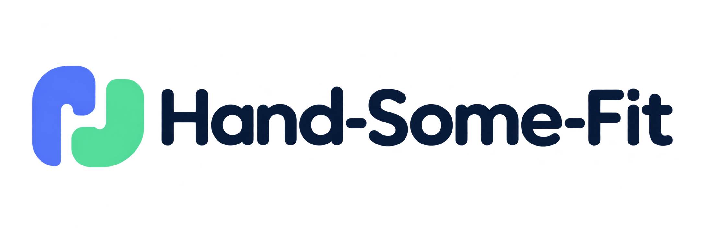
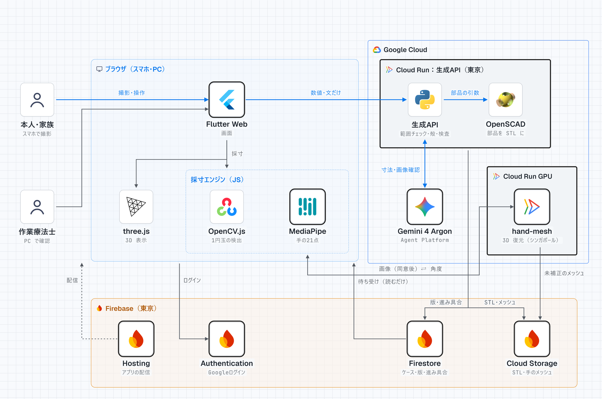

<p align="center">
  
</p>

<p align="center">
  <b>こぶしを撮るだけで、その人の手に合う自助具を 3D プリント</b><br>
  DevFest GDGoC Japan Hackathon 2026（医療・福祉）
</p>

**デプロイした作品：https://jijogu-hackathon-2026.web.app**

> 審査・デモの期間中は動かしたままにしています。デモ用の設定では、作業療法士（OT）の確認を省略して印刷用データまで作れます。画面には必ず「デモ用：OTの確認を省略しています」と出ます。

## どんな課題を解くか

病気やけがで、指が握った形のまま固まってしまう人がいます。筆・ペン・スプーンを自分で持てず、道具を手に付ける「自助具」が要ります。手の形は一人ひとり違うので、自助具は本人に合わせて作る必要があります。

3D プリンタなら合わせて作れます。ですが、3D プリンタを使ったことがある作業療法士は、回答した 3,469 人のうち 153 人（4.4%）だけでした。理由は「職場に設備がない」「使い方がわからない」です（Harada Y ら, Disabil Rehabil Assist Technol 2025）。

## 何ができるか

スマホ 1 台で、次の流れを最後まで行えます。

1. **聞く**：やりたいこと（筆で描く・ペンで書く・スプーンで食べる。いくつでも）、どちらの手か、道具の柄の太さなどを、大きなボタンで答える
2. **撮る**：手の甲に 1 円玉を置き、こぶしのまわりをスマホで半周して撮る（15〜20 秒）。1 円玉は自動で見つかり、手の 3D の形を 1 円玉で実寸（mm）にする
3. **形を作る**：こぶしの外側にかぶせる**カバー**と、道具の太さに合わせた **C 字クリップ**を、Gemini が部品を選んで寸法と角度を決める。理由も一緒に出る。3D で確かめ、言葉・数値・角度・色で直せる。別の道具のクリップは、カバーを作り直さずにあとから足せる
4. **確かめて刷る**：作業療法士（OT）が寸法と理由を見て「確認済み」にしてから、部品ごとの印刷用 STL をダウンロードする。刷り方・組み立て方・注意も出る

## 設計で大事にしたこと

- **AI に形をまるごと作らせない**：Gemini が出すのは「どの部品を、どの寸法・角度で使うか」の JSON だけです。形は人が作って試し刷りした OpenSCAD の部品から組み立て、範囲チェックと、描いたあとの自動の検査（手のひら側が開いているか、手首を覆っていないか、厚み、角の丸み、クリップの開き）を通します。生成 AI で形を作ると寸法を保証できないことが、先行研究（ASSETS 2025）でも中心的な課題でした
- **装具にしない**：カバーは手のひら側を開け、手首を覆わず、握った指を無理に開かせません。作れない依頼（指を伸ばす・固定する装具など）は理由を示して断ります
- **手の映像を外に出さない**：手の点は MediaPipe でブラウザの中で取ります。動画はサーバーに送らず、保存もしません。手の 3D を作るためだけに、同意を得て、手を切り抜いた画像を最大 8 枚送り、保存しません。Gemini に渡すのは数値・文と、作った形を描いた画像だけです
- **最後は人が確かめる**：通常の手順では、OT の確認が済むまで印刷用 STL を読めないことを、Firebase のルールで守っています

設計の判断は、選んだ理由と捨てた案と一緒に [docs/adr/](docs/adr/) に 14 件残しています。

## 構成



| 部分 | 使っている技術 | 場所 |
|---|---|---|
| 画面 | Flutter Web、three.js（3D 表示） | [app/](app/) |
| 採寸エンジン（ブラウザの中） | MediaPipe Hand Landmarker、OpenCV.js（1 円玉の検出、Web Worker） | [app/web_engine/](app/web_engine/) |
| 生成 API | Cloud Run（東京）、Python（FastAPI）、Gemini 4 Argon（Agent Platform）、OpenSCAD | [api/](api/)、[scad/](scad/) |
| 手の 3D 復元 | Cloud Run GPU（シンガポール、L4、使わない間は 0 台）、SAM 3D Body | [hand_mesh/](hand_mesh/) |
| ログイン・データ・配信 | Firebase Authentication、Firestore、Cloud Storage、Hosting | [firebase/](firebase/) |
| データの形 | JSON Schema | [schemas/](schemas/) |

### Google の技術を選んだ理由

| 技術 | 何をするか | なぜその技術か |
|---|---|---|
| Gemini 4 Argon | 聞き取り、部品選び、寸法と角度の決定と理由、できた形の画像での確認（最大 3 回） | 会話・決まった形の JSON での出力・画像を見ての確認を 1 つのモデルで行えるので、「決めた理由を説明でき、作ったものを見て直す AI」を 1 つの流れで作れる |
| MediaPipe | 動画から手の 21 点を取る。撮影中に骨組みを重ねて、手が写っているかを示す | ブラウザの中で動くので、手の動画を送らずに採寸できる |
| Cloud Run | 生成 API（OpenSCAD を同梱）、手の 3D 復元（GPU） | OpenSCAD のような普通のプログラムをコンテナごと動かせて、使わない間は費用がかからない |
| Firebase | ログイン、データ、STL の保存、アプリの配信 | ルールで「OT が確認するまで印刷用データを渡さない」を、サーバーのコードに頼らずに守れる |
| Flutter | 画面 | 同じコードでスマホのアプリにも広げられる |

詳しくは [ADR-0003](docs/adr/0003-why-google-technologies.md) にあります。

## 動かし方

### 画面だけを試す（API なし）

Flutter と Node.js が要ります。

```sh
bash scripts/fetch_mediapipe.sh   # MediaPipe・手のモデル・OpenCV.js を取ってきて、採寸エンジンをビルドする
cd app
flutter run -d chrome --dart-define=MOCK_API=true
```

モックでは、3D の見本（[app/web/demo/](app/web/demo/)）を使って、聞き取りから印刷用データのダウンロードまで画面を通せます。撮影の画面では、手と 1 円玉を撮った動画を選んでください。

### 本番の構成で動かす

- 画面と Firebase Hosting へのデプロイ：[app/README.md](app/README.md)
- 手の 3D 復元（Cloud Run GPU）：[hand_mesh/README.md](hand_mesh/README.md)
- 生成 API（Cloud Run）：[deploy/cloudbuild.api.yaml](deploy/cloudbuild.api.yaml)、手元で動かす手順は [docs/notes/prototype-lessons.md](docs/notes/prototype-lessons.md)

Firebase の設定は [env/example.json](env/example.json) を写して値を入れます（本物はコミットしません）。

### テスト

```sh
cd app && flutter test
cd api && python -m pytest
```

## 今できていること・まだのこと

- 確かめたのは、チームのメンバーの手だけです。指が握った形で固まった方と作業療法士による評価は、まだしていません
- 採寸の大きさの補正係数は、メンバーの手での仮の値です
- クリップを作れるのは丸い柄の道具だけです（平たい柄は今後）

## ドキュメント

設計仕様は [docs/](docs/README.md) にあります。画面（[screens.md](docs/screens.md)）、採寸（[measurement.md](docs/measurement.md)）、部品（[parts-library.md](docs/parts-library.md)）、生成の流れ（[generation-pipeline.md](docs/generation-pipeline.md)）、API（[api.md](docs/api.md)）、先行例との違い（[prior-art.md](docs/prior-art.md)）など。

## ライセンス

このリポジトリのコードは [MIT License](LICENSE) です。ただし次のものは、それぞれのライセンスに従います。

- `hand_mesh/vendor/sam-3d-body/`：SAM 3D Body（Meta、SAM License）。重みはリポジトリに入れていません
- MHR（Meta、Apache-2.0）、MediaPipe（Apache-2.0）、OpenCV.js（Apache-2.0）、three.js（MIT）、OpenSCAD（GPL-2.0。生成 API のコンテナの中でコマンドとして動かします）
