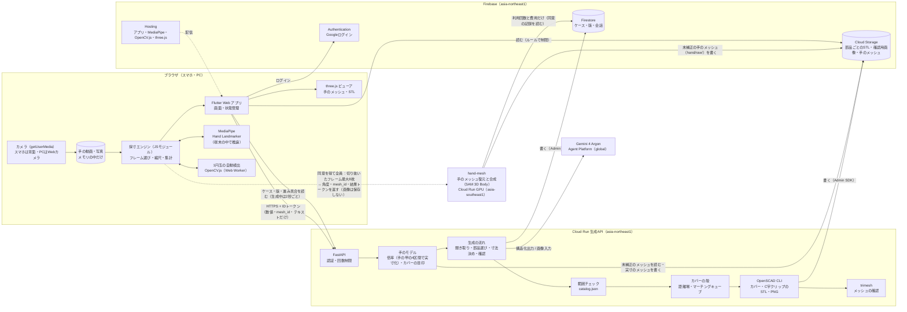
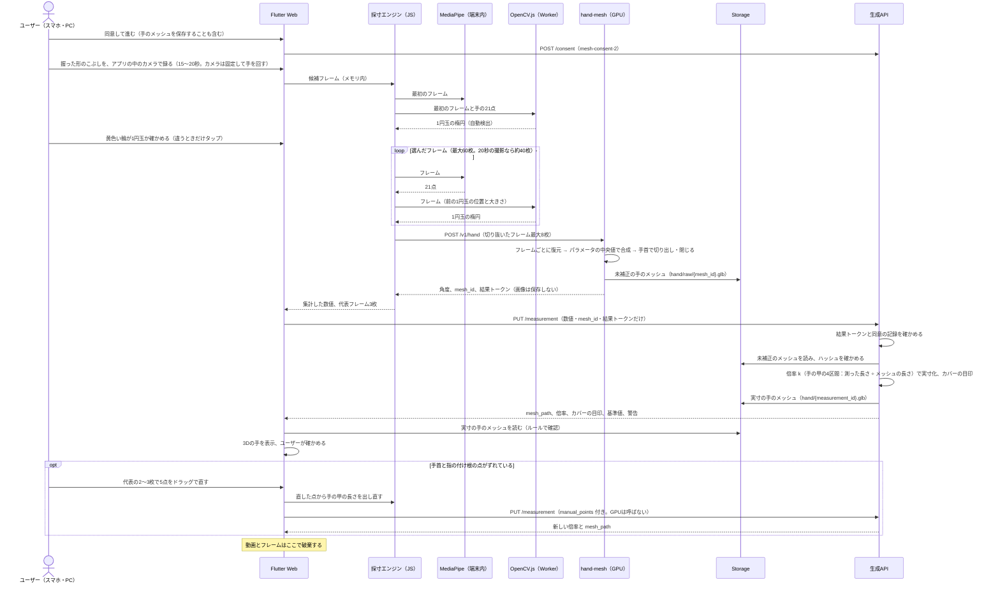
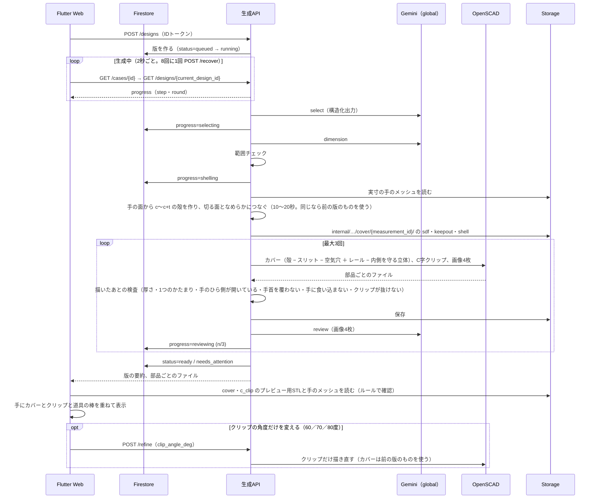
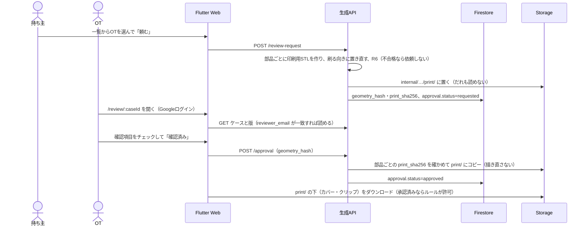

# システム構成

> **このドキュメントで決めたこと**
> 1. 構成は3つに分ける。ブラウザ（Flutter Web。撮影・採寸・プレビュー）、生成API（Cloud Run。手のメッシュの実寸化とカバーの殻の計算・Gemini・範囲チェック・OpenSCAD）、Firebase（認証・データ・ファイル・配信）に、手の3Dメッシュを作るGPUのサービス `hand-mesh` を加える。動画を丸ごと扱うのはブラウザだけで、端末の外に出るのは、同意を得て `hand-mesh` に送る切り抜いたフレーム（最大8枚）だけにする。
> 2. 生成APIは、OpenSCADとPythonを1つのコンテナに入れ、東京（asia-northeast1）に置く。Geminiは `global` で呼ぶ。Firestore・Storageも東京に置く。
> 3. ケース・会話・版は生成APIだけが書き、`hand-mesh` が書くのは利用回数と費用と、Storageの未補正の手のメッシュだけにする。手のメッシュはブラウザを通さずにStorageで受け渡す（重いファイルを運ばず、書き換えられないため）。ブラウザはFirestoreに書かず、ケース・版・進み具合は生成APIの `GET` で読む（生成中は2秒ごと。Firestoreの待ち受けは、時間の都合で impl では使っていない。2026-11-09）。生成の二重実行は、期限付きの処理中の印で防ぐ。

関連：[api.md](api.md)、[data-model.md](data-model.md)、[generation-pipeline.md](generation-pipeline.md)、[adr/0002-frontend-flutter-web.md](adr/0002-frontend-flutter-web.md)、[adr/0003-why-google-technologies.md](adr/0003-why-google-technologies.md)

---

## 1. 構成図

生成APIへ進むのは、`GEO` が集計した数値と `mesh_id` だけで、生成APIへの矢印に映像は乗らない。映像が端末の外に出るのは点線の1か所だけで、手を切り抜いたフレーム（最大8枚）を、同意を得て `hand-mesh` に送る（[ADR-0008](adr/0008-hand-model-capsules.md)）。`hand-mesh` は、フレームから合成した**手のメッシュ**（大きさは未補正）をStorageに置き、角度と `mesh_id` と結果トークンを返す。生成APIは、ブラウザが送った手の甲の長さ（1円玉で測ったmm）で倍率を出し、メッシュを実寸にして、**こぶしの外側にかぶせるカバーの殻**を作る（[ADR-0010](adr/0010-hand-mesh-fusion.md)、[ADR-0011](adr/0011-dorsal-cover.md)）。道具は、道具の太さに合わせたC字クリップで挟み、カバーのアリ溝のレールに差し込む（[ADR-0012](adr/0012-c-clip-dovetail.md)）。

## 2. コンポーネントの責務

| コンポーネント | 置き場所 | 責務 | 持たない責務 |
|---|---|---|---|
| Flutter Web アプリ（`app/`） | Firebase Hosting | 画面と遷移、ログイン、生成中の進み具合の読み取り（`GET designs/{id}` を2秒ごと）、APIの呼び出し、採寸エンジンの呼び出しと結果の表示 | Firestore・Storageへの書き込み、Geminiの呼び出し、フレームの処理 |
| 採寸エンジン（`app/web_engine/` のTypeScriptを、`app/web/js/measure_engine.js` の1ファイルにまとめる） | ブラウザ | アプリ内カメラでの録画（スマホは背面、PCはWebカメラ。握った形のこぶしを撮る）、フレームの取り出し、ぼけの判定、MediaPipeの呼び出し、1円玉の自動検出の呼び出しと縮尺、フレームごとの値、集計（[measurement.md §2〜§7](measurement.md)）、切り抜いたフレームを `hand-mesh` に送ること、S5で直した手首と指の付け根の5点から手の甲の長さを出し直すこと。Dartからは `dart:js_interop` で呼び、結果をJSONで返す。写真モードの計算も持つ | 手のメッシュの実寸化・手のモデルの組み立て（生成APIが行う） |
| 1円玉の自動検出（`app/web_engine/src/coin_worker.ts` → `app/web/js/coin_worker.js`） | ブラウザ（Web Worker） | OpenCV.jsで、画像の中の楕円から1円玉を探す（手の上の丸を外し、手の大きさから大きさの見当をつける）。Web Workerで動かし、画面を止めない | 寸法の計算 |
| MediaPipe（Hand Landmarker） | ブラウザ（WebAssembly） | フレームから21点を返す（`numHands: 2`。2つ以上見つかったら、そのフレームを捨てる）。Interactive Segmenterは使わない（CPUで1回約5秒かかり画面が止まる。GPUでは空のマスクが返った） | 寸法の計算 |
| three.js ビューア（`app/web/js/stl_viewer.js`） | ブラウザ | STLの表示、手のメッシュ（GLB）の表示（S5）、手のメッシュにカバーとクリップと道具の棒を重ねる表示（S7。どれも手の座標系なので、そのまま重なる）、回転・拡大、色の変更 | 形を変えること |
| 生成API（`api/`） | Cloud Run | IDトークンの検証、回数制限、同意の記録、`hand-mesh` の結果トークンと手のメッシュのハッシュの検証、聞き取り、手のモデル（`handmodel`：手の甲の4区間の倍率で実寸化、カバーの目印＝切る面・レールの位置・スリットの範囲）、カバーの殻と内側を守る立体の計算（距離場とマーチングキューブ）、スリット・空気穴・レールの位置の計算、基準値の計算、Geminiの呼び出し、範囲チェック、OpenSCADの実行、描いたあとの検査（手のひら側に材料がない・手首を覆わないなど、装具にしないための検査を含む）、Firestore・Storageへの書き込み、OTの確認の受け付け | 映像を受け取ること（受け取る口を作らない）、手の姿勢を作り直すこと（MHRのモデルとGPUは `hand-mesh` だけが持つ） |
| `hand-mesh`（手のメッシュ復元、`hand_mesh/`） | Cloud Run GPU（asia-southeast1、L4） | 切り抜いたフレームからSAM 3D Bodyで手を復元し、形・比率・姿勢のパラメータの中央値で1つの手のメッシュに合成する。手首で切り出して閉じ、手の座標系に置き、未補正のままStorage（`cases/{caseId}/hand/raw/`）に書く。合成した手の関節から角度を出す。IDトークンとケースの持ち主・同意の記録の検証、共通の停止設定、GPUの回数・時間・1日の費用の上限、署名付きの結果トークンの発行。[ADR-0009](adr/0009-gpu-placement.md)、[ADR-0010](adr/0010-hand-mesh-fusion.md) | 画像の保存、画像のログへの記録、ケース・会話・版への書き込み、メッシュの実寸化 |
| 部品ライブラリ（`scad/`） | 生成APIのコンテナに同梱 | 部品の形（カバーに付けるスリット・空気穴・アリ溝のレール、C字クリップ、TPUの筒）。殻は生成APIが作り、OpenSCADは `import()` して加工する。引数の定義（`catalog.json`） | 引数の妥当性の判断（範囲チェックが行う） |
| Gemini 4 Argon | Agent Platform（`global`） | 聞き取り、部品選び、寸法の調整と理由、画像での確認、言葉での微調整 | 形を作ること、数値の最終判断 |
| Firestore | asia-northeast1 | ケース・会話・版・回数の記録。生成の進み具合をブラウザへ伝える | — |
| Cloud Storage | asia-northeast1 | 部品ごとのSTL・確認用画像・手のメッシュ（未補正と実寸）・カバーの殻の保存。OTの確認前は印刷用STLを読ませない（デモのケースを除く）。未補正のメッシュと殻はだれにも読ませない | 動画・写真の保存 |
| Authentication | Firebase | Googleログイン。スマホとPCで同じアカウントにして引き継ぐ | OTかどうかの判定（Firestoreの許可リストで行う） |

## 3. 通信の流れ

### 3.1 撮影と採寸（動画はブラウザの中だけ。切り抜いたフレームだけを `hand-mesh` へ。手のメッシュはStorageで受け渡す）

### 3.2 形の生成

### 3.3 OTへの依頼・確認とダウンロード

デモのケース（`demo: true`）では、持ち主が「印刷用データを作る（デモ）」を押すと `POST /prepare-print` が同じ手順で部品ごとの印刷用STLを作り、`print/` に直接置く。OTの確認は通らない。画面には「デモ用：OTの確認を省略しています」と必ず出す（[api.md §3.11](api.md#311-post-v1casescase_iddesignsdesign_idprepare-printデモのケースだけ)）。

## 4. デプロイ先と設定

| 対象 | デプロイ先 | 方法 | 備考 |
|---|---|---|---|
| Flutter Web | Firebase Hosting | `flutter build web` → `firebase deploy --only hosting` | MediaPipeの本体（`@mediapipe/tasks-vision` 1.2.x のwasm）・手のモデル・OpenCV.js（約11MB、圧縮して約3.5MB）・three.jsも、同じHostingから配る（外部のCDNに頼らない）。採寸エンジンから `@mediapipe/tasks-vision` を直接呼ぶ（[ADR-0002](adr/0002-frontend-flutter-web.md)）ので、`FilesetResolver.forVisionTasks` に自前のパスを渡す。OpenCV.jsは、カメラを開くのを待たせないよう、MediaPipeの準備のあとでWeb Workerが裏で読む |
| 生成API | Cloud Run（asia-northeast1） | `gcloud run deploy --source api/`（Cloud Buildでビルドし、Artifact Registryに置く） | 4 vCPU、4 GiB、同時に処理するリクエストは2、タイムアウト300秒、インスタンスは最小0・最大3。審査とデモの時間帯だけ最小1にする（`hand-mesh` も同じ時間帯だけ最小1）。前の版の2 vCPU・2 GiBから上げたのは、カバーの殻の計算（格子の距離場、手全体のボクセル）が加わったため。同じ仕組みのくり抜きは手元で約12秒（多コアのPC）。4 vCPUでの時間とメモリの最大は11/8に測る（要確認） |
| Firestore・Storageのルール | Firebase | `firebase deploy --only firestore:rules,storage` | エミュレータでテストしてから出す |
| 手のメッシュ復元 | Cloud Run GPU（asia-southeast1） | `gcloud run deploy hand-mesh --source hand_mesh/`（GPUはL4、ゾーン冗長なし、4 vCPU・16 GiB、最小0台・最大1台） | 重みはasia-southeast1のCloud Storageのバケットに置き、起動時に読む。未補正の手のメッシュは、アプリの既定のバケット（asia-northeast1）に書く（1回数百KBなので、地域をまたいでも時間と料金はほとんど変わらない）。[ADR-0009](adr/0009-gpu-placement.md) |
| 予算アラート | Cloud Billing | コンソールで設定 | [non-functional.md](non-functional.md) |

アプリ（Hosting・Firestore・Storage・生成API・Gemini・`hand-mesh`）は、Google CloudとFirebaseで同じ1つのプロジェクトを使う。クレジットと権限の管理を1か所にするため。ハッカソンのクーポンは個人の請求先アカウントで引き換え、2つのクレジットをまとめる（[non-functional.md §2.5](non-functional.md#25-どのクレジットで何を動かすか)）。

### 4.1 生成APIの環境変数

| 名前 | 例 | 意味 |
|---|---|---|
| `GOOGLE_CLOUD_PROJECT` | `jijogu-gen` | プロジェクトID |
| `GEMINI_MODEL` | `gemini-4-argon` | 使うモデル |
| `GEMINI_LOCATION` | `global` | モデルのロケーション |
| `GEMINI_MODE` | `live` ／ `mock` | `mock` なら保存した応答を返す |
| `GENERATION_ENABLED` | `true` | 停止スイッチ |
| `DAILY_COST_LIMIT_USD` | `15` | GeminiとGPU推論のその日の概算費用を合算し、この値に達したら新しい処理を始めない（GPUは1回$0.40で数えるので、$4では1日10回しか呼べず、開発が止まるため引き上げた） |
| `RATE_LIMIT_DESIGNS_PER_USER_DAY` | `10` | 1人1日あたりの生成の上限 |
| `RATE_LIMIT_MESH_PER_USER_DAY` / `RATE_LIMIT_MESH_GLOBAL_DAY` | `20` / `100` | `hand-mesh` 側の1人・全体のGPU推論回数の上限。再試行も含む |
| `MESH_MAX_EXECUTION_SECONDS` | `60` | `hand-mesh` 側の1回の推論の実行時間上限 |
| `MESH_COST_PER_CALL_USD` | `0.40`（仮） | `hand-mesh` の1回あたりの固定の見積もり額。まばらに呼ぶと、起動・推論・止まるまでの待機の分（約18分×$1.26/時）がかかるため（[api.md §4](api.md#4-手のメッシュ復元サービス-hand-mesh)）。回数×この額を、その日の費用に足す |
| `MESH_RESULT_HMAC_KEY` | （Secret Managerから） | `hand-mesh` の結果トークンの署名の鍵。生成APIと `hand-mesh` に、Secret Managerからだけ渡す。リポジトリやファイルには入れない |
| `ALLOWED_ORIGINS` | `https://jijogu-gen.web.app,...` | CORSで許可するオリジン。Hostingのプレビューチャンネル（`https://jijogu-gen--<チャンネル名>-<ハッシュ>.web.app`）は `ALLOWED_ORIGIN_REGEX` で許可する |
| `STORAGE_BUCKET` | `jijogu-gen.firebasestorage.app` | 保存先 |
| `OPENSCAD_DISPLAY` | `egl` ／ `xvfb` | 画像を描く方式（[generation-pipeline.md §6.1](generation-pipeline.md#61-実行環境)） |

秘密の値は `MESH_RESULT_HMAC_KEY` の1つだけで、Secret Managerに置く（Geminiはサービスアカウントで呼ぶため、APIキーが要らない）。

GPU用の4項目（`RATE_LIMIT_MESH_*`、`MESH_MAX_EXECUTION_SECONDS`、`MESH_COST_PER_CALL_USD`）は `hand-mesh` に設定する。`STORAGE_BUCKET` は両サービスに設定する（`hand-mesh` は未補正の手のメッシュを書くため）。カバーとこぶしのすき間（`HAND_CLEARANCE_MM`）やクリップのしめしろ（`CLIP_INTERFERENCE_MM`）などの形の固定値は、環境変数ではなく `scad/lib/common.scad` と `scad/catalog.json` に置く（[parts-library.md §3](parts-library.md#3-固定値aiは変えられない)）。`DAILY_COST_LIMIT_USD` は両サービスで同じ値を使い、共通の `usage` を判定する。全体の停止はFirestoreの `settings/runtime.generation_enabled=false` で行う。各サービスの環境変数 `GENERATION_ENABLED=false` は、そのサービスを追加で止めるためのもの。

### 4.2 サービスアカウントと権限

生成API専用のサービスアカウントを作り、既定のサービスアカウントは使わない。

| ロール | 理由 |
|---|---|
| `roles/aiplatform.user` | Geminiを呼ぶ |
| `roles/datastore.user` | Firestoreを読み書きする |
| `roles/storage.objectAdmin`（既定のバケットだけ） | 部品ごとのSTL・画像・実寸の手のメッシュ・カバーの殻を保存し、未補正の手のメッシュを読む |
| `roles/logging.logWriter` | ログを書く |
| `roles/secretmanager.secretAccessor`（`MESH_RESULT_HMAC_KEY` だけ） | 結果トークンを確かめる |

IDトークンの検証は公開鍵で行うので、追加のロールは要らない。

`hand-mesh` にも別の専用サービスアカウントを作る。`roles/datastore.user`（停止設定と同意の記録の読み取り、利用回数と費用の更新）、`MESH_RESULT_HMAC_KEY` だけの `roles/secretmanager.secretAccessor`、重みのバケットだけの `roles/storage.objectViewer`、`roles/logging.logWriter` を付ける。Geminiの呼び出し権限は付けない。

アプリのバケットには、**未補正の手のメッシュを書くためだけ**の権限を付ける。

- 第1案：IAMの条件で、`cases/*/hand/raw/` の下だけに書けるようにする。ただし、IAMの条件の `resource.name.startsWith()` は先頭の一致しか見られず、パスの途中にケースIDが入るこの形を条件で絞れるかは要確認（11/8に確かめる）
- 絞れなければ第2案：アプリのバケットに `roles/storage.objectCreator`（新しいファイルを作るだけ。読めない・上書きできない・消せない）を付ける。万一 `hand-mesh` が乗っ取られても、STLや承認済みのファイルを読んだり書き換えたりはできない。`mesh_id` は毎回新しく作るので、上書きの権限は要らないAdmin SDKではFirestoreのルールが適用されないため、ケース・会話・版を書かないことはサービスの実装と検証で守る。

### 4.3 主な依存ライブラリ

| 置き場所 | ライブラリ | 使い道 | ライセンス |
|---|---|---|---|
| ブラウザ | `@mediapipe/tasks-vision` 1.2.2 | 手の21点 | Apache-2.0 |
| ブラウザ | `@techstark/opencv-js` 4.12.0 | 1円玉の自動検出（Web Worker） | Apache-2.0 |
| ブラウザ | three.js r187（STLLoader・GLTFLoader・OrbitControls） | STLと手のメッシュ（GLB）の表示 | MIT |
| 生成API | FastAPI、`google-genai` 2.34.0、Firebase Admin SDK | API、Gemini、認証とFirestore・Storage | MIT／Apache-2.0 |
| 生成API | trimesh、NumPy、SciPy（`cKDTree`・`ndimage`）、scikit-image（`marching_cubes`） | 手のメッシュの読み書き（GLB）、倍率とカバーの目印、カバーの殻（距離場・マーチングキューブ）、描いたあとの検査 | MIT／BSD |
| 生成API | OpenSCAD 開発版（Manifold）、BOSL2 | 形を描く（ねじをやめたので、BOSL2は角の丸めなどに使う範囲だけ。使わなくなれば外す） | GPL-2.0（コマンドとして呼ぶだけ）／BSD-2-Clause |
| `hand-mesh` | PyTorch（CUDA）、SAM 3D Body、MHR | 手のメッシュ復元と合成 | BSD／SAM License／Apache-2.0 |
| `hand-mesh` | trimesh、NumPy、FastAPI | 手首での切り出し・ふさぐ・細分割・GLBの書き出し、API | MIT／BSD |

- 手元のプロトタイプは PyTorch 2.14.1（CUDA 13.2）で動かした。Cloud Run の L4 で使うCUDAの版と、コンテナの土台のイメージは要確認（11/8）
- 生成APIのコンテナに、SciPy と scikit-image が加わる（イメージが数十MB大きくなる見込み）

### 4.4 開発環境

- フロントエンドは、`flutter run -d chrome` とFirebase Local Emulator Suite（Auth・Firestore・Storage）で動かす
- 生成APIは、ローカルのDocker（本番と同じイメージ）で動かす。Geminiは `GEMINI_MODE=mock`、本物を呼ぶときは `gcloud auth application-default login` の認証を使う
- スマホの実機での確認は、Hostingのプレビューチャンネル（`firebase hosting:channel:deploy`）に出して行う（カメラにはHTTPSが必要なため）

## 5. リポジトリと提出

- 開発は自分たちのリポジトリで行う。GitHub Actionsは補助（テストの自動実行）にだけ使い、デプロイは手元のコマンドで行う。提出用のリポジトリではActionsが使えないため、動かすのに必要な手順をActionsに頼らない
- 最終版を提出用のリポジトリにpushする前に、手元で秘密情報の検査（例：`gitleaks`）を行う
- ディレクトリ構成は [tasks.md](tasks.md#1-リポジトリのディレクトリ構成) を参照
