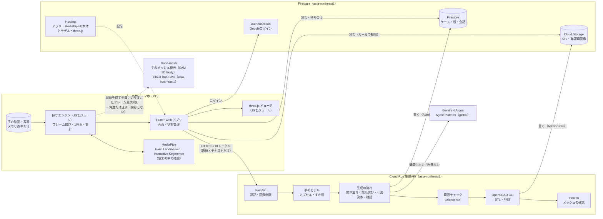
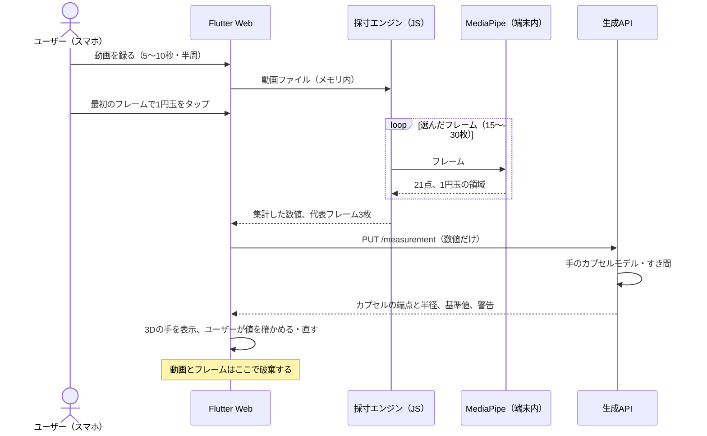
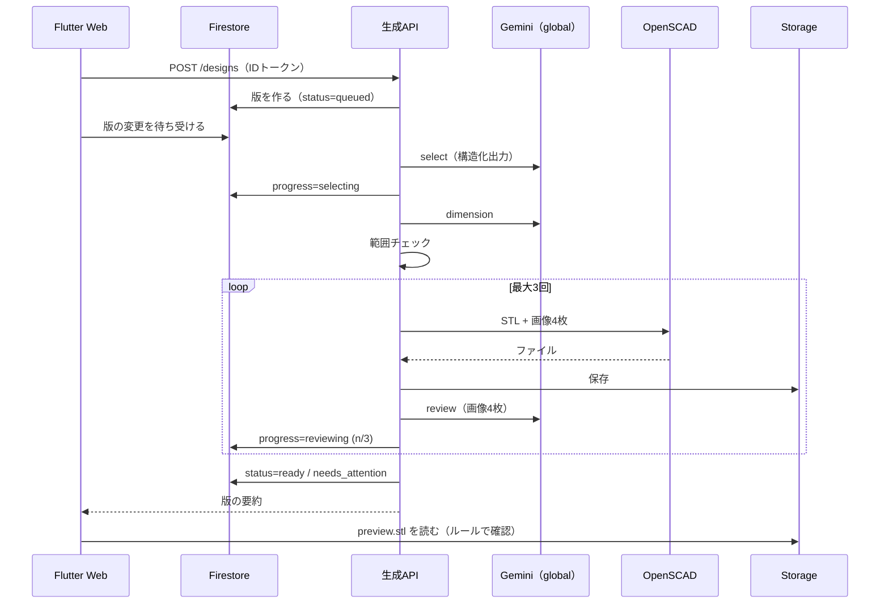
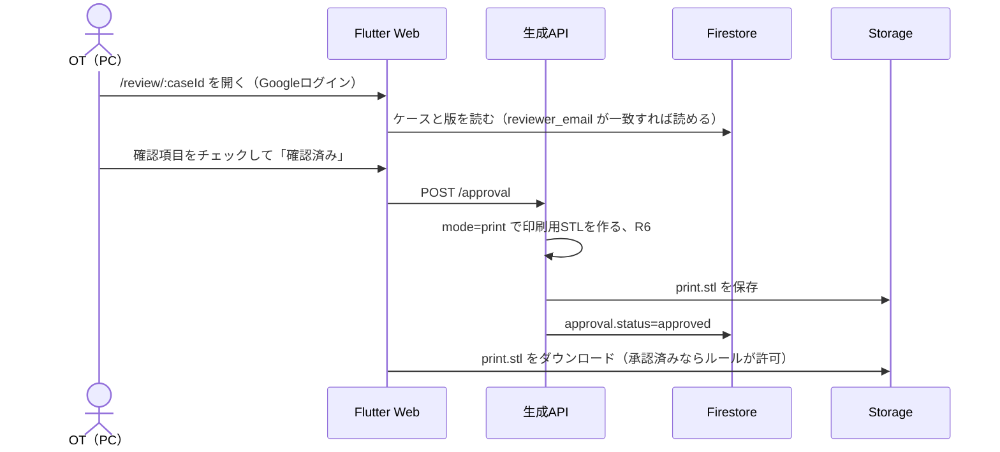

# システム構成

> **このドキュメントで決めたこと**
> 1. 構成は3つに分ける。ブラウザ（Flutter Web。撮影・採寸・プレビュー）、生成API（Cloud Run。Gemini・範囲チェック・OpenSCAD）、Firebase（認証・データ・ファイル・配信）。手の写真を扱うのはブラウザだけにする。
> 2. 生成APIは、OpenSCADとPythonを1つのコンテナに入れ、東京（asia-northeast1）に置く。Geminiは `global` で呼ぶ。Firestore・Storageも東京に置く。
> 3. Firestoreへの書き込みは生成APIだけが行い、ブラウザは読むだけにする。生成の進み具合は、ブラウザがFirestoreの変更を待ち受けて表示する。

関連：[api.md](api.md)、[data-model.md](data-model.md)、[generation-pipeline.md](generation-pipeline.md)、[adr/0002-frontend-flutter-web.md](adr/0002-frontend-flutter-web.md)、[adr/0003-why-google-technologies.md](adr/0003-why-google-technologies.md)

---

## 1. 構成図

生成APIへ進むのは、`GEO` が集計した数値だけで、生成APIへの矢印に映像は乗らない。映像が端末の外に出るのは点線の1か所だけで、手を切り抜いたフレーム（最大8枚）を、同意を得て `hand-mesh` に送り、角度だけを受け取る（[ADR-0008](adr/0008-hand-model-capsules.md)）。

## 2. コンポーネントの責務

| コンポーネント | 置き場所 | 責務 | 持たない責務 |
|---|---|---|---|
| Flutter Web アプリ（`app/`） | Firebase Hosting | 画面と遷移、ログイン、Firestoreの待ち受け、APIの呼び出し、採寸エンジンの呼び出しと結果の表示 | Firestore・Storageへの書き込み、Geminiの呼び出し、フレームの処理 |
| 採寸エンジン（`app/web_engine/` のTypeScriptを、`app/web/js/measure_engine.js` の1ファイルにまとめる） | ブラウザ | 動画からのフレームの取り出し、ぼけの判定、MediaPipeの呼び出し、1円玉の追いかけと縮尺、フレームごとの値、集計（[measurement.md §2〜§7](measurement.md)）。Dartからは `dart:js_interop` で呼び、結果をJSONで返す。写真モードの計算も持つ | 手のモデルの組み立て（生成APIが行う） |
| MediaPipe（Hand Landmarker、Interactive Segmenter） | ブラウザ（WebAssembly） | フレームから21点を返す（`numHands: 2`。2つ以上見つかったら、そのフレームを捨てる）。1円玉の領域を返す | 寸法の計算 |
| three.js ビューア（`app/web/js/stl_viewer.js`） | ブラウザ | STLの表示、手のカプセルモデルの表示（S5）、回転・拡大、色の変更 | 形を変えること |
| 生成API（`api/`） | Cloud Run | IDトークンの検証、回数制限、聞き取り、手のモデルの組み立て（`handmodel`：カプセル・すき間・握りの座標系への変換）、基準値の計算、Geminiの呼び出し、範囲チェック、OpenSCADの実行、メッシュの確認、Firestore・Storageへの書き込み、OTの確認の受け付け | 映像を受け取ること（受け取る口を作らない） |
| `hand-mesh`（手のメッシュ復元、`hand_mesh/`） | Cloud Run GPU（asia-southeast1、L4） | 切り抜いたフレームからSAM 3D Bodyで関節の角度を出し、中央値を返す（`AngleEstimator` の方法C）。IDトークンの検証。[ADR-0009](adr/0009-gpu-placement.md) | 画像の保存、ログへの記録 |
| 部品ライブラリ（`scad/`） | 生成APIのコンテナに同梱 | 部品の形。引数の定義（`catalog.json`） | 引数の妥当性の判断（範囲チェックが行う） |
| Gemini 4 Argon | Agent Platform（`global`） | 聞き取り、部品選び、寸法の調整と理由、画像での確認、言葉での微調整 | 形を作ること、数値の最終判断 |
| Firestore | asia-northeast1 | ケース・会話・版・回数の記録。生成の進み具合をブラウザへ伝える | — |
| Cloud Storage | asia-northeast1 | STLと確認用画像の保存。OTの確認前は印刷用STLを読ませない | 写真の保存 |
| Authentication | Firebase | Googleログイン。スマホとPCで同じアカウントにして引き継ぐ | OTかどうかの判定（Firestoreの許可リストで行う） |

## 3. 通信の流れ

### 3.1 撮影と採寸（映像はブラウザの中だけ）

### 3.2 形の生成

### 3.3 OTの確認とダウンロード

## 4. デプロイ先と設定

| 対象 | デプロイ先 | 方法 | 備考 |
|---|---|---|---|
| Flutter Web | Firebase Hosting | `flutter build web` → `firebase deploy --only hosting` | MediaPipeの本体（wasm）・手のモデル・three.jsも、同じHostingから配る（外部のCDNに頼らない）。`mediapipe_vision` は既定でjsDelivrから読み込むので、`dart run mediapipe_core:web_runtime` と `MediaPipeWebRuntime.baseUrl` で自前の配信に切り替える（手順は要確認） |
| 生成API | Cloud Run（asia-northeast1） | `gcloud run deploy --source api/`（Cloud Buildでビルドし、Artifact Registryに置く） | 2 vCPU、2 GiB、同時に処理するリクエストは2、タイムアウト300秒、インスタンスは最小0・最大3。審査の時間帯だけ最小1にする |
| Firestore・Storageのルール | Firebase | `firebase deploy --only firestore:rules,storage` | エミュレータでテストしてから出す |
| 手のメッシュ復元 | Cloud Run GPU（asia-southeast1） | `gcloud run deploy hand-mesh --source hand_mesh/`（GPUはL4、ゾーン冗長なし、4 vCPU・16 GiB、最小0台・最大1台） | 重みはasia-southeast1のCloud Storageのバケットに置き、起動時に読む。[ADR-0009](adr/0009-gpu-placement.md) |
| 予算アラート | Cloud Billing | コンソールで設定 | [non-functional.md](non-functional.md) |

アプリ（Hosting・Firestore・Storage・生成API・Gemini・`hand-mesh`）は、Google CloudとFirebaseで同じ1つのプロジェクトを使う。クレジットと権限の管理を1か所にするため。ハッカソンのクーポンは個人の請求先アカウントで引き換え、2つのクレジットをまとめる（[non-functional.md §2.5](non-functional.md#25-どのクレジットで何を動かすか)）。

### 4.1 生成APIの環境変数

| 名前 | 例 | 意味 |
|---|---|---|
| `GOOGLE_CLOUD_PROJECT` | `jijogu-gen` | プロジェクトID |
| `GEMINI_MODEL` | `gemini-4-argon` | 使うモデル |
| `GEMINI_LOCATION` | `global` | モデルのロケーション |
| `GEMINI_MODE` | `live` ／ `mock` | `mock` なら保存した応答を返す |
| `GENERATION_ENABLED` | `true` | 停止スイッチ |
| `DAILY_COST_LIMIT_USD` | `4` | その日の概算コストがこれを超えたら止める |
| `RATE_LIMIT_DESIGNS_PER_USER_DAY` | `10` | 1人1日あたりの生成の上限 |
| `ALLOWED_ORIGINS` | `https://jijogu-gen.web.app,...` | CORSで許可するオリジン |
| `STORAGE_BUCKET` | `jijogu-gen.firebasestorage.app` | 保存先 |
| `OPENSCAD_DISPLAY` | `egl` ／ `xvfb` | 画像を描く方式（[generation-pipeline.md §6.1](generation-pipeline.md#61-実行環境)） |

秘密の値は1つもない（Geminiはサービスアカウントで呼ぶため、APIキーが要らない）。

### 4.2 サービスアカウントと権限

生成API専用のサービスアカウントを作り、既定のサービスアカウントは使わない。

| ロール | 理由 |
|---|---|
| `roles/aiplatform.user` | Geminiを呼ぶ |
| `roles/datastore.user` | Firestoreを読み書きする |
| `roles/storage.objectAdmin`（既定のバケットだけ） | STLと画像を保存する |
| `roles/logging.logWriter` | ログを書く |

IDトークンの検証は公開鍵で行うので、追加のロールは要らない。

### 4.3 開発環境

- フロントエンドは、`flutter run -d chrome` とFirebase Local Emulator Suite（Auth・Firestore・Storage）で動かす
- 生成APIは、ローカルのDocker（本番と同じイメージ）で動かす。Geminiは `GEMINI_MODE=mock`、本物を呼ぶときは `gcloud auth application-default login` の認証を使う
- スマホの実機での確認は、Hostingのプレビューチャンネル（`firebase hosting:channel:deploy`）に出して行う（カメラにはHTTPSが必要なため）

## 5. リポジトリと提出

- 開発は自分たちのリポジトリで行う。GitHub Actionsは補助（テストの自動実行）にだけ使い、デプロイは手元のコマンドで行う。提出用のリポジトリではActionsが使えないため、動かすのに必要な手順をActionsに頼らない
- 最終版を提出用のリポジトリにpushする前に、手元で秘密情報の検査（例：`gitleaks`）を行う
- ディレクトリ構成は [tasks.md](tasks.md#1-リポジトリのディレクトリ構成) を参照
