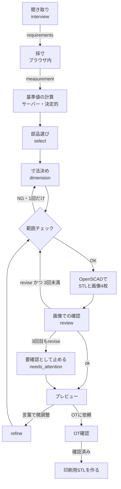

# 生成の流れ

> **このドキュメントで決めたこと**
> 1. Geminiには、決まったJSONスキーマで「聞き取り」「部品選び」「寸法決め」「画像での確認」「言葉での微調整」の5種類を答えさせる。形（OpenSCADのコード）は書かせない（[ADR-0001](adr/0001-gemini-output-json-params.md)）。
> 2. Geminiの出力は、必ずサーバーの範囲チェックを通してからOpenSCADに渡す。画像での確認は最大3回まで。それでも合わなければ「要確認」として止め、未解決の点をOTに見せる。
> 3. モデルは `gemini-4-argon`（ロケーション `global`）を本番に使う。開発中は安いモデルとモック（録っておいた応答）を使う。モデル名とロケーションは環境変数で切り替えられるようにする。

関連：[parts-library.md](parts-library.md)、[measurement.md](measurement.md)、[api.md](api.md)、[non-functional.md](non-functional.md)（コスト）

---

## 1. 全体の流れ



- 「基準値の計算」では、まず採寸値から手のカプセルモデルを組み立て、指ごとのすき間と、くり抜くカプセルを握りの座標系で求める（`api/app/handmodel/`。[measurement.md §8](measurement.md#8-手のカプセルモデル)）。この計算はGeminiを使わない決まった手順で、結果はGeminiにも動かせない
- 聞き取りは、ケースを作った直後と、ユーザーが答えるたびに呼ぶ
- `POST /v1/cases/{case_id}/designs` が1回呼ばれると、「基準値の計算」から「プレビュー」までを1回のリクエストの中で続けて行う。途中経過はFirestoreの `designs/{designId}.progress` に書く。画面はそれを読んで進み具合を出す（[api.md](api.md)）

## 2. Geminiの呼び方（共通）

| 項目 | 決めたこと | 理由 |
|---|---|---|
| 呼び先 | Gemini Enterprise Agent Platform（旧 Vertex AI）。API名は `aiplatform.googleapis.com` | 配布クレジットはAI Studioに使えないため |
| モデル | 本番：`gemini-4-argon`（2026-10-13 GA）。開発：`gemini-3.5-flash-lite`。予備：`gemini-3.8-flash` | Argonは画像入力・構造化出力・思考レベルの調整に対応している。開発で回す回数が多いので、開発は安いモデルにする |
| ロケーション | `global` | Argonは `global`／`us`／`eu` だけで提供されていて、`asia-northeast1` にはない。東京で完結させる必要があれば、`gemini-2.5-flash` か `gemini-3.5-flash`（どちらも asia-northeast1 で使える）に切り替える |
| SDK | Python の `google-genai`。バージョンは1つに固定する | 3.0.0は2026-11-06公開の大きな更新で、既定の通信ライブラリが変わった。まず2.x系の最新版（Argonには2.30.1以上が必要）で動かし、3.0.0に上げるかは11/7の動作確認で決める（要確認） |
| 接続の設定 | 2.x系は `vertexai=True`、3.x系は `enterprise=True`（`vertexai=True` も互換のため使える）。`project` と `location` は環境変数で渡す | — |
| 認証 | Cloud Runのサービスアカウントの自動認証（ADC）。ロールは `roles/aiplatform.user` | APIキーが要らないので、秘密情報がリポジトリに入る余地がない |
| 構造化出力 | `response_mime_type="application/json"` と `response_json_schema`（Pydanticのモデルから作るJSON Schema） | スキーマで出力の形を縛り、崩れにくくする。使えるキーワードは `type`、`enum`、`minimum`、`maximum`、`anyOf`、`required` など（SDK 3.0.0 の型定義で確認） |
| 思考レベル | `thinking_level` を LOW／MEDIUM で使い分ける（§3の表）。使える値はモデルごとに違うので、モデルごとの設定表を持つ | Argonは `thinking_budget` と `MINIMAL` を受け付けない（400エラーになる）。3.8 Flashには `MINIMAL` がなく、3.5 Flash-Liteは既定が `MINIMAL`。温度などのサンプリング設定はArgonと3.6 Flash以降で無視されるので、指定しない |
| 画像の解像度 | `media_resolution` を MEDIUM（1枚560トークン）にする | 既定のHIGH（1,120トークン）の半分で済む。形の確認なら768pxで足りる。精度が足りなければHIGHにする |
| 失敗したとき | 408／429／5xxは、指数的に間隔を空けて最大5回まで自動で再試行する（SDKの再試行設定）。それでもだめなら `AI_UNAVAILABLE` を返す | 429はクォータ超過ではなく、共有リソースの一時的な混雑だと公式に説明されている |
| キャッシュ | プロジェクトの `cacheConfig` を `disableCache: true` にする（既定では最長24時間キャッシュされる）。request-response logging は有効にしない | 健康に関わる会話を残さないため（[non-functional.md §4](non-functional.md#4-プライバシー)） |
| 記録 | 呼ぶたびに、モデル名・プロンプトの版・入出力のトークン数を `designs/{id}.usage` に足していく | コストの見張りと、プロンプトを直したときの比較のため |

プロンプトの本文は `api/prompts/<名前>.v<版>.md` に置き、版番号を `designs/{id}.prompt_versions` に記録する。部品の説明と引数の範囲は `scad/catalog.json` から作ってプロンプトに埋め込み、手で二重に書かない。

## 3. 各リクエストの方針と出力スキーマ

共通のシステム指示（要旨）：

- あなたは自助具（日常生活の道具を使いやすくする補助具）の設計を手伝う。医療機器や装具は扱わない
- 形は作らない。カタログにある部品と引数だけを使い、カタログにない部品や引数を作らない
- 寸法はmm、角度は度。数値は小数第1位まで
- ユーザーに見せる文（`*_ja`）は、やさしい日本語で短く書く
- 理由を書くときは、根拠にした採寸値や聞き取りの値の名前を挙げる（例：`cavities.index.diameter_mm=31.4 なので`）
- 手指の装具（関節を固定・矯正するもの）や、口に入れる部品を求められたら、作らずに理由を説明する

| リクエスト | 思考レベル | 入力 | 出力スキーマ |
|---|---|---|---|
| 聞き取り `interview` | LOW | これまでの会話、現在の `requirements` | §3.1 |
| 部品選び `select` | LOW | `requirements`、カタログ（部品と種類の説明） | §3.2 |
| 寸法決め `dimension` | MEDIUM | `requirements`、`measurement.derived`、選んだ部品の引数の定義、基準値（baseline） | §3.3 |
| 画像での確認 `review` | MEDIUM | 画像4枚、`requirements`、現在の引数、採寸値の要約、前回までの指摘 | §3.4 |
| 言葉での微調整 `refine` | LOW | ユーザーの指示、現在の引数、引数の定義、言葉と引数の対応表 | §3.5 |

### 3.1 聞き取り `interview`

方針：

- 1回に1つだけ質問する。答えやすいように選択肢（`choices`）を最大4つ付ける
- 必ず集めるのは次の4つ：やりたいこと、道具の種類、道具の柄の太さ、どちらの手で持つか。つまむ力の強さは、分かれば集める
- 柄の太さが分からないと言われたら、「定規で測る」「1円玉（直径20mm）と比べる」のどちらかを案内する。それでも分からなければ、道具の種類ごとの既定値（筆8mm、ペン10mm、スプーン12mm。仮の値）を使い、`assumptions` に残す
- 質問は最大5回まで。5回目でまだ足りなければ、既定値で埋めて `ready` にする
- 対象外の依頼は `out_of_scope` にし、理由と代わりの案（例：装具はOTに相談する）を伝える

```json
{
  "type": "object",
  "required": ["status", "message_ja", "choices", "requirements"],
  "properties": {
    "status": { "enum": ["ask", "ready", "out_of_scope"] },
    "message_ja": { "type": "string", "description": "次の質問、またはまとめ" },
    "choices": { "type": "array", "items": { "type": "string" }, "maxItems": 4 },
    "requirements": {
      "type": "object",
      "properties": {
        "activity_ja": { "type": "string", "description": "例: 筆で絵を描く" },
        "tool_type": { "enum": ["brush", "pen", "spoon", "other"] },
        "tool_shaft_diameter_mm": { "type": ["number", "null"], "minimum": 3, "maximum": 18 },
        "tool_shaft_shape": { "enum": ["round", "flat", "unknown"] },
        "hand_side": { "enum": ["right", "left", "unknown"] },
        "pinch_strength": { "enum": ["weak", "normal", "unknown"] },
        "preferences_ja": { "type": "string", "description": "見た目の好みなど" },
        "assumptions": { "type": "array", "items": { "type": "string" } }
      }
    },
    "out_of_scope_reason": { "enum": ["orthosis", "mouth_contact", "unsupported_tool", "medical_claim", "none"] }
  }
}
```

### 3.2 部品選び `select`

方針：

- 必須の役割（握り本体、道具を挟む部分、締めナット）には、必ず1つずつ部品を選ぶ。任意の部品（親指置き、ベルト通し）は、要望に理由があるときだけ選ぶ
- 種類（`variant`）を選ぶ理由を書く。例：「手の中で回りにくいよう楕円にする」「つまむ力が弱いので羽根付きのナットにする」
- 握り本体は、標準は `fitted`（指のカプセルでくり抜く）。`CAVITY_OPEN` が1つでもある場合、または人差し指・小指のすき間の中心が求まらない場合は、サーバーが `fitted` を選択肢から外す。その他の採寸の警告（`FEW_FRAMES`・`LENGTH_UNSTABLE`・`ANGLE_DISAGREE` など）が多い場合や、写真モードで中指〜小指の角度が取れなかった場合も、`round`／`oval`（リング状のくぼみ）を選び、理由を書く
- MVPのカタログは、握り本体（`fitted`／`round`／`oval`）、コレット（`standard`）、ナット（`wings`／`knurl`）だけ。拡張部品は実装できたらカタログに足す

```json
{
  "type": "object",
  "required": ["parts"],
  "properties": {
    "parts": {
      "type": "array",
      "minItems": 3,
      "maxItems": 5,
      "items": {
        "type": "object",
        "required": ["part_id", "variant", "reason_ja"],
        "properties": {
          "part_id": { "enum": ["grip_body", "collet", "collet_nut", "thumb_rest", "strap_slot"] },
          "variant": { "type": "string" },
          "reason_ja": { "type": "string" }
        }
      }
    }
  }
}
```

### 3.3 寸法決め `dimension`

方針：

- 選んだ部品の**全部の引数**を返す（変えない引数も、基準値のまま返す）。OTが一覧で全部を見られるようにするため
- 引数ごとに `source` を付ける：`measured`（採寸値そのまま）、`rule`（固定の式）、`interview`（聞き取りの値）、`ai`（Geminiが要望を見て調整）、`default`（既定値）
- `ai` で基準値から動かした引数には、必ず理由を書く。動かしてよい幅は引数の定義に書いてある
- 曲がり角（`flexion_deg`）は、くぼみの深さや楕円にするかどうかの判断材料に使ってよい。ただし、具体的な数値の式は決めず、理由として説明させる
- `fitted` のとき、くり抜くカプセル（`capsules`）と軸のずれ（`axis_offset_mm`）は、採寸から決まった値として渡し、変えさせない。Geminiが調整するのは、`press_depth_mm`（どれだけ深く沿わせるか）と `end_margin_mm` など、形の好みに関わる引数だけ

```json
{
  "type": "object",
  "required": ["params", "summary_ja"],
  "properties": {
    "params": {
      "type": "array",
      "items": {
        "type": "object",
        "required": ["part_id", "name", "value", "source", "reason_ja"],
        "properties": {
          "part_id": { "type": "string" },
          "name": { "type": "string" },
          "value": {
            "anyOf": [
              { "type": "number" },
              { "type": "boolean" },
              { "type": "string" },
              { "type": "array", "items": { "anyOf": [{ "type": "number" }, { "type": "boolean" }] } }
            ]
          },
          "source": { "enum": ["measured", "rule", "interview", "ai", "default"] },
          "reason_ja": { "type": "string" }
        }
      }
    },
    "summary_ja": { "type": "string", "description": "この形にした理由を2〜3文で" }
  }
}
```

### 3.4 画像での確認 `review`

画像はすべて `mode=assembled` で描く。道具の目安として、柄の太さの棒を色付きで添える。`fitted` のときは、手のカプセルモデルも半透明で重ねる（[§6.3](#63-確認用画像)）。指がくぼみに収まっているかを、Geminiが目で見て確かめられるようにするため。

方針：

- 画像では**意図と合っているか**を見る。mm単位の正しさは、範囲チェックと採寸値の対応で保証する。そのため、画像を見て寸法を細かく合わせ直すことはさせない
- 次のチェック項目を1つずつ判定する

| ID | 確かめること |
|---|---|
| C1 | 道具を挟む部分が、握りの上端（人差し指側）にあり、道具の目安の棒が上に伸びている |
| C2 | `fitted`：重ねた指のカプセルが、それぞれくぼみに収まり、指が握りの外に浮いていない。`round`／`oval`：くぼみの数と並び方が、`groove_enabled` と `finger_pos_mm` に合っている |
| C3 | 指が当たる所に、尖った角や極端に薄い所が見えない |
| C4 | 太さと長さの釣り合いが、手の幅（`hand_width_mcp_mm`）から見て不自然でない |
| C5 | 聞き取りの要望（例：羽根付きのナット、楕円）が形に表れている |

- 直す必要があれば `verdict=revise` とし、直す引数と値を `changes` に入れる。直す必要がなければ `changes` は空にする

```json
{
  "type": "object",
  "required": ["verdict", "checks", "issues", "changes"],
  "properties": {
    "verdict": { "enum": ["ok", "revise"] },
    "checks": {
      "type": "array",
      "items": {
        "type": "object",
        "required": ["id", "pass", "note_ja"],
        "properties": {
          "id": { "enum": ["C1", "C2", "C3", "C4", "C5"] },
          "pass": { "type": "boolean" },
          "note_ja": { "type": "string" }
        }
      }
    },
    "issues": {
      "type": "array",
      "items": {
        "type": "object",
        "required": ["severity", "description_ja"],
        "properties": {
          "severity": { "enum": ["high", "medium", "low"] },
          "description_ja": { "type": "string" }
        }
      }
    },
    "changes": { "$ref": "#/$defs/param_changes" }
  },
  "$defs": {
    "param_changes": {
      "type": "array",
      "maxItems": 8,
      "items": {
        "type": "object",
        "required": ["part_id", "name", "value", "reason_ja"],
        "properties": {
          "part_id": { "type": "string" },
          "name": { "type": "string" },
          "value": { "anyOf": [{ "type": "number" }, { "type": "boolean" }, { "type": "string" }, { "type": "array" }] },
          "reason_ja": { "type": "string" }
        }
      }
    }
  }
}
```

### 3.5 言葉での微調整 `refine`

方針：

- 言葉と引数の対応表をプロンプトに入れる。例：「太く／細く」→ `d_top_mm` と `d_bottom_mm`、「長く／短く」→ `length_mm`、「くぼみを深く」→ `groove_depth_mm`、「ナットを回しやすく」→ `collet_nut` の種類を `wings` に
- 量の目安：「少し」＝5%（最低1mm）、無指定＝10%、「かなり」＝15%
- 指示があいまいなら、何も変えずに確認の質問を返す（`clarify_ja`）
- 採寸から決めた引数を「AIが変えてよい幅」を超えて変えたいとユーザーが言った場合は、変えたうえで `override_by_user=true` を付ける。「AIが変えてよい幅」（R3）では止めず、OT画面で目立たせる（ユーザーの意思を優先し、OTが判断する）。範囲（R2）と組み合わせ（R4）のルールは、ユーザーの指示でも当てはめる

出力：`changes`（§3.4 と同じ形）、`message_ja`、`clarify_ja`（なければ空文字）、`override_by_user`（真偽）

## 4. 範囲チェック

チェックは生成APIの `validator` が決まった手順で行う。ルールは `scad/catalog.json` から読む。

| 番号 | ルール | 外れたときの扱い |
|---|---|---|
| R1 | 出力がスキーマに合う。部品ID・引数名がカタログにある。必須の役割がそろっている | Geminiに誤りの内容を伝えて1回だけ聞き直す。だめなら `AI_OUTPUT_INVALID` |
| R2 | 各引数が範囲（最小〜最大）に入っている | 違反の一覧を添えて1回だけ聞き直す。だめなら、範囲の端に丸めて `clamped` に記録する |
| R3 | 採寸から決めた引数が、基準値から「AIが変えてよい幅」以内にある。ユーザーが言葉で求めた変更（`override_by_user`）と、画面のスライダーで直した値（`param_changes`）には当てはめない | 幅の端まで戻し、`clamped` に記録する |
| R4 | 組み合わせのルール（穴のまわりの厚さ、くぼみの深さと幅の比、くぼみの並びと間隔、太さの差、造形サイズの高さ、羽根の長さ。[parts-library.md §4](parts-library.md#4-部品と引数)） | 1回だけ聞き直す。だめなら、決まった順に自動で直す：①くぼみを浅くする ②握りを太くする ③コレットを短くする ④握りを短くする。それでも満たせなければ `DESIGN_INFEASIBLE` |
| R5 | 安全のルール（`edge_radius_mm ≥ 1.5`、対象外の依頼でない） | 対象外の依頼は `OUT_OF_SCOPE` で止める。角の丸みは1.5に引き上げる |
| R6 | 描画したあとのメッシュの確認：閉じた立体になっている、部品の数が合う、体積が0より大きい、`print` レイアウトの外形が `BED_MM` に収まる。さらに、立てて刷る向きで、下向きに45度を超えて張り出す面（底面を除く）の面積が2cm²以下 | 生成・微調整の中では、張り出しを減らすため `press_depth_mm` を0.5mmずつ下げて描き直せる（最小値を守り、最大2回、R2〜R5も再検証）。変更後の引数と画像をその版に記録してから、Geminiの確認に進む。OTへの依頼のときのR6では引数を変えず、不合格なら `RENDER_FAILED` で依頼を止める |

- R2〜R4の聞き直しは、§5の「確認と直し」の回数に数えない
- `clamped` に入った引数は、OT画面で「AIの値を自動で直しました」と目立つように出す
- 造形サイズに収まるかは、プレビューの段階でもR4（引数の式）で確かめる。そのうえで、**OTに頼むとき**に `print` モードで印刷用のSTLを作り、R6で実際のメッシュの外形と張り出しを確かめる（[api.md §3.6](api.md#36-post-v1casescase_idreview-request)）
- OTに頼んだあとは、その版の引数を変えない。承認では描き直さず、頼んだときに作った印刷用STLを公開するだけにする。形を変える必要があれば `refine` で新しい版を作り、OTに頼み直す

## 5. 確認と直しのループ

```
round = 0
引数 = 寸法決めの結果 → 範囲チェック
繰り返す:
    OpenSCADで描く（STL1つ＋画像4枚）
    round = round + 1
    確認の結果 = review(画像, 引数, …)
    verdict=ok かつ C1〜C5がすべてpass かつ high・mediumの指摘がない かつ changesが空なら → ready で終わる（lowの指摘はメモとして残す）
    verdict=ok なのに、不合格のチェックか high・mediumの指摘がある → needs_attention で終わる（ok を信じず、指摘を残す）
    changes が空なら → needs_attention で終わる（指摘を残したまま正常完了にしない）
    round が 3 なら → needs_attention で終わる
    引数に changes を当てる → 範囲チェック
    前の回と同じ値に戻る引数があれば → needs_attention で終わる（行ったり来たりを防ぐ）
```

- 「最大3回」は、確認（review）を呼ぶ回数で数える。最初の確認を含めて3回
- C1〜C5の欠落・重複は、形の誤りなのでR1で1回だけ聞き直し、再び不正なら `AI_OUTPUT_INVALID`。一方、`verdict=ok` に low の指摘が付くのは正常な応答として扱う（Geminiはokでも補足を書くことが多いため）。ok と不合格のチェック・high/medium の指摘が食い違うときは、聞き直さずに `needs_attention` にする（生成全体を失敗にしない）。`revise` で修正案がない場合は、指摘を `unresolved_issues` に残して `needs_attention` にする。指摘自体が空でも「AIは修正が必要と判定しましたが、修正案を出せませんでした」を残す
- 進み具合は `progress = { step: "reviewing", round: 2, max_rounds: 3 }` のようにFirestoreに書く
- `needs_attention` になった場合
  - 最後に範囲チェックを通った形を、プレビューとして見せる（作り直さない）
  - 解決しなかった指摘（`issues`）を、ユーザーとOTの両方に見せる
  - ユーザーにできること：言葉で直す、数値を直接直す、採寸からやり直す
  - OTは、指摘を読んだうえで「確認済み」にするか差し戻すかを判断できる（AIの判断よりOTの判断を優先する）
- 言葉での微調整（refine）のあとは、確認を1回だけ行う（待ち時間を短くするため）。`ready` の条件は上と同じで、`revise` なら変更案の有無にかかわらず `needs_attention` にして、その時点の形と未解決の指摘を見せる

## 6. OpenSCADの実行

### 6.1 実行環境

| 項目 | 決めたこと | 理由・要確認 |
|---|---|---|
| ベースのイメージ | `openscad/openscad:dev.<日付>`（Debian trixie）を日付のタグで固定する。例：`dev.2026-11-02` | 安定版の2021.01は高速なManifoldバックエンドがなく、PNGを出すのに画面（X）が必要。開発版は画面なしのEGL描画に対応し、Manifoldが既定になっている |
| 画面なしでの描画 | まずEGLで試す。Cloud Runで動かなければ、同じイメージに `xvfb` を入れて `xvfb-run -a` で動かす | Cloud RunでEGLが動くかは要確認（11/7にCが確かめる） |
| 同居させるもの | Python 3、`google-genai`、FastAPI、`trimesh`（メッシュの確認）、Firebase Admin SDK | 1つのコンテナで、AI・範囲チェック・描画まで完結させる |
| ねじ | BOSL2 を `scad/vendor/` に同梱する | BOSL2は2021.01以降で動く |

### 6.2 コマンドの組み立て

- 作業用のフォルダはジョブごとに作り、終わったら消す
- `-D` の値は、範囲チェックを通った**型付きの値だけ**から、サーバーが文字列にする（数値は小数第2位まで、文字列はカタログの選択肢だけ）。Geminiが書いた文字列を、そのままコマンドに入れることはない
- 1回のOpenSCADの実行は60秒で打ち切る。超えたら `RENDER_TIMEOUT` にする

| 出力 | 使う引数 | 主なオプション |
|---|---|---|
| プレビュー用STL | `mode=assembled`、`quality=preview` | `-o preview.stl --export-format binstl` |
| 確認用画像4枚 | `scad/view.scad` で `preview.stl` を読み込み、道具の目安の棒と、`fitted` なら手のカプセル（半透明）を添える | `--preview --imgsize=768,768 --viewall --autocenter --projection=p --camera=…`。4枚は並行して描く |
| 印刷用STL（OTの確認後） | `mode=print`、`quality=print` | `-o print.stl --export-format binstl`。描いたあとR6を確かめる |

- 画像は、いったん作ったSTLを読み込んで描く。毎回立体を作り直さずに済み、色付きの目安の棒も重ねられる。`--preview` で色が出るか、速さが足りるかは要確認

### 6.3 確認用画像

| 名前 | 視点（`--camera=0,0,0,回転x,回転y,回転z,0` と `--viewall --autocenter`） | 見たいこと |
|---|---|---|
| `front.png` | 回転 (90, 0, 0)：真横から | くぼみの並び、全体の長さ |
| `side.png` | 回転 (90, 0, 90)：90度回した真横から | 楕円の向き、ナットの形 |
| `top.png` | 回転 (0, 0, 0)：真上から | コレットと道具の位置 |
| `iso.png` | 回転 (60, 0, 35)：斜め上から | 全体の印象、角の丸み |

- 色：握りとナット（1つのSTLにまとまっている）は選んだ色、道具の目安の棒は赤、手のカプセルは半透明の肌色にする。画像の上に名前は書かず、プロンプトの中で「1枚目は真横から…」と説明する
- 視点の角度は仮の値。11/7に実際に描いて調整する（要確認）

### 6.4 かかる時間の目安（要確認）

| 処理 | 目安 |
|---|---|
| プレビュー用STL | 5〜15秒（Manifold、円の分割48） |
| 確認用画像4枚（並行） | 5〜10秒 |
| 印刷用STL | 10〜30秒（円の分割128） |

実際の時間は11/7〜11/8に測り、[non-functional.md](non-functional.md) の目標と比べる。

## 7. モックとテスト

- `GEMINI_MODE=mock` のときは、`api/tests/fixtures/` に保存した応答を返す。画面の開発はこれで行い、クレジットを使わない
- 決まった入力（採寸JSONと聞き取りの結果）を5パターン用意し、プロンプトを直すたびに流して、範囲チェックの違反数・確認の回数・トークン数を比べる
- 範囲チェックとコマンドの組み立ては、Geminiなしの単体テストで確かめる
