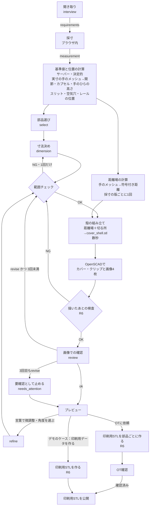

# 生成の流れ

> **このドキュメントで決めたこと**
> 1. Geminiには、決まったJSONスキーマで「聞き取り」「部品選び」「寸法決め」「画像での確認」「言葉での微調整」の5種類を答えさせる。形（OpenSCADのコード）は書かせない（[ADR-0001](adr/0001-gemini-output-json-params.md)）。カバーの殻（`cover_shell.stl`）は、生成APIが手の3Dメッシュの距離場から決まった手順で作り、Geminiは厚みや切る位置などの引数だけを決める（[ADR-0011](adr/0011-dorsal-cover.md)）。クリップの角度はGeminiがやりたいことから選んで理由を書き、内径は道具の太さから決まる（Geminiは変えない）。
> 2. Geminiの出力は、必ずサーバーの範囲チェックを通してからOpenSCADに渡し、描いたあとも実際の形を確かめる（**手のひら側に材料がない・手首を覆わない・手に食い込まない**・厚さ・1つのかたまり・クリップの開き）。画像での確認は最大3回まで。それでも合わなければ「要確認」として止め、未解決の点をOTに見せる。
> 3. モデルは `gemini-4-argon`（ロケーション `global`）を本番に使う。開発中は安いモデルとモック（録っておいた応答）を使う。モデル名とロケーションは環境変数で切り替えられるようにする。

関連：[parts-library.md](parts-library.md)、[measurement.md](measurement.md)、[api.md](api.md)、[non-functional.md](non-functional.md)（コスト）、[ADR-0011](adr/0011-dorsal-cover.md)・[ADR-0012](adr/0012-c-clip-dovetail.md)・[ADR-0013](adr/0013-clip-angle-variants.md)

---

## 1. 全体の流れ



- 「基準値と位置の計算」では、採寸の保存のときに作った実寸の手の3Dメッシュ（`cases/{caseId}/hand/{measurementId}.glb`）と、その関節から組み立てたカプセル（目安）を使い、カバーの目印（PIP関節の高さ `z_pip`、手首側を切る位置の基準値、人差し指側の端、親指のカプセル。[measurement.md §8.3](measurement.md#83-カバーの目印手の座標系の上)）と、スリット・空気穴・レールの位置を求める（`api/app/cover/`。[parts-library.md §5](parts-library.md#5-採寸値との対応)）。この計算はGeminiを使わない決まった手順で、位置はGeminiにも動かせない
- 「距離場の計算」は、手のメッシュだけで決まる（Geminiの答えを待たない）ので、部品選び・寸法決めと**並行して**行う（10〜40秒かかる見込み。§6.2）。採寸の版ごとに1回だけ作って保存し、同じ採寸の2回目からの生成・微調整では読むだけにする
- 「殻の組み立て」は、保存した距離場に、Geminiが決めた厚み・切る位置・丸みを当てて面を取り出すだけなので数秒で済む（§6.2）。そのため、確認と直しのループや言葉での微調整で厚みや切る位置が変わっても、待ち時間は大きく増えない
- 聞き取りの基本の情報（道具の種類と**太さ（mm）**を含む）は、選択式の質問で集める（[screens.md S2](screens.md#s2-やりたいこと選択式の質問任意のチャット)）。Geminiの `interview` は、任意のチャット（S2b）で文が送られたときだけ呼ぶ
- `POST /v1/cases/{case_id}/designs` が1回呼ばれると、「基準値と位置の計算」から「プレビュー」までを1回のリクエストの中で続けて行う。途中経過はFirestoreの `designs/{designId}.progress` に書く。画面はそれを読んで進み具合を出す（[api.md](api.md)）

## 2. Geminiの呼び方（共通）

| 項目 | 決めたこと | 理由 |
|---|---|---|
| 呼び先 | Gemini Enterprise Agent Platform（旧 Vertex AI）。API名は `aiplatform.googleapis.com` | 配布クレジットはAI Studioに使えないため |
| モデル | 本番：`gemini-4-argon`（2026-10-13 GA）。開発：`gemini-3.5-flash-lite`。予備：`gemini-3.8-flash` | Argonは画像入力・構造化出力・思考レベルの調整に対応している。開発で回す回数が多いので、開発は安いモデルにする |
| ロケーション | `global` | Argonは `global`／`us`／`eu` だけで提供されていて、`asia-northeast1` にはない。東京で完結させる必要があれば、`gemini-2.5-flash` か `gemini-3.5-flash`（どちらも asia-northeast1 で使える）に切り替える |
| SDK | Python の `google-genai`。バージョンは1つに固定する | 3.0.0は2026-11-06公開の大きな更新で、既定の通信ライブラリが変わった。まず2.x系の最新版（Argonには2.30.1以上が必要）で動かし、3.0.0に上げるかは11/7の動作確認で決める（要確認） |
| 接続の設定 | 2.x系は `vertexai=True`、3.x系は `enterprise=True`（`vertexai=True` も互換のため使える）。`project` と `location` は環境変数で渡す | — |
| 認証 | Cloud Runのサービスアカウントの自動認証（ADC）。ロールは `roles/aiplatform.user` | APIキーが要らないので、秘密情報がリポジトリに入る余地がない |
| 構造化出力 | `response_mime_type="application/json"` と `response_json_schema`（Pydanticのモデルから作るJSON Schema） | スキーマで出力の形を縛り、崩れにくくする。使えるキーワードは `type`、`enum`、`minimum`、`maximum`、`anyOf`、`required` など（SDK 3.0.0 の型定義で確認） |
| 思考レベル | `thinking_level` を LOW／MEDIUM で使い分ける（§3の表）。使える値はモデルごとに違うので、モデルごとの設定表を持つ | Argonは `thinking_budget` と `MINIMAL` を受け付けない（400エラーになる）。3.8 Flashには `MINIMAL` がなく、3.5 Flash-Liteは既定が `MINIMAL`。温度などのサンプリング設定はArgonと3.6 Flash以降で無視されるので、指定しない |
| 画像の解像度 | `media_resolution` を MEDIUM（1枚560トークン）にする | 既定のHIGH（1,120トークン）の半分で済む。形の確認なら768pxで足りる。精度が足りなければHIGHにする |
| 失敗したとき | 408／429／5xxは、指数的に間隔を空けて最大5回まで自動で再試行する（SDKの再試行設定）。それでもだめなら `AI_UNAVAILABLE` を返す | 429はクォータ超過ではなく、共有リソースの一時的な混雑だと公式に説明されている |
| キャッシュ | プロジェクトの `cacheConfig` を `disableCache: true` にする（既定では最長24時間キャッシュされる）。request-response logging は有効にしない | 健康に関わる会話を残さないため（[non-functional.md §4](non-functional.md#4-プライバシー)） |
| 記録 | 呼ぶたびに、モデル名・プロンプトの版・入出力のトークン数を `designs/{id}.usage` に足していく | コストの見張りと、プロンプトを直したときの比較のため |

プロンプトの本文は `api/prompts/<名前>.v<版>.md` に置き、版番号を `designs/{id}.prompt_versions` に記録する。部品の説明と引数の範囲は `scad/catalog.json` から作ってプロンプトに埋め込み、手で二重に書かない。

## 3. 各リクエストの方針と出力スキーマ

共通のシステム指示（要旨）：

- あなたは自助具（日常生活の道具を使いやすくする補助具）の設計を手伝う。医療機器や装具は扱わない
- 作るのは、こぶしの外側にかぶせるカバーと、道具を挟むC字クリップ。形は作らない。カタログにある部品と引数だけを使い、カタログにない部品や引数を作らない
- 寸法はmm、角度は度。数値は小数第1位まで
- ユーザーに見せる文（`*_ja`）は、やさしい日本語で短く書く
- 理由を書くときは、根拠にした採寸値や聞き取りの値の名前を挙げる（例：`hand.wrist_to_middle_mcp_mm=78 なので`）
- 手のひら側を覆う形、指を伸ばす・固定する形（装具）、口に入れる部品を求められたら、作らずに理由を説明する

| リクエスト | 思考レベル | 入力 | 出力スキーマ |
|---|---|---|---|
| 聞き取り `interview`（任意のチャット） | LOW | 選択式の答え（`requirements`）、これまでの会話 | §3.1 |
| 部品選び `select` | LOW | `requirements`、カタログ（部品と種類の説明） | §3.2 |
| 寸法決め `dimension` | MEDIUM | `requirements`、手の要約（§3.3）、選んだ部品の引数の定義、基準値（baseline） | §3.3 |
| 画像での確認 `review` | MEDIUM | 画像4枚、`requirements`、現在の引数、手の要約、前回までの指摘 | §3.4 |
| 言葉での微調整 `refine` | LOW | ユーザーの指示、現在の引数、引数の定義、言葉と引数の対応表 | §3.5 |

### 3.1 聞き取り `interview`（任意のチャット）

選択式の質問の答えは、`PUT /v1/cases/{case_id}/requirements` で、Geminiを通さずにそのまま `requirements` に入る（[api.md §3.2](api.md#32-put-v1casescase_idrequirements)）。Geminiが受け持つのは、選択式で聞けない内容だけ。

方針：

- 書かれた内容を、要件のメモ（`notes`。例：「人差し指の付け根が痛い」「長時間使う」「家族が着けてくれる」）に直す
- 足りない点があれば、1つだけ聞き返す。選択肢（`choices`）を最大4つ付ける。往復は最大3回
- 選択式の答えと食い違う内容があっても、`requirements` を直接書き換えない。`suggested_changes` に入れ、ユーザーが画面のボタンで確かめてから変える
- 道具の太さが分からないと書かれたら、定規か1円玉（直径20mm）と比べて測る方法を伝える
- Q1が「その他」のときは、やりたいことと道具を聞き取り、`tool_type` を `brush`／`pen`／`spoon` のどれで代用できるか提案する。どれにも当たらなければ `unsupported_tool` として、できない理由を伝える
- 対象外の依頼（指を伸ばす・固定する装具、手のひらを覆う形、口に入れる部分）は `out_of_scope` にし、理由と代わりの案（例：装具はOTに相談する）を伝える
- 見た目の好みが書かれたら、メモに残し、S7の雰囲気の初期値に使う（形は変えない）

```json
{
  "type": "object",
  "required": ["status", "message_ja", "choices", "notes", "suggested_changes", "out_of_scope_reason"],
  "properties": {
    "status": { "enum": ["ask", "done", "out_of_scope"] },
    "message_ja": { "type": "string", "description": "聞き返し、またはまとめ" },
    "choices": { "type": "array", "items": { "type": "string" }, "maxItems": 4 },
    "notes": { "type": "array", "items": { "type": "string" }, "description": "要件のメモ（今回の会話で増えた分）" },
    "suggested_changes": {
      "type": "array",
      "description": "選択式の答えを変える提案。ユーザーが確かめてから反映する",
      "items": {
        "type": "object",
        "required": ["field", "value", "reason_ja"],
        "properties": {
          "field": { "enum": ["activity", "tool_type", "hand_side", "tool_d_mm", "tool_shaft_shape", "finger_state", "donning_by", "capture_by"] },
          "value": { "type": "string" },
          "reason_ja": { "type": "string" }
        }
      }
    },
    "activity_ja": { "type": "string", "description": "Q1が「その他」のときの、やりたいことの説明" },
    "out_of_scope_reason": { "enum": ["orthosis", "mouth_contact", "unsupported_tool", "medical_claim", "none"] }
  }
}
```

### 3.2 部品選び `select`

方針：

- 必須の部品（カバー `cover`、空気穴 `air_holes`、ベルトのスリット `strap_slits`、レール `rail`、C字クリップ `c_clip`）は必ず選ぶ。種類はどれも `standard` だけ
- 任意の部品（TPUの筒 `tpu_sleeve`）は、TPUが使えるとき（`requirements` の材料の欄、要確認）で、滑りやすい柄・重い道具・太さの違う道具を使い回したい、などの理由があるときだけ選び、理由を書く
- クリップを2個にするか（先が細くなる筆の柄など）、ベルトを2本にするか（握る力がほとんどない、カバーが回りやすい）は、ここで理由を書いて提案し、値は寸法決めで決める
- MVPのカタログは、上の6つだけ。カムレバー式の固定やトンネルに差し込む部品（方式A）はカタログに入れない（[ADR-0011](adr/0011-dorsal-cover.md)・[ADR-0012](adr/0012-c-clip-dovetail.md)）

```json
{
  "type": "object",
  "required": ["parts"],
  "properties": {
    "parts": {
      "type": "array",
      "minItems": 5,
      "maxItems": 6,
      "items": {
        "type": "object",
        "required": ["part_id", "variant", "reason_ja"],
        "properties": {
          "part_id": { "enum": ["cover", "air_holes", "strap_slits", "rail", "c_clip", "tpu_sleeve"] },
          "variant": { "enum": ["standard"] },
          "reason_ja": { "type": "string" }
        }
      }
    }
  }
}
```

### 3.3 寸法決め `dimension`

方針：

- 選んだ部品の、**AIが扱う引数**を全部返す（変えない引数も、基準値のまま返す）。OTが一覧で全部を見られるようにするため。サーバーが決める引数（`shell_file`・`keepout_file`、スリット・空気穴・レールの位置と向き、レールの寸法、クリップの内径）は、Geminiの出力に含めない（ファイル・位置・受け口の寸法はGeminiが決めるものではなく、トークンの無駄にもなる）。サーバーが基準値のまま版に入れる
- 引数ごとに `source` を付ける：`measured`（採寸値そのまま）、`rule`（固定の式）、`interview`（聞き取りの値）、`ai`（Geminiが要望を見て調整）、`default`（既定値）
- `ai` で基準値から動かした引数には、必ず理由を書く。動かしてよい幅は引数の定義に書いてある
- **クリップの角度 `c_clip.angle_deg`** は、0／20／40度から、やりたいこと（`activity`）と道具から選び、理由を書く。目安：筆で絵や字＝20度（寝かせ気味で、穂先が紙に当たりやすい）、ペンで字＝40度（立て気味）、スプーン＝0度（手の向きのまま口へ運ぶ）。基準値と違う角度を選ぶときは、チャットのメモの根拠を書く。ユーザーはプレビューで角度を変えられる（[ADR-0013](adr/0013-clip-angle-variants.md)）
- **クリップの内径は道具の太さで決まる**（`tool_d_mm − CLIP_INTERFERENCE_MM`）。Geminiは `tool_d_mm` も `inner_d_mm` も変えない。挟む強さは `wall_mm`（厚いほど強い）と `opening_ratio`（小さいほど抜けにくいが押し込みにくい）で調整する
- 手の3Dメッシュそのものは**渡さない**（頂点が約9,000あり、Geminiが数値の列から形を読み取ることは期待できず、トークンも多いため）。代わりに、手の要約を渡す：手首→中指の付け根の長さ（`|0-9|`）、手の幅（`|5-17|`）、手のひらの皮膚の高さ、関節の曲がり角（握りこぶしの程度）、倍率 k と警告（`MESH_SCALE_INCONSISTENT` など）、点を手で直したか
- 着け外しを家族や介護する人がする場合（チャットのメモ）は、クリップの押し込みやすさ（`opening_ratio` を大きめ、`wall_mm` を薄め）とベルトの扱いやすさを理由に入れてよい

```json
{
  "type": "object",
  "required": ["params", "summary_ja"],
  "properties": {
    "params": {
      "type": "array",
      "items": {
        "type": "object",
        "required": ["part_id", "name", "value", "source", "reason_ja"],
        "properties": {
          "part_id": { "type": "string" },
          "name": { "type": "string" },
          "value": {
            "anyOf": [
              { "type": "number" },
              { "type": "boolean" },
              { "type": "string" },
              { "type": "array", "items": { "anyOf": [{ "type": "number" }, { "type": "boolean" }] } }
            ]
          },
          "source": { "enum": ["measured", "rule", "interview", "ai", "default"] },
          "reason_ja": { "type": "string" }
        }
      }
    },
    "summary_ja": { "type": "string", "description": "この形にした理由を2〜3文で" }
  }
}
```

### 3.4 画像での確認 `review`

画像はすべて `mode=assembled` で描く。実寸の手の3Dメッシュを半透明の肌色で、カバーを選んだ色で、クリップを別の色で、道具の目安（柄の太さの赤い棒）を添える（[§6.4](#64-確認用画像)）。カバーがこぶしに沿っているか、道具の先がどこに来るかを、Geminiが目で見て確かめられるようにするため。

方針：

- 画像では**意図と合っているか**を見る。mm単位の正しさと安全（手のひら側・手首・食い込み）は、範囲チェックと描いたあとの検査（R6）で保証する。そのため、画像を見て寸法を細かく合わせ直すことはさせない
- 次のチェック項目を1つずつ判定する

| ID | 確かめること |
|---|---|
| C1 | 道具の目安の棒が、人差し指の親指側から出て、先が人差し指の指先の近くにある。角度がやりたいこと（`activity`）に合っている |
| C2 | カバーが、こぶしの外側（手の甲・付け根の関節の山・指の背）に沿っている。手がカバーを突き抜けていない、大きく浮いていない |
| C3 | 手のひら側が開いている、手首が出ている、親指を包んでいない、中節より先の指を覆っていない |
| C4 | ふちが丸く、尖った所や極端に薄い所が見えない。スリット・空気穴・レールが関節の山にかかっていない |
| C5 | 選択式の答えとチャットのメモの要望（例：ベルト2本、薄く軽く、TPUの筒、痛い所を避ける）が形に表れている |

- 直す必要があれば `verdict=revise` とし、直す引数と値を `changes` に入れる。直す必要がなければ `changes` は空にする

```json
{
  "type": "object",
  "required": ["verdict", "checks", "issues", "changes"],
  "properties": {
    "verdict": { "enum": ["ok", "revise"] },
    "checks": {
      "type": "array",
      "items": {
        "type": "object",
        "required": ["id", "pass", "note_ja"],
        "properties": {
          "id": { "enum": ["C1", "C2", "C3", "C4", "C5"] },
          "pass": { "type": "boolean" },
          "note_ja": { "type": "string" }
        }
      }
    },
    "issues": {
      "type": "array",
      "items": {
        "type": "object",
        "required": ["severity", "description_ja"],
        "properties": {
          "severity": { "enum": ["high", "medium", "low"] },
          "description_ja": { "type": "string" }
        }
      }
    },
    "changes": { "$ref": "#/$defs/param_changes" }
  },
  "$defs": {
    "param_changes": {
      "type": "array",
      "maxItems": 8,
      "items": {
        "type": "object",
        "required": ["part_id", "name", "value", "reason_ja"],
        "properties": {
          "part_id": { "type": "string" },
          "name": { "type": "string" },
          "value": { "anyOf": [{ "type": "number" }, { "type": "boolean" }, { "type": "string" }, { "type": "array" }] },
          "reason_ja": { "type": "string" }
        }
      }
    }
  }
}
```

### 3.5 言葉での微調整 `refine`

方針：

- 言葉と引数の対応表をプロンプトに入れる。例：
  - 「厚く／薄く」「丈夫に／軽く」→ `cover.cover_thickness_mm`
  - 「もっと覆って／小さく」→ `cover.wrist_cut_mm`（手首の側）と `cover.palm_cut_offset_mm`（手のひらの側。正にしても、手のひらと中節より先は覆わない）
  - 「ふちをもっと丸く」→ `cover.edge_radius_mm`
  - 「角度を寝かせて／立てて」→ `c_clip.angle_deg` を1段（20度）変える
  - 「挟むのをきつく／ゆるく」→ `c_clip.wall_mm`（±0.2mm）と `c_clip.opening_ratio`（±0.02）。内径は変えない
  - 「ベルトを2本に」→ `strap_slits.strap_count`、「蒸れる」→ `air_holes.count`・`air_holes.diameter_mm`
- 量の目安：「少し」＝5%（最低0.2mm）、無指定＝10%、「かなり」＝15%
- 指示があいまいなら、何も変えずに確認の質問を返す（`clarify_ja`）
- 採寸から決めた引数を「AIが変えてよい幅」を超えて変えたいとユーザーが言った場合は、変えたうえで `override_by_user=true` を付ける。「AIが変えてよい幅」（R3）では止めず、OT画面で目立たせる（ユーザーの意思を優先し、OTが判断する）。範囲（R2）・組み合わせ（R4）・**安全（R5）**のルールは、ユーザーの指示でも当てはめる（手のひらを覆う、手首を覆う、という指示には従わない）
- 描き直す範囲：殻の引数（`cover_thickness_mm`・`palm_cut_offset_mm`・`wrist_cut_mm`・`edge_radius_mm`）が変わったら殻を組み立て直す（数秒。距離場は使い回す）。**クリップの引数だけ（角度を含む）の変更では、カバーは前の版のSTLを使い回し、クリップだけ描き直す**。空気穴・スリットだけの変更では、殻は使い回してOpenSCADだけ描き直す

出力：`changes`（§3.4 と同じ形）、`message_ja`、`clarify_ja`（なければ空文字）、`override_by_user`（真偽）

色だけの変更（「青にして」）は、Geminiを呼ばず、版を作らずに `style` だけを書き換える（[api.md §3.5](api.md#35-post-v1casescase_iddesignsdesign_idrefine)）。プレビューの画面で角度のボタン（0／20／40度）を押した場合は、Geminiを呼ばない引数の直接の変更（`param_changes`）として扱い、クリップだけ描き直す。

## 4. 範囲チェック

チェックは生成APIの `validator` が決まった手順で行う。ルールは `scad/catalog.json` から読む。

| 番号 | ルール | 外れたときの扱い |
|---|---|---|
| R1 | 出力がスキーマに合う。部品ID・引数名がカタログにある。必須の部品（`cover`・`air_holes`・`strap_slits`・`rail`・`c_clip`）がそろっている | Geminiに誤りの内容を伝えて1回だけ聞き直す。だめなら `AI_OUTPUT_INVALID` |
| R2 | 各引数が範囲（最小〜最大、選択肢）に入っている | 違反の一覧を添えて1回だけ聞き直す。だめなら、範囲の端（選択肢なら基準値）に丸めて `clamped` に記録する |
| R3 | 採寸から決めた引数（`wrist_cut_mm` など）が、基準値から「AIが変えてよい幅」以内にある。サーバーが決める引数（位置・ファイル・レールの寸法・クリップの内径・`tool_d_mm`）が出力に含まれていない、または基準値と同じ。ユーザーが言葉で求めた変更（`override_by_user`）と、画面で直接直した値（`param_changes`）には「AIが変えてよい幅」を当てはめない | 幅の端まで戻し、`clamped` に記録する。サーバーが決める引数は基準値に戻す |
| R4 | 組み合わせのルール（[parts-library.md §4.8](parts-library.md#48-組み合わせのルール範囲チェックのr4r5)）：`wrist_cut_mm` の上限、丸みと厚みの比、クリップの開きと内径、TPUの筒と道具の太さ、ベルト2本の間隔、造形サイズの見積もり | 1回だけ聞き直す。だめなら、決まった順に自動で直し、**直すたびにR2〜R5をやり直す**：①`edge_radius_mm` を `cover_thickness_mm × 1.5` まで下げる ②`wrist_cut_mm` を範囲の中へ戻す ③`opening_ratio` を0.80以下に下げる ④`tpu_sleeve` を false にする ⑤`strap_count` を1にする。それでも満たせなければ、最初の寸法決めなら `DESIGN_INFEASIBLE`。確認と直しのループの途中や微調整のときは、生成全体を失敗にせず、**前に通った形のまま** `needs_attention` で終える |
| R5 | 安全のルール：`edge_radius_mm ≥ 1.5`、`wrist_cut_mm ≥ WRIST_FREE_MM`（手首を覆わない）、対象外の依頼でない（手のひらを覆う形は、引数では作れない。§6.2の手順8で必ず捨てる） | 対象外の依頼は `OUT_OF_SCOPE` で止める。丸みは1.5に、`wrist_cut_mm` は25に引き上げる（ユーザーの指示でも同じ）。直したことを `clamped` に記録して画面で伝える |
| R6 | **描いたあとの実際の形での検査**（描くたびに行う。プレビュー用でも印刷用でも。座標は正準形で見る）：<br/>R6a 閉じた立体になっている、体積が0より大きい、部品ごとに刷る向きの外形が `BED_MM` に収まる<br/>R6b カバーが1つのかたまり（距離場の層の、手から離れた小さな破片がない）。クリップも1つのかたまり<br/>R6c **手のひら側が開いている**：カバーの頂点のうち、手のひら側を切る面（`z_pip + palm_cut_offset_mm`）より0.3mm以上手のひら側にあるものがない。かつ、手の面のうち手のひら側を向いた所（面の向きが +z から50度以内）から `c + t + 1` mm以内に、カバーがない<br/>R6d **手首を覆わない**：カバーの頂点のうち、手首の関節から y の向きに `WRIST_FREE_MM`（25mm）より手首側にあるものがない<br/>R6e **手に食い込まない・厚さ**：カバーのすべての頂点で `sdf ≥ c − 0.3`（内側を守る立体を引いたあとでも確かめる）。殻の厚さ（内側の面から外側の面まで）がふちの丸みの所を除いて `MIN_WALL_MM` 以上。スリット・空気穴とふちの間が `MIN_WALL_MM` 以上<br/>R6f クリップ：開きの幅が `tool_d_mm − 0.5` 未満、刷る向き（輪が机と平行）で下向きに45度を超えて張り出す面が0.5cm²以下（入口の面取りと底は数えない）<br/>R6g カバーの外側の張り出し：刷る向き（手のひら側の切り口が下）で、外側の面のうち下向きに45度を超えて張り出す面の面積を記録する（内側はサポートを付ける前提なので数えない） | R6a：`RENDER_FAILED`。<br/>R6b：0.5cm³未満の破片は自動で取り除き、記録する。それより大きい破片があれば、生成・微調整の中では前に通った形のまま `needs_attention`。<br/>R6c・R6d：安全の決まりなので、通るまで直す。`palm_cut_offset_mm` を2mmずつ手の甲側へ、`wrist_cut_mm` を5mmずつ指先側へ動かして殻を組み立て直す（最大2回、R2〜R5も再検証）。それでも通らなければ、前に通った形のまま `needs_attention` にし、**印刷用のデータは作らない**。<br/>R6e：食い込みは作り方の誤りなので `RENDER_FAILED`（ログに残す）。ふちとの間の不足は、かかった空気穴を自動で外して記録する（スリットなら `needs_attention`）。<br/>R6f：張り出しが多い角度のクリップは止めずに、「サポートが要るかもしれません」と印刷ガイドに出す（要確認：11/9に20度・40度を刷って確かめる）。開きの不足は `RENDER_FAILED`。<br/>R6g：3cm²を超えたら、外側にもサポートが要るおそれとして記録し、印刷ガイドに出す（止めない）。<br/>印刷用STLを作るとき（OTへの依頼、デモのケースの「印刷用データを作る」）のR6では引数を変えず、不合格なら `RENDER_FAILED` で止める |

- R2〜R4の聞き直しは、§5の「確認と直し」の回数に数えない
- R6c・R6d・R6e は、殻を組み立てた直後（OpenSCADで描く前）にも `cover_shell.stl` で確かめてよい。早く分かれば、OpenSCADの時間を無駄にしない。ただし、レールの土台とスリットを足したあとの形でも必ずもう一度確かめる
- `clamped` に入った引数は、OT画面で「AIの値を自動で直しました」と目立つように出す
- 造形サイズに収まるかは、プレビューの段階でもR4（手のメッシュの外接箱からの見積もり）で確かめる。そのうえで、**OTに頼むとき**（デモのケースでは「印刷用データを作る」を押したとき）に、部品ごとの印刷用のSTLを作り、R6で実際のメッシュを確かめる（[api.md §3.6](api.md#36-post-v1casescase_idreview-request)）
- OTに頼んだあとは、その版の引数を変えない。承認では描き直さず、頼んだときに作った印刷用STLを公開するだけにする。形を変える必要があれば `refine` で新しい版を作り、OTに頼み直す

## 5. 確認と直しのループ

```
round = 0
引数 = 寸法決めの結果 → 範囲チェック
繰り返す:
    OpenSCADで描く（部品ごとのSTL＋画像4枚）
    round = round + 1
    確認の結果 = review(画像, 引数, …)
    （この回の範囲チェックや描画が通らなければ → 前に通った形のまま needs_attention で終わる）
    verdict=ok かつ C1〜C5がすべてpass かつ high・mediumの指摘がない かつ changesが空なら → ready で終わる（lowの指摘はメモとして残す）
    verdict=ok なのに、不合格のチェックか high・mediumの指摘がある → needs_attention で終わる（ok を信じず、指摘を残す）
    changes が空なら → needs_attention で終わる（指摘を残したまま正常完了にしない）
    round が 3 なら → needs_attention で終わる
    引数に changes を当てる → 範囲チェック
    前の回と同じ値に戻る引数があれば → needs_attention で終わる（行ったり来たりを防ぐ）
```

- 「最大3回」は、確認（review）を呼ぶ回数で数える。最初の確認を含めて3回
- C1〜C5の欠落・重複は、形の誤りなのでR1で1回だけ聞き直し、再び不正なら `AI_OUTPUT_INVALID`。一方、`verdict=ok` に low の指摘が付くのは正常な応答として扱う（Geminiはokでも補足を書くことが多いため）。ok と不合格のチェック・high/medium の指摘が食い違うときは、聞き直さずに `needs_attention` にする（生成全体を失敗にしない）。`revise` で修正案がない場合は、指摘を `unresolved_issues` に残して `needs_attention` にする。指摘自体が空でも「AIは修正が必要と判定しましたが、修正案を出せませんでした」を残す
- 進み具合は `progress = { step: "reviewing", round: 2, max_rounds: 3 }` のようにFirestoreに書く。版の `status` は `queued`／`running`／`ready`／`needs_attention`／`failed` の5つだけにし、どの段階かは `progress.step`（`selecting`／`dimensioning`／`shelling`（距離場と殻の計算）／`rendering`／`reviewing`）で表す
- `needs_attention` になった場合
  - 最後に範囲チェックを通った形を、プレビューとして見せる（作り直さない）
  - 解決しなかった指摘（`issues`）を、ユーザーとOTの両方に見せる
  - ユーザーにできること：言葉で直す、数値を直接直す、採寸からやり直す
  - OTは、指摘を読んだうえで「確認済み」にするか差し戻すかを判断できる（AIの判断よりOTの判断を優先する）
- 言葉での微調整（refine）のあとは、確認を1回だけ行う（待ち時間を短くするため）。`ready` の条件は上と同じで、`revise` なら変更案の有無にかかわらず `needs_attention` にして、その時点の形と未解決の指摘を見せる

## 6. OpenSCADの実行

### 6.1 実行環境

| 項目 | 決めたこと | 理由・要確認 |
|---|---|---|
| ベースのイメージ | `openscad/openscad:dev.<日付>`（Debian trixie）を日付のタグで固定する。例：`dev.2026-11-02` | 安定版の2021.01は高速なManifoldバックエンドがなく、PNGを出すのに画面（X）が必要。開発版は画面なしのEGL描画に対応し、Manifoldが既定になっている |
| 画面なしでの描画 | まずEGLで試す。Cloud Runで動かなければ、同じイメージに `xvfb` を入れて `xvfb-run -a` で動かす | Cloud RunでEGLが動くかは要確認（11/7にCが確かめる） |
| 同居させるもの | Python 3、`google-genai`、FastAPI、`trimesh`（メッシュの読み書きと確認）、`numpy`・`scipy`（距離の計算、塗りつぶし、ぼかし）・`scikit-image`（マーチングキューブ）、Firebase Admin SDK | 1つのコンテナで、AI・範囲チェック・距離場と殻の計算・描画まで完結させる。GPUは使わない |
| CPUとメモリ | 4 vCPU・4 GiB（要確認。[architecture.md §4](architecture.md#4-デプロイ先と設定) と同じ） | 殻の距離場は、握りのくり抜き（約140万点）より箱が大きい（手の甲と関節のまわり、約220×200×120点＝約530万点の見込み）。粗い格子で先に遠い所を除けば、細かく計算するのは表面の近くだけになる（§6.2の手順2）。メモリは2 GiB以内の見込みだが、Cloud Runで測って決める |
| アリ溝・角の丸め | BOSL2 を `scad/vendor/` に同梱する | BOSL2は2021.01以降で動く。ねじには使わなくなった |

### 6.2 殻（`cover_shell.stl`）の作り方

生成APIのPython（`api/app/cover/shell.py`）が、実寸の手の3Dメッシュから作る。距離場の仕組みは11/7のスパイクで動かしたもの（[ADR-0010](adr/0010-hand-mesh-fusion.md)）で、それを殻と「切る所」の組み合わせに作り直した。**距離場（手順1〜6）は採寸の版ごとに1回**、**殻の組み立て（手順7〜10）は殻の引数が変わるたび**に行う。

| 順 | 処理 | 理由・注意 |
|---|---|---|
| 1 | 実寸の手のメッシュ（手の座標系、mm）を読み、右手なら z の符号を変えて正準形にする（z が手のひら側。[measurement.md §8.1](measurement.md#81-手の座標系)）。メッシュの関節から、カプセル（目安）と、カバーの目印（`z_pip`・`x_index` など。[measurement.md §8.3](measurement.md#83-カバーの目印手の座標系の上)）を求める | 手のひら側・手首・親指・指先側の「切る所」を、左右で同じ式で決めるため |
| 2 | 計算する箱を決める：手のメッシュの外接箱を、殻が取りうる最大の外側（`c + 3.5 + 4` mm）だけ広げ、手首側は `WRIST_FREE_MM − 4`、手のひら側は `z_pip + 8 + 4`（`palm_cut_offset_mm` の最大＋余白）で切る。格子は `CAVITY_VOXEL_MM`（0.5mm）。まず2mmの粗い格子で距離を測り、殻の層から遠い所（距離が `c + 3.5 + 6` mmより遠い所と、手の中の深い所）は細かく計算しない（要確認：速さ） | 箱を引数の最大値で決めると、厚みや切る位置を変えても同じ距離場を使える。手の中や遠い所は殻にならないので、点を減らして時間を抑える |
| 3 | 表面の点を拾う：メッシュの面から約30万点を拾い、点ごとにその面の法線を持たせる | 格子の点から表面までの距離を、点の木（KD木）で速く求めるため |
| 4 | 格子の各点で、一番近い表面の点を探す。**表面から2mm以内**の点は、その点の面の平面までの符号付き距離を使い、符号（手の中が負）もその面の法線の向きで決める。一番近い面の法線も、手順8の「手のひらを向いた面」の判定のために持っておく | 表面の近くの内外をボクセルで決めると、面が階段になる。拾った点までの距離のままだと、ざらつく（スパイクで確かめた） |
| 5 | 表面から2mmより遠い点の内外は、閉じた手のメッシュ**全体**をボクセル（0.5mm）にして中を塗りつぶし、その値で決める | 手は計算の箱からはみ出すので、箱の中だけでは内外を塗り分けられない（スパイクの落とし穴） |
| 6 | 距離場を `CAVITY_SMOOTH_SIGMA`（0.7格子）でガウスにぼかし、保存する（採寸の版ごと。§6.2の使い回し） | 残ったざらつきを消す。ここまでが手のメッシュだけで決まる |
| 7 | 殻の層の場を作る：`f_shell = max(c − sdf, sdf − (c + t))`（層の中が負） | 手の面から c〜c＋t の層（[ADR-0011](adr/0011-dorsal-cover.md)） |
| 8 | 「切る所」の場を作る（どれも、残す側が負、捨てる側が正の、おおよその距離）：手のひら側 `z − (z_pip + palm_cut_offset_mm)`、手首側 `wrist_cut_mm − y`、人差し指の外側、親指のカプセルから `c + t + THUMB_EXTRA_MM` 以内、中節・末節に一番近い所（基節との二等分の面で分ける。PIP関節の山の半分は残る）、手のひらを向いた面の上（一番近い面の法線と +z のなす角が60度以内） | [parts-library.md §4.1](parts-library.md#41-カバー本体-cover必須) の「捨てる所」。**手のひらを向いた面の判定は、平面と別に必ず入れる**（握りこぶしでは、PIP関節の平面より手の甲側に手のひらの皮膚が入るため）。法線の判定は距離ではないので、角度の差を長さに直して（1度あたり0.2mm、仮）ほかの場と同じ尺度にする |
| 9 | 全部の場を、**なめらかな最大**（半径 `edge_radius_mm` の丸み）で組み合わせ、0になる面をマーチングキューブで取り出す。箱の縁は外側の値で囲み、面を閉じる | 角ばった最大を取ると、切り口のふちが尖る。なめらかな最大なら、ふちが半径 `edge_radius_mm` 程度に丸くなる（直角に交わる面での目安。斜めに交わる所の丸みの大きさは要確認） |
| 10 | 面の向きを外向きにそろえる（体積が負なら裏返す）。1番大きなかたまりだけを残し、取り除いた破片の体積を記録する（R6b）。右手なら z の符号を戻して実際の手の座標にし、`cover_shell.stl`（バイナリSTL）に書く | 面が裏返しの立体は、引くと足される（スパイクの落とし穴）。鏡像はここで1回だけ戻す |

- **内側を守る立体**（`cover_keepout.stl`）：同じ距離場から、`sdf < c` の面を取り出す（手を c だけ広げた立体。第1弾のくり抜き `cavity.stl` と同じもの）。手のメッシュと c だけで決まるので、採寸の版ごとに1回作る。OpenSCADで、レールの土台やスリットを足したあとに引き、内側の面に何も出ないようにする
- **スリット・空気穴・レールの位置**：手順1の関節と、手順10の殻の外面から、[parts-library.md §5](parts-library.md#5-採寸値との対応) の式で計算する（殻を組み立て直したら計算し直す）。右手なら鏡像に戻した座標で `-D` に渡す
- **使い回し**：
  - 距離場と `cover_keepout.stl` は、実寸の手のメッシュ（採寸の版）、`HAND_CLEARANCE_MM`、`CAVITY_VOXEL_MM`・`CAVITY_SMOOTH_SIGMA` だけで決まる。**採寸の版ごとに1回だけ**作り、`internal/cases/{caseId}/cover/{measurementId}/`（`sdf`・`keepout/c{c}`・`shell/<24桁>`）に保存して（だれも読めない場所。距離場は圧縮して数MBの見込み、要確認）、同じ採寸のすべての版で使い回す。採寸をやり直したとき、固定値を変えたときだけ作り直す
  - `cover_shell.stl` は、距離場と、殻の引数（`cover_thickness_mm`・`palm_cut_offset_mm`・`wrist_cut_mm`・`edge_radius_mm`）で決まる。同じ組み合わせなら保存したものを使う。版には `cover_shell_sha256` を記録する
  - クリップの引数（角度を含む）、空気穴・スリットの引数だけの変更では、殻は作り直さない
- 最初の生成では、距離場を部品選び・寸法決めと並行して作る（§1）。2回目からは保存したものを読むだけなので、待ち時間は殻の組み立て（数秒）だけになる
- 確認用画像に重ねる手（`hand.stl`）は、実寸の手のメッシュを実際の手の座標のまま書いたもの。殻と同じ座標なので変換は要らない
- 失敗（閉じた面にならない、体積が0、カバーが手のどこにもかからない）は `RENDER_FAILED` にする

### 6.3 コマンドの組み立て

- 作業用のフォルダはジョブごとに作り、終わったら消す。`cover_shell.stl`・`cover_keepout.stl`・`hand.stl` は、保存したものをこのフォルダに取ってくる
- `-D` の値は、範囲チェックを通った**型付きの値だけ**から、サーバーが文字列にする（数値は小数第2位まで、文字列はカタログの選択肢だけ）。Geminiが書いた文字列を、そのままコマンドに入れることはない
- ファイルのパス（`-D cover_shell_file="…/cover_shell.stl"`、`-D cover_keepout_file="…/cover_keepout.stl"`、`view.scad` の `-D hand_file="…/hand.stl"`）は、サーバーが作った作業フォルダの**絶対パス**を渡す（区切りは `/`）。OpenSCADの `import()` は、相対パスだと `import()` を書いたファイル（`scad/parts/cover.scad`）の場所から探すため（要確認：開発版での動き）。パスにはサーバーが作った英数字の名前だけを使い、引用符を含まないことを確かめてから渡す
- 1回のOpenSCADの実行は60秒で打ち切る。超えたら `RENDER_TIMEOUT` にする

| 出力 | 使う引数 | 主なオプション |
|---|---|---|
| プレビュー用STL（部品ごと、手の座標で組んだ位置） | `mode=assembled`、`quality=preview`。カバーは `cover_preview.stl`、クリップは `clip_preview.stl`（レールに差した位置）に分けて書く | `-o cover_preview.stl --export-format binstl`。画面（three.js）は部品ごとに色を変えて重ねる |
| 確認用画像4枚 | `scad/view.scad` でプレビュー用STLを読み込み、手の3Dメッシュ（`hand_file`、半透明）と道具の目安の棒を添える | `--preview --imgsize=768,768 --viewall --autocenter --projection=p --camera=…`。4枚は並行して描く |
| 印刷用STL（部品ごと、刷る向き） | `mode=cover`／`mode=clip`／`mode=sleeve`、`quality=print`。クリップは角度ごとに `print_clip_<角度>.stl` | `-o print_cover.stl --export-format binstl`。描いたあとR6を確かめる。承認のときは描き直さない |

- 画像は、いったん作ったSTLを読み込んで描く。毎回立体を作り直さずに済み、色付きの目安の棒も重ねられる。`--preview` で色が出るか、速さが足りるかは要確認
- ここのファイル名は作業用のフォルダの中の名前。Storageに置くときの名前は [data-model.md §3](data-model.md#3-cloud-storageのパス) に従う（`cover_preview.stl` → `designs/{designId}/cover.preview.stl`、`clip_preview.stl` → `c_clip_{角度}.preview.stl`、`print_cover.stl` → `print/cover.stl`、`print_clip_<角度>.stl` → `print/c_clip_{角度}.stl`）
- 角度だけを変えたときは、`clip_preview.stl`・画像・`print_clip_<角度>.stl` だけ描き直す（カバーのSTLは前の版のものを使う）

### 6.4 確認用画像

視点は手の座標（実際の手）で決める。右手と左手で x の向きが逆になるので、カメラの回転は生成APIが手の左右で切り替える。

| 名前 | 視点（`--camera=0,0,0,回転x,回転y,回転z,0` と `--viewall --autocenter`） | 見たいこと |
|---|---|---|
| `top.png` | 手の甲の側から（−z の向きから見下ろす） | カバーが手の甲を覆う範囲、空気穴・スリットの位置 |
| `radial.png` | 人差し指の側（親指側）から | レール・クリップ・道具の向き、筆先と指先の位置 |
| `front.png` | 指先の側から、付け根の関節の山を見る | カバーが関節の山に沿っているか、手のひら側が開いているか |
| `iso.png` | 斜め上（手の甲側・人差し指側）から | 全体の印象、ふちの丸み |

- 色：カバーは選んだ色、クリップは灰色、道具の目安の棒は赤、手の3Dメッシュは半透明の肌色にする。画像の上に名前は書かず、プロンプトの中で「1枚目は手の甲の側から…」と説明する
- 手のメッシュを重ねると、カバーの内側が見えにくい。手を重ねない `iso` も描くかは、11/8に実際の画像を見て決める（要確認。画像を5枚にするとトークンが増える）
- 視点の角度は仮の値。11/8に実際の握りこぶしのメッシュで描いて調整する（要確認）

### 6.5 かかる時間の目安（要確認）

| 処理 | 目安 |
|---|---|
| 距離場（採寸の版ごとに1回） | 10〜40秒の見込み。くり抜きのスパイク（約140万点）で約12秒。殻の箱は大きいが、粗い格子で表面の近くだけに絞る（§6.2の手順2）。部品選び・寸法決めと並行させるので、待ち時間には一部だけ出る |
| 殻の組み立て（`cover_shell.stl`、殻の引数が変わるたび） | 数秒の見込み（なめらかな最大とマーチングキューブだけ） |
| カバーのプレビュー用STL（殻の読み込み＋スリット・空気穴・レール＋内側を守る立体を引く） | 5〜20秒の見込み（Manifold。殻の面の数で変わる） |
| クリップのプレビュー用STL | 1〜3秒 |
| 確認用画像4枚（並行） | 5〜10秒 |
| 印刷用STL（部品ごと） | 10〜30秒（円の分割128） |

実際の時間は11/8に測り、[non-functional.md](non-functional.md) の目標と比べる。

## 7. モックとテスト

- `GEMINI_MODE=mock` のときは、`api/tests/fixtures/` に保存した応答を返す。画面の開発はこれで行い、クレジットを使わない
- 決まった入力（採寸JSONと聞き取りの結果）を5パターン用意し、プロンプトを直すたびに流して、範囲チェックの違反数・確認の回数・トークン数を比べる。5パターンには、握りこぶし・少し曲がった手・右手と左手・筆とペンとスプーンを入れる
- 範囲チェックとコマンドの組み立ては、Geminiなしの単体テストで確かめる
- 殻の計算（§6.2）は、形の分かっている立体で単体テストにする：①半径20mmの球を「手」として、c＝1.5・t＝2.5の殻が、半径21.5〜24mmの層になる（±0.25mm）②手のひら側の面で切ったあと、切る面より手のひら側に頂点がない ③切り口のふちの丸みが、`edge_radius_mm` の±30%に入る（直角に交わる面で）④閉じた面で、体積が正（面が外向き）⑤箱からはみ出す長い円柱（指の代わり）でも内外が正しく塗れる（スパイクの落とし穴の再現）
- 安全の検査（R6c・R6d・R6e）は、わざと違反する形（手のひらまで回り込んだ殻、手首まで伸びた殻、手に食い込む殻）を作って、必ず止まることを確かめる
- 11/7のスパイクで作った手のメッシュ（MediaPipeの見本の手の画像から復元したもの）を `api/tests/fixtures/hand_sample.glb` に置き、カバーとクリップの1回目の生成までを通すテストに使う。握りこぶしのメッシュも11/8に1つ用意する（メンバーの手で撮り、メッシュだけを置く）。顔や個人が分かる画像は入れない
- `GEMINI_MODE=mock` でも、距離場・殻の計算とOpenSCADは本物を動かす（形の検査を毎回通すため）
