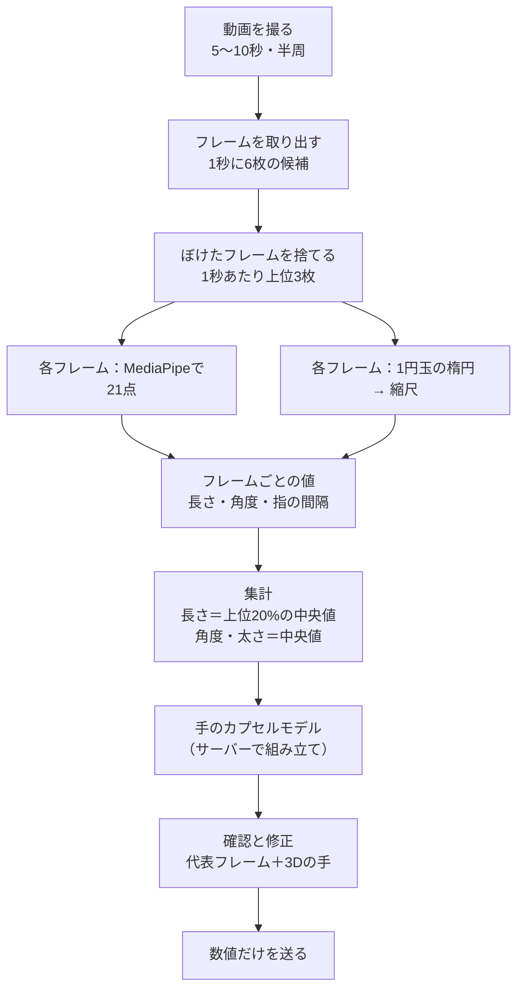
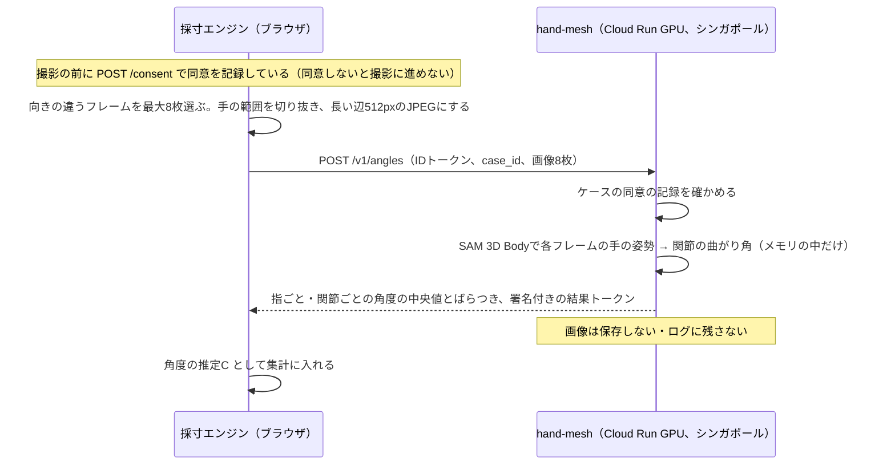

# 採寸の仕様

> **このドキュメントで決めたこと**
> 1. 撮影は動画（5〜10秒）。手を机に置いたまま、スマホを手のまわりで半周させる。大きさの基準は1円玉（直径20.0mm）で、最初のフレームで1回タップしたあとは自動で追いかける。写真2枚と、1円玉の手動指定をフォールバックにする。動画はブラウザで解析し、角度を出すために、手を切り抜いたフレームを最大8枚、同意を得て全員分送る（保存しない）。
> 2. 手は「指をカプセル（両端が丸い円柱）で表したモデル」にする。集計は、長さが「長く写ったフレームの上位20%の中央値」、太さが中央値。角度はメッシュ復元（SAM 3D Body）で出し、失敗してもMediaPipeの角度で代わりにはしない。MediaPipeの角度は比較用にOT画面へ出す。
> 3. 精度は、定規・分度器・既知の太さの筒との差で確かめる。系統的なずれは、検証で求めた補正係数で直す。最終確認は、値と3Dの手のモデルを見て行い、数値を直せるようにする。

関連：[parts-library.md](parts-library.md)（カプセルのくり抜き）、[adr/0006-coin-scale-reference.md](adr/0006-coin-scale-reference.md)、[adr/0007-video-capture.md](adr/0007-video-capture.md)、[adr/0008-hand-model-capsules.md](adr/0008-hand-model-capsules.md)

> この版（2.0）は、チャットでの検討メモ（2026-11-07）を反映して、写真2枚＋カードの方式（1.0）から書き直したもの。1.0の計算方法は、§9のフォールバックに残している。

---

## 1. 全体の流れ



- §2〜§7はブラウザの中で行う（`app/web/js/measure_engine.js`。[architecture.md](architecture.md)）。§8のカプセルモデルの組み立ては生成APIが行い、結果をブラウザに返して3Dで見せる
- 動画、フレーム、フレームごとの点は、メモリの中だけで扱い、保存しない。生成APIには送らない。例外は、手を切り抜いたフレーム（最大8枚）で、角度の推定のためだけに、同意を得て `hand-mesh` に送る（§11）

## 2. 撮影の手順

### 2.1 準備

| 項目 | 指示 | 理由 |
|---|---|---|
| 下に敷くもの | 暗い色の布か紙を机に敷く | 1円玉（銀色）と手の輪郭を、背景からはっきり分けるため |
| 手 | 敷いた布の上に、**いつもの曲がり方のまま**手を置く。手の甲が上 | 本人が道具を握る形に近い形を測るため |
| 1円玉 | 指先の前、手の長さの方向の延長上に、指先から3〜5cm離して平らに置く | 半周するあいだ、1円玉とカメラの距離が、手の中心とカメラの距離に近いまま保たれるため（[§4.4](#44-誤差の見積もり)） |
| 撮る人 | 家族やOTなど、本人以外が撮ることを勧める | 本人が片手でスマホを持って自分の手のまわりを回るのは難しいため |

### 2.2 撮り方

1. スマホを手から40〜50cm離す。できれば2倍ズームにする（遠くから撮るほど、遠近による誤差が小さくなる）
2. 親指側の、机に近い高さから撮り始める
3. 手の上を通り、小指側の机に近い高さまで、**5〜10秒かけてゆっくり**半周する
4. 撮っているあいだ、手と1円玉がずっと画面に入っているようにする。手は動かさない

撮る前に、この動きを短いアニメーションで見せる。

### 2.3 録画の方法

| 段階 | 方法 | 理由 |
|---|---|---|
| MVP | OSのカメラで録画する（`<input type="file" accept="video/*" capture="environment">`）。終わったら、すぐブラウザの中で解析する | iPhoneでもAndroidでも一番確実に録れる。ただし、録画中に画面へ案内を重ねられない |
| 拡張機能 | アプリの中でカメラを開き（`getUserMedia`）、映像に「手と1円玉が入っているか」「速すぎないか」を重ねて表示しながら撮る | 撮り直しが減る。ただし、iPhoneで動かす手間が大きい |

録画が終わったら、解析の結果から撮り直しを勧めるかどうかを判断する（[§3.3](#33-撮り直しを勧める条件)）。

### 2.4 映像の扱い

- 動画ファイルはブラウザのメモリの中にだけ置き、解析が終わったら参照を消す（オブジェクトURLを破棄する）
- iPhoneは、カメラの設定が「高効率」ならHEVC、「互換性優先」ならH.264で録る（Appleの公式の説明）。Safariがファイル選択で受け取った動画がどちらになるか、`<video>` で読めてフレームを取り出せるかは要確認（11/7にAが実機で確かめる）。読めなければ「互換性優先」にするよう案内する
- `capture` 付きのファイル選択で、カメラが録画のモードで直接開くかは公式の記述がなく、要確認
- フレームの取り出しには `requestVideoFrameCallback`（Safari・iOS 15.4以上、Chrome 83以上）か、`currentTime` を動かして `seeked` を待つ方法を使う

---

## 3. フレームの選び方

### 3.1 手順

1. 動画から、1秒に6枚の割合で候補のフレームを取り出す（取り出し方は、`requestVideoFrameCallback` か、再生位置を動かして `seeked` を待つ方法。端末での速さを見て決める：要確認）
2. 各候補を、長い辺が256pxの白黒画像に縮め、ぼけの少なさを点数にする（ラプラシアンの分散。値が大きいほどくっきりしている）
3. 1秒ごとに、点数が上位3枚のフレームだけを残す（10秒なら最大30枚、上限の15秒なら最大45枚）
4. 残したフレームを元の解像度（長い辺が最大1920px）でMediaPipeに渡す。`runningMode: "VIDEO"` にし、タイムスタンプは動画の中の時刻（ミリ秒）を使う（時刻が必ず増えていくようにする）。間引いた静止フレームなので、`"IMAGE"` でもよい。追いかけの安定性を見て決める

### 3.2 使わないフレーム

| 条件 | 理由 |
|---|---|
| 手が見つからない、または手が2つ以上写っている | 点が取れない、または取り違える |
| 1円玉が見つからない、または楕円の短径÷長径が0.15未満（ほぼ真横） | 縮尺が出せない、または不安定。低い角度ほど、1円玉の縁（厚さ約1.5mm）の帯がマスクに入るため（§4.3） |
| 縮尺が、前後のフレームから15%以上離れている | 1円玉の検出を誤った可能性が高い |
| 手の点の一部が画面の端（5%以内）にかかっている | 手が画面からはみ出していて、点がずれやすい |

### 3.3 撮り直しを勧める条件

| 条件 | 画面の説明（例） |
|---|---|
| 使えるフレームが10枚未満 | もう少しゆっくり、手と1円玉が画面に入るように撮ってください |
| 1円玉が見つかったフレームが半分未満 | 1円玉が隠れていたか、光って見えにくかったようです。暗い布の上に置いてください |
| 見えた向きが片寄っている（親指側だけ、上からだけ、など） | 親指側から小指側まで、半周してください |

撮り直しを勧めても、ユーザーが選べば先に進める。そのときは警告を記録する。

---

## 4. 大きさの基準：1円玉

### 4.1 寸法

| 項目 | 値 | 出典 |
|---|---|---|
| 直径 | 20.0 mm | 財務省「通常貨幣一覧」（一円アルミニウム貨） https://www.mof.go.jp/policy/currency/coin/general_coin/list.htm |
| 量目 | 1.00 g | 同上 |
| 厚さ | 約1.5 mm（公式の値は要確認） | 計算には使わない |

### 4.2 楕円から縮尺を出す

斜めから見た円は楕円に写る。カメラが十分に遠いとき、**楕円の長径は円の直径に対応する**。そのため、どの向きのフレームでも縮尺を出せる。

```
s_k = a_k / 20.0     … フレーム k の縮尺（px/mm）。a_k は1円玉の楕円の長径（px）
L(mm) = L(px) / s_k  … そのフレームで測った長さをmmに直す
```

### 4.3 1円玉の見つけ方

| 段階 | 方法 | 理由 |
|---|---|---|
| MVP | 最初に使うフレームで、ユーザーが1円玉を**1回タップ**する。MediaPipeのInteractive Segmenterに、その点を渡して1円玉の領域（マスク）を取る。次のフレームからは、前のフレームで見つかった中心の位置を、新しいタップの代わりにして追いかける | 1回のタップで済む。OpenCV.js（約16MB）を読み込まずに済む。Googleの技術で一貫する |
| フォールバック | ユーザーが、1円玉の長いほうの両端に、2つのハンドルを合わせる。少なくとも3枚のフレーム（写真モードなら各写真）で行う | 自動で見つからない場合でも、必ず先に進める |
| 拡張機能 | タップなしの完全な自動検出（輪郭からの楕円の当てはめ） | 時間がかかるため、後回しにする |

マスクから楕円を出す方法：マスクの画素の座標の平均（中心）と共分散行列を求め、固有ベクトルから長軸の向きを出す。共分散行列の固有値を λ1 ≥ λ2 とすると、中身の詰まった楕円の半径は、長いほうが `2√λ1`、短いほうが `2√λ2` になる。

ただし、低い角度から見ると、1円玉の縁（厚さ約1.5mm）の帯がマスクに入り、`4√λ1` は長めに出る（見下ろす角度8度で約+7%、20度で約+3%。レビューでの試算）。縁の帯は主に短軸の向きに広がるので、**長径は、マスクの画素を長軸の向きに投影したときの幅（最大−最小）で測る**。`4√λ1` との差が5%を超えるフレームは使わない。次の場合も、検出の誤りとしてそのフレームを使わない。

- マスクの面積と、求めた楕円の面積（π × 長いほうの半径 × 短いほうの半径）の比が0.85〜1.15の外（形が楕円でない）
- 長径が20px未満、または400pxを超える

### 4.4 誤差の見積もり

| 原因 | 大きさの目安 | 対策 |
|---|---|---|
| 1円玉と、測る関節の、カメラからの距離の差（Δd） | 距離の比 Δd/D の分だけずれる。D=450mm、Δd=30mm（関節が机から浮いている、指が手の中心より手前にある）なら約7% | 離れてズームで撮る。1円玉を手の長さの方向の延長上に置き、手の中心との距離の差を小さくする。残ったずれは、検証で求めた補正係数（§10.3）で直す |
| 長径の読み取りのずれ | 長径が70pxなら、1pxで約1.4% | 多くのフレームの中央値を使う |
| 1円玉の縁の帯（低い角度のフレーム） | 共分散から出すと+3〜7% | 長軸の向きの幅で測る（§4.3） |
| 測る指と手の中心の、カメラからの距離の差（横から見たフレーム） | 横から見ると、手前の指（親指側からなら人差し指）は手の中心より約40mmカメラに近く、D=450mmで約+9%大きく写る。奥の指は小さく写る | 指ごと・向きごとにずれが違うので、補正係数を指ごとに求める（§10.3）。中指・薬指は横からのフレームでは隠れていることが多く、点は推定になる |
| MediaPipeの点のずれ | 公式のモデルカードでは、点の誤差の平均が手のひらの大きさの約5〜10%（手のひらが90mmなら1点あたり約5〜9mm）。指の付け根で小さく、指先ほど大きい | 多くのフレームで集計する。最後に値と3Dの手で確かめ、直せるようにする |
| 指の太さの仮定 | 数mm | §7.3 |

---

## 5. 使うランドマーク

MediaPipe Hand Landmarkerは、1つの手につき21点を返す。各点は**関節のおおよその中心**で、皮膚の表面ではない。

| 番号 | 名前 | 日本語 | 使い道 |
|---|---|---|---|
| 0 | WRIST | 手首 | 手の座標系の原点、手のひらの長さ |
| 1〜4 | THUMB_CMC / MCP / IP / TIP | 親指 | 参考（MVPでは握りのくり抜きに使わない） |
| 5〜8 | INDEX_FINGER_MCP / PIP / DIP / TIP | 人差し指 | 区間の長さ、曲がり角、付け根の位置 |
| 9〜12 | MIDDLE_FINGER_MCP / PIP / DIP / TIP | 中指 | 同上。9は手の座標系の向きにも使う |
| 13〜16 | RING_FINGER_MCP / PIP / DIP / TIP | 薬指 | 同上 |
| 17〜20 | PINKY_MCP / PIP / DIP / TIP | 小指 | 同上 |

- `landmarks`（画像に対する0〜1の値）に画像の幅・高さを掛けてpxにする
- `worldLandmarks`（メートル単位の3D座標）は、平均的な手の大きさを前提にした推定値なので、**長さには使わない**。角度は大きさに関係しないので、角度の推定の1つとして使う（§7.2）
- `handedness`（右手か左手か）は判定に使わず、聞き取りの答えを使う

---

## 6. フレームごとに求める値

記号：`P_i` はフレーム k でのランドマーク i の位置（px）、`s_k` はそのフレームの縮尺（px/mm）、`W_i` は `worldLandmarks` の位置。

| 値 | 式 | 使い道 |
|---|---|---|
| 区間の見かけの長さ `ℓ_k(i→j)` | `|P_i − P_j| / s_k`（mm）。指の区間は MCP→PIP、PIP→DIP、DIP→TIP。手のひらは 0→5、0→9、0→17、5→17 | 長さの集計（§7.1） |
| 指の見かけの全長 `F_k(f)` | 指 f の3区間の `ℓ_k` の合計 | 「その指がどれだけ横向きに写っているか」の目安（長く写るほど、指の曲がる面がカメラに正対している） |
| 2Dの曲がり角 `θ2D_k` | 符号付きの角 `∠(a, b) = atan2(cross(a, b), a·b)` を度で表す（`cross` は2Dの外積）。MCP は `(P_mcp − P0)` と `(P_pip − P_mcp)`、PIP は `(P_pip − P_mcp)` と `(P_dip − P_pip)`、DIP は `(P_dip − P_pip)` と `(P_tip − P_dip)` | 角度の推定A（§7.2） |
| 3Dの曲がり角 `θ3D_k` | `∠(a, b) = atan2((a × b)·n, a·b)`。n は曲がる面の法線（§8.2の回転軸 a の向き） | 角度の推定B（§7.2） |
| 隣り合う指のPIPの間隔 `g_k` | `|P6 − P10|`、`|P10 − P14|`、`|P14 − P18|` を `s_k` で割る | 太さの推定（§7.3）、くぼみの位置 |
| 手のひらの見かけの面積 `A_k` | 三角形 P0・P5・P17 の面積を `s_k²` で割る | 「手の甲がカメラに正対しているか」の目安（大きく写るほど真上から） |

角度の符号：曲がる向き（手のひら側）を正とし、反りすぎ（過伸展）は負にする。`acos` は0〜180度しか返さず負の値を表せないので、`atan2` を使う。2Dでは、親指側から見たフレームと小指側から見たフレームで手のひら側が画像の左右逆になるため、フレームごとに「その指の3つの角の合計が正になる向き」を正とする。リウマチのスワンネック変形やボタン穴変形を、OTが見分ける手がかりにする。

既知のずれ：MCPの角度の基準に「手首→付け根」の向きを使っているので、中手骨と指のまっすぐな向きのずれ（約10度）が混ざる。伸ばした人差し指でも約10度曲がって見える。11/9の検証で、伸ばした指の値から引く量を決める。

---

## 7. 集計

### 7.1 長さ：上位20%のフレームの中央値

```
区間ごとに、全フレームの ℓ_k を大きい順に並べ、上位20%（最低3枚）の中央値を長さとする
L = median( top20%( ℓ_k ) ) × k_len      … k_len は系統的なずれの補正係数（既定 1.00、§10.3）
```

- 斜めから見た区間は短く写るので、長く写ったフレームほど本当の長さに近い。ここまではメモの考え方と同じ
- **最大値そのものを使わない理由**：MediaPipeの点は1点あたり数mmずれるので、最大値は「たまたま長めにずれたフレーム」を拾ってしまい、長めに偏る。カメラに近い側の関節が大きく写ることも、長めに偏る原因になる。上位20%の中央値なら、正対に近いフレームを選びつつ、偶然のずれに強い

### 7.2 曲がり角：中央値（推定方法は差し替えられる）

角度の推定は、次の決まった形で入れ替えられるようにする（`AngleEstimator`）。

- 入力：使ったフレームの点（2D・3D）。メッシュ復元を使う場合は、フレームの画像も入る（§11）
- 出力：指ごと、関節ごとの角度（度）と、ばらつき（四分位範囲）と、使った方法の名前

| 方法 | 中身 | 段階 |
|---|---|---|
| A `mp_lateral2d` | 指ごとに、`F_k(f)` が上位20%のフレーム（その指が横向きに写っている）だけを選び、`θ2D_k` の中央値を取る | MVP |
| B `mp_world3d` | 全フレームの `θ3D_k` の中央値を取る | MVP |
| C `mesh_recovery` | 手のメッシュ復元（SAM 3D Body）で推定した角度の中央値（[ADR-0008](adr/0008-hand-model-capsules.md)） | **MVPの既定**（全員） |

- 採寸に使う角度はC。AとBは、開発中の仮の通しと、OT画面の比較用（`angles_alt_deg`）にだけ使う。比較の表示では、人差し指と小指はA、中指と薬指はBを並べる。どちらを比較用に出すかは、11/9の検証（§10）で分度器と比べて決め直す
- CとA・Bの差が15度を超える関節は、`ANGLE_DISAGREE` の警告を出し、OT画面で目立たせる

### 7.3 指の太さ（カプセルの半径）

| 段階 | 方法 | 理由 |
|---|---|---|
| MVP | 隣り合う指のPIPの間隔 `g` の中央値を、指の幅とみなす（人差し指は `|P6P10|`、中指は `|P6P10|` と `|P10P14|` の平均、薬指は `|P10P14|` と `|P14P18|` の平均、小指は `|P14P18| × 0.9`）。半径は、基節を幅の半分とし、中節はその0.9倍、末節は0.8倍にする | 曲がったまま固まった指は、たいてい隣の指とくっついて並ぶので、関節の間隔がほぼ指の幅になる。輪郭を探すより確実 |
| 拡張機能 | 手の領域（マスク）を取り、各区間の中点で、区間に垂直な方向の幅を測り、中央値を取る。マスクは、MediaPipe Image Segmenterの `selfie_multiclass_256x256`（クラス2が肌 body-skin）か、Interactive Segmenterで手をタップして取る。手専用の切り出しモデルは公式にはない | 指どうしがくっついていると境目が見えないので、外側の指（人差し指・小指）でしか測れない |

- 間隔が25mmを超えたら、指が開いているとみなし、手の幅（`|P5P17|` の値）の1/3.4を幅の代わりに使う（仮の値。要検証）
- 0.9・0.8・1/3.4はいずれも仮の値で、11/9にノギスで測った値と比べて決め直す

### 7.4 手のひら

| 値 | 方法 |
|---|---|
| 各指の付け根の位置（手のひらの面の上の2D座標、mm） | `A_k` が上位20%のフレーム（手の甲が真上に近い）で、手の座標系（§8.1）に直した位置の中央値 |
| 指の開き（外転）の角度 | 同じフレームで、`(P_pip − P_mcp)` を手のひらの面に投影した向きと、手の座標系のy軸とのなす角の中央値。MCPが強く曲がっていると投影が短くなり（80度で約8mm、90度で0mm）、点のずれ（5〜9mm）に負けて向きがでたらめになる。そのため、投影の長さが10mm未満のフレームでは `(P_tip − P_pip)` の投影を使い、それも10mm未満なら0度にして `ABDUCTION_UNKNOWN` を出す。範囲（±40度）を超えた値は、422で弾かずに±40度に丸めて警告を出す（曲がったままの指でこそ起きるため） |
| 手のひらの厚さ（関節の中心から手のひら側の皮膚まで） | 既定12mm（仮の値。要検証）。MVPでは測らない |

### 7.5 ばらつきと警告

値ごとに四分位範囲（IQR）を記録し、次の場合に警告を出す。

| コード | 条件 | 意味 |
|---|---|---|
| `FEW_FRAMES` | 使えたフレームが10枚未満 | 集計が不安定 |
| `LENGTH_UNSTABLE` | 区間の長さのIQRが、その長さの20%を超える | 点のずれが大きい |
| `ANGLE_DISAGREE` | 推定C（メッシュ復元）と、比較用のA・Bの差が15度を超える | 角度が怪しい（OT画面で目立たせる） |
| `ABDUCTION_UNKNOWN` | 指が強く曲がっていて、指の開きの向きが決まらなかった（§7.4） | 指の開きを0度にした |
| `CAVITY_PARTIAL` | すき間の円が、指先の閉じていない側（§8.3の閉じる線分）に接している | すき間の大きさが、指先の位置に左右されている |
| `VIEW_BIASED` | 親指側・上・小指側のどれかの向きのフレームがない | 見えていない向きがある |
| `FINGERS_SPREAD` | PIPの間隔が25mmを超えた | 太さを仮の比で出した |
| `COIN_MANUAL` | 1円玉を手で指定した | — |
| `ODD_PROPORTION` | 基節が中節より短いなど、並びが不自然 | 点の取り違えの可能性 |

---

## 8. 手のカプセルモデル

### 8.1 手の座標系

```
原点：手首（0）
x軸：人差し指の付け根（5）→ 小指の付け根（17）の向き
y軸：手首 → 中指の付け根（9）の向きから、x成分を除いたもの
z軸：x × y（右手系）
```

- このままだと、左手ではzが手のひら側、右手では手の甲側になる。計算をそろえるため、**右手のときは、点を左右反転してから左手として扱う**（正準形。2Dの点は画像のx座標を反転し、3Dの点はx成分の符号を変える）。長さ・角度は反転しても変わらない
- 正準形では、z軸が常に手のひら側を向き、指は+zの向きに曲がる。§8.2・§8.3はこの正準形で計算する
- 握りの座標系に直すとき（§8.4）に、右手ならもう一度左右反転して、実際の手の形に戻す。そのため、OpenSCADに渡すカプセルは実際の手の座標になり、右手と左手で、くり抜いた形は互いの鏡像になる（[parts-library.md §1](parts-library.md#1-全体の形)）

### 8.2 指の組み立て（順運動学）

指 f ごとに、付け根の位置 `M_f`（z=0）、開きの角度 `α_f`、3区間の長さ `L1・L2・L3`、曲がり角 `θmcp・θpip・θdip`、半径 `r1・r2・r3` を使う。

```
d0 = (sin α_f, cos α_f, 0)            … まっすぐ伸ばしたときの向き
回転軸 a = (cos α_f, −sin α_f, 0)      … 手のひらの面の中で d0 に垂直
J1 = M_f
J2 = J1 + L1 · R(a, θmcp) d0
J3 = J2 + L2 · R(a, θmcp + θpip) d0
J4 = J3 + L3 · R(a, θmcp + θpip + θdip) d0
カプセル：(J1, J2, r1)、(J2, J3, r2)、(J3, J4, r3)
```

`R(a, θ)` は、軸 a のまわりに、手のひら側（+z）へ θ 度回す回転。

- 回転の向きは、`a × d0 = +z` になるように取ってある（手のひら側へ曲がる）
- 組み立ては生成APIのPython（`api/app/handmodel/`）で行い、結果のカプセルの端点と半径を、ブラウザに返して3Dで見せる（S5）。同じ計算をブラウザとサーバーで二重に書かないため
- 親指はMVPではくり抜きに使わず、3Dの表示だけにする

### 8.3 握りを置く場所（指ごとのすき間）

道具は、指の付け根の並び（x軸）に沿った向きで握る。指 f の曲がる面（d0 と z が張る面）に投影し、付け根 J1、各関節 J2・J3、指先 J4 を使う。手のひら側の皮膚の線（z = t_palm）の上で、J1 の真下の点を S、J4 から下ろした点を Q とする。J1→J2→J3→J4→Q→S→J1 の閉じた単純多角形 P を作る（前の版は手首と指先を結んでいたが、手首の位置にすき間が左右されるため、指先から手のひらの皮膚へ下ろす線に変えた）。自己交差や面積0の場合は、有効なすき間を計算できないものとする。

```
手のひら側の皮膚：z = t_palm（既定12mm）
Ω = P の内部 ∩ { z > t_palm } から、指のカプセルの断面を除いた領域
探索範囲：P の外接長方形の中だけ（有限）。0.5mm 間隔の格子を使う
円の中心 c は Ω の内部にある点だけを候補にする（境界・外側は除く）
  ρ(c) = distance(c, Ω の境界)       … 内側から境界までの最短距離
すき間の直径 D_f = min(55, 2 × max ρ(c))、そのときの中心を c_f とする
```

- Ω の境界には、手のひら側の皮膚、カプセルの表面、指先から皮膚へ下ろす線分 J4–Q が含まれる。距離だけを最大化すると手の外側を選んでしまうため、内部判定を必ず先に行う
- J4–Q は実際の面ではない。一番大きい円がこの線分に接したとき（距離の差が0.5mm以内）は、すき間が指で閉じていないので、`CAVITY_PARTIAL` を記録してOT画面で示す（`fitted` は選べるまま）
- P が不正、Ω が空、または正の半径を持つ格子点がない場合は、`diameter_mm` と `center_mm` を `null` にして `CAVITY_OPEN` を記録する。直径55mmや外側の中心を代入して成功扱いにはしない
- 55mmで打ち切った場合も `CAVITY_OPEN` を記録する。いずれの `CAVITY_OPEN` でも `fitted` は選べず、`round`／`oval` にする。有効なすき間の径がない指は、基準径32mmを仮の値として使い、ユーザーとOTに警告を示す
- 中指と薬指は、握りの面とカプセルが重なった所が、くり抜きでくぼみになる

### 8.4 握りの座標系

握りの軸と、手の座標系（正準形）から握りの座標系への変換を、次のように決める。

```
c_index・c_pinky：人差し指・小指のすき間の中心（手の座標系の3D点。曲がる面の2D点を、その指の付け根を通る面に戻したもの）
握りのZ軸：ez = (c_index − c_pinky) / |c_index − c_pinky|   … 小指側から人差し指側へ
握りのX軸：手のひらの法線（手の座標系の+z）から、ez の成分を除いて正規化したもの（ex は手のひら側を向く）
握りのY軸：ey = ez × ex
原点：c_pinky から、ez の逆向きに end_margin_mm だけ進んだ点（握りの下端の中心）
変換：p_grip = R · (p_hand − origin)。R の行は ex・ey・ez
右手なら、最後に p_grip の Y の符号を変えて、実際の手の形（鏡像）に戻す
```

- 握りは、Z=0（小指側の端）からZ=`length_mm`（人差し指側の端）までの、先細りの筒になる。両端の太さは `D_pinky`・`D_index` を基準にする（[parts-library.md §4.1](parts-library.md#41-握り本体-grip_body必須)）
- 生成APIは、この変換（`R` と `origin`）を版に記録し、カプセルを握りの座標系に直してOpenSCADに渡す。前の版の `axis_offset_mm`（2つの中心の差を軸に垂直な面へ投影したもの）は、定義から必ず0になるので廃止した
- 軸は、手のx軸（付け根の並び）に対して傾いてよい（2つのすき間の中心の高さが違うため）。傾くとくり抜きの深さが変わるので、深さは描く前にカプセルごとに実際の幾何で確かめる（[parts-library.md §4.1](parts-library.md#41-握り本体-grip_body必須) の組み合わせのルール）

---

## 9. フォールバック

| 場面 | 方法 |
|---|---|
| 動画の解析がうまくいかない（使えるフレームが少ない、端末で動画が読めない） | **写真2枚のモード**：写真①（上から）と写真②（親指側の横から）を撮る。1円玉は机に置いたまま写す（横からは細い楕円になるが、長径は測れる）。区間の長さは写真②の人差し指から、付け根の位置と指の間隔は写真①から出す。**角度は、動画と同じく、2枚を切り抜いて `hand-mesh` に送って出す**（MediaPipeの角度で代わりにはしない）。このモードでは、点をドラッグで直せる（フレームが2枚だけなので） |
| 1円玉が自動で見つからない | 長いほうの両端に2つのハンドルを合わせる（§4.3） |
| 手が見つからない（写真モード） | 平均的な手の形の21点を1円玉の大きさに合わせて置き、ユーザーが全部の点を合わせる「手で置くモード」（拡張機能。遅れたら落とす候補）。角度は、この場合も `hand-mesh` で出す |

写真モードの寸法の計算は、1.0版と同じ考え方（射影変換の代わりに、1円玉の長径から出した縮尺を使う）にする。

---

## 10. 精度の確かめ方

協力してくれるOTや当事者がいないため、チームの何人かの手で確かめる。11/9に行い、結果を `docs/measurement-validation.md`（11/9に作る）に書く。ピッチで「誤差は平均○mm」と数字で言えるようにする。

### 10.1 測るものと道具

| 値 | 正解の測り方 | 目標（補正後） |
|---|---|---|
| 区間の長さ | 指を曲げたまま、手の甲側の関節の山から山までをノギスで測る（関節の中心とは少しずれるので、ずれの平均も記録する） | ±3 mm |
| 曲がり角 | 横から撮った写真を印刷するか画面に出し、分度器で測る | ±10 度 |
| 指の幅 | 基節の中ほどをノギスで測る | ±2 mm |
| すき間の直径 | 握り径ゲージ（20〜45mm、5mm刻み。[parts-library.md §6](parts-library.md#6-試し刷り用の部品)）のうち、一番しっくり握れる段の直径 | ±3 mm |

### 10.2 手順

1. メンバー3人以上が、指を曲げた同じ形で、動画を3回ずつ撮る
2. 各回の値と正解との差を出す
3. 記録する：平均の誤差（絶対値）、最大の誤差、3回のばらつき、推定C（メッシュ復元）・A・Bそれぞれと分度器との差

### 10.3 補正係数の求め方

- 長さ：`k_len = 平均(正解 ÷ 測った値)` を求める。ずれは見る向きと指ごとに違う（横から見たときの手前の指は大きく、奥の指は小さく写る。§4.4）ので、まず指ごとに求め、指の間で5%以上違えば指ごとの係数を使う。差が小さければ全員・全区間の1つの係数にする。1.00から5%以上離れていれば、既定値を書き換える
- 手のひらの厚さ `t_palm`：すき間の直径の測った値とゲージの直径の差が、全員で同じ向きに偏っていれば、`t_palm` を調整する
- 補正係数を変えたら `calibration.source` に日付を残す

---

## 11. 手のメッシュ復元で角度を補う

[ADR-0008](adr/0008-hand-model-capsules.md)・[ADR-0009](adr/0009-gpu-placement.md) で決めた。



- 送るフレームは、`F_k(f)` と `A_k`（§6）から、親指側・上・小指側がそろうように選ぶ
- 切り抜きは、21点を囲む四角を20%広げた範囲。1円玉と背景はなるべく入れない
- 起動中（503）や混雑、時間切れは、自動で最大3回やり直す（合わせて最大5分）。それでもだめなら採寸を止める。角度がないので採寸は保存できず、ケースは `measuring` のまま。動画もフレームも保存しないので、**もう一度撮影からやり直す**（約1分）。画面にはそのとおりに伝える。方法A・Bでは代わりにしない
- 角度は、メッシュの関節の位置から、§6と同じ定義（隣り合う区間の符号付きのなす角、手のひら側が正）で出す。どの関節を使うかは、SAM 3D Bodyの出力の形を見て、11/8に決める（要確認）
- **結果トークン**：`hand-mesh` は、ケースID・角度のハッシュ・日時に、Secret Managerに置いた共有の鍵でHMACの署名を付けて返す（鍵はリポジトリに入れない）。ブラウザは採寸JSONの `capture.mesh_result_token` に入れて送り、生成APIは `PUT measurement` で署名・ケースID・角度の一致を確かめる。これで、メッシュ復元を通らない角度や、ブラウザが書き換えた角度を受け付けない
- 送ったフレームのどれでも手の姿勢が出なかったときは、撮り直してもらう

## 12. 出力するJSON（`measurement`、2.0）

`PUT /v1/cases/{case_id}/measurement` で送る（[api.md](api.md)）。スキーマは `schemas/measurement.schema.json`（JSON Schema 2020-12）に置き、フロントエンドとサーバーで共有する。

生成APIに送るのは数値だけ。動画、フレーム、フレームごとの点は送らない。

```json
{
  "$schema": "https://json-schema.org/draft/2020-12/schema",
  "$id": "measurement.schema.json",
  "type": "object",
  "required": ["schema_version", "hand_side", "capture", "scale", "fingers", "palm", "calibration", "quality"],
  "$defs": {
    "lengths": { "type": "array", "items": { "type": "number", "exclusiveMinimum": 0, "maximum": 100 }, "minItems": 3, "maxItems": 3 },
    "radii": { "type": "array", "items": { "type": "number", "exclusiveMinimum": 0, "maximum": 20 }, "minItems": 3, "maxItems": 3 },
    "mcp_position": {
      "type": "array", "minItems": 2, "maxItems": 2,
      "prefixItems": [
        { "type": "number", "minimum": -150, "maximum": 150 },
        { "type": "number", "minimum": 0, "maximum": 200 }
      ],
      "items": false
    },
    "finger": {
      "type": "object",
      "required": ["lengths_mm", "radii_mm", "flexion_deg", "abduction_deg", "angle_method"],
      "properties": {
        "lengths_mm": { "$ref": "#/$defs/lengths", "description": "基節・中節・末節（関節の中心どうし）" },
        "radii_mm": { "$ref": "#/$defs/radii" },
        "flexion_deg": {
          "type": "object",
          "required": ["mcp", "pip", "dip"],
          "properties": {
            "mcp": { "type": "number", "minimum": -45, "maximum": 135 },
            "pip": { "type": "number", "minimum": -45, "maximum": 135 },
            "dip": { "type": "number", "minimum": -45, "maximum": 135 }
          }
        },
        "abduction_deg": { "type": "number", "minimum": -40, "maximum": 40 },
        "angle_method": { "enum": ["mp_lateral2d", "mp_world3d", "mesh_recovery", "manual"] },
        "angles_alt_deg": { "type": "object", "description": "使わなかった方法の角度（比較用。OT画面に出す）" },
        "iqr": { "type": "object", "description": "各値の四分位範囲（同じ形）" }
      }
    }
  },
  "properties": {
    "schema_version": { "const": "2.0" },
    "hand_side": { "enum": ["right", "left"] },
    "capture": {
      "type": "object",
      "required": ["mode", "frames_used", "mesh_consent", "mesh_frames_sent", "mesh_result_token"],
      "properties": {
        "mode": { "enum": ["video", "photos"] },
        "duration_s": { "type": "number", "exclusiveMinimum": 0, "maximum": 15, "description": "撮影の目安は5〜10秒。少しはみ出しても受け付ける" },
        "frames_sampled": { "type": "integer", "minimum": 1, "maximum": 90, "description": "1秒に6枚×最大15秒" },
        "frames_used": { "type": "integer", "minimum": 1, "maximum": 45, "description": "1秒あたり上位3枚×最大15秒" },
        "mesh_consent": { "const": true, "description": "メッシュ復元のために切り抜いたフレームを送ることに同意した（同意しないと採寸に進めない）" },
        "mesh_frames_sent": { "type": "integer", "minimum": 1, "maximum": 8 },
        "mesh_result_token": { "type": "string", "maxLength": 2048, "description": "hand-mesh が返した署名付きの結果トークン（§11）" }
      }
    },
    "scale": {
      "type": "object",
      "required": ["reference", "diameter_mm", "method"],
      "properties": {
        "reference": { "const": "jp_1yen" },
        "diameter_mm": { "const": 20.0 },
        "method": { "enum": ["coin_tracked", "coin_manual"] },
        "px_per_mm_median": { "type": "number", "exclusiveMinimum": 0, "maximum": 20 },
        "px_per_mm_iqr": { "type": "number", "minimum": 0, "maximum": 20 }
      }
    },
    "fingers": {
      "type": "object",
      "required": ["index", "middle", "ring", "pinky"],
      "properties": {
        "index":  { "$ref": "#/$defs/finger" },
        "middle": { "$ref": "#/$defs/finger" },
        "ring":   { "$ref": "#/$defs/finger" },
        "pinky":  { "$ref": "#/$defs/finger" },
        "thumb":  { "$ref": "#/$defs/finger", "description": "参考" }
      }
    },
    "palm": {
      "type": "object",
      "required": ["mcp_positions_mm", "hand_width_mcp_mm", "wrist_to_middle_mcp_mm", "palm_thickness_mm"],
      "properties": {
        "mcp_positions_mm": {
          "type": "object",
          "description": "手の座標系（§8.1）の x, y",
          "required": ["index", "middle", "ring", "pinky"],
          "properties": {
            "index":  { "$ref": "#/$defs/mcp_position" },
            "middle": { "$ref": "#/$defs/mcp_position" },
            "ring":   { "$ref": "#/$defs/mcp_position" },
            "pinky":  { "$ref": "#/$defs/mcp_position" }
          }
        },
        "hand_width_mcp_mm": { "type": "number", "minimum": 40, "maximum": 110 },
        "wrist_to_middle_mcp_mm": { "type": "number", "exclusiveMinimum": 0, "maximum": 200 },
        "palm_thickness_mm": { "type": "number", "minimum": 5, "maximum": 25 }
      }
    },
    "calibration": {
      "type": "object",
      "required": ["length_factor", "source"],
      "properties": {
        "length_factor": { "type": "number", "minimum": 0.8, "maximum": 1.2 },
        "source": { "type": "string", "description": "default、または検証した日付" }
      }
    },
    "overrides": {
      "type": "array",
      "items": {
        "type": "object",
        "required": ["key", "value", "reason"],
        "properties": {
          "key": { "type": "string", "description": "例: fingers.index.flexion_deg.pip" },
          "value": { "type": "number" },
          "reason": { "enum": ["finger_shape_differs", "length_differs", "angle_differs", "thickness_differs", "ot_judgement", "other"], "description": "画面の選択肢から選ぶ" },
          "note": { "type": "string", "maxLength": 200, "description": "other のときだけ（任意）" }
        }
      }
    },
    "quality": {
      "type": "object",
      "required": ["warnings"],
      "properties": {
        "warnings": { "type": "array", "items": { "type": "string" } },
        "views_covered": { "type": "array", "items": { "enum": ["thumb_side", "top", "pinky_side"] } }
      }
    },
    "method_version": { "type": "string", "description": "例: measure-2.0" }
  }
}
```

スキーマの上限は、計算量と不正入力を制限するための入力制約で、採寸の精度を保証する値ではない。対象の手が範囲外なら、自動で丸めずに `MEASUREMENT_INVALID` として、手動測定を含めて確認を求める。

サーバーはJSON Schemaの検証後、全数値が有限（NaN・Infinityを含まない）であること、各指の長さの合計が180mm以下であること、付け根が人差し指から小指へx座標の増加順に並ぶことを確かめる。`frames_sampled` がある場合は `frames_used ≤ frames_sampled`、写真モードは `frames_used ≤ 2`、`mesh_frames_sent ≤ frames_used` も検証する。`overrides` を適用した最終値にも同じ検証を行い、違反したフィールドを422の `details` に返す。デプロイ版の `angle_method` は `mesh_recovery`、またはメッシュ復元後の値を理由付きで直した `manual` だけを受け付ける。さらに、`mesh_result_token` の署名・ケースID・角度のハッシュを確かめ、ケースに同意の記録（`mesh_consent_at`）があることも確かめる。どれかが合わなければ `422 MEASUREMENT_INVALID`。

## 13. 確認と修正（S5）

本人と家族が見る画面は、判断しやすいものだけにする。数値の一覧とスライダーは「詳しく見る」とOT画面に移す。

| 表示・操作 | 内容 |
|---|---|
| 代表フレームと3Dの手 | 親指側・上・小指側の代表フレーム（点と1円玉の楕円を重ねたもの）と、生成APIが組み立てたカプセルの手（three.js）を並べる。握りを置く場所（すき間の円）も重ねる |
| 本人の答え | 「合っている」「ずれている」「撮り直す」の3つの大きなボタン。「ずれている」を選ぶと、どこが違うかを選択肢（指の形／長さ／角度／太さ）で選び、「詳しく見る」を開く |
| 詳しく見る（家族・OT向け） | 指ごとの長さ・角度・太さ、手の幅、すき間の直径。警告とばらつきの印。値をタップすると、3Dの手の該当する所が光る。値ごとのスライダーで直せる。直した理由は選択肢から選ぶ（文字は打たなくてよい）。直すと3Dの手がすぐ変わる。記録は `overrides` に残す |
| やり直す | 「撮り直す」「写真2枚で測る」 |

動画のモードでは、フレームごとの点はドラッグで直さない（フレームが多く、1枚を直しても集計の値はほとんど変わらないため）。点を直したい場合は、写真2枚のモードを使う。
