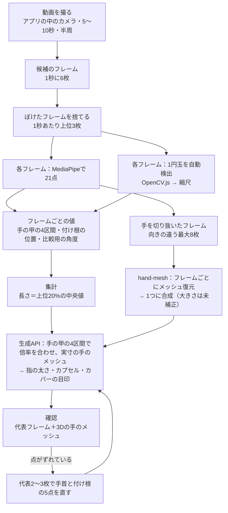
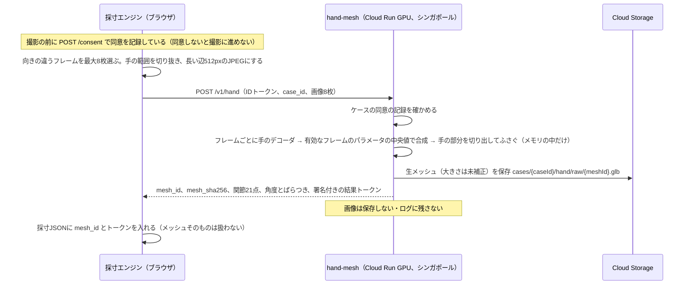

# 採寸の仕様

> **このドキュメントで決めたこと**
> 1. 測るのは**握った形のこぶしの外形**（手の甲・指の背・関節の出っ張り）。いつもの握った形のまま、手の甲を上にして机に置き、アプリの中のカメラ（スマホは背面、PCはWebカメラ）で5〜10秒、半周して撮る。大きさの基準は1円玉（直径20.0mm）で、OpenCV.jsで自動検出し、ユーザーは確かめるだけにする。動画はブラウザで解析し、保存しない。
> 2. 手は3Dメッシュで表す（SAM 3D Bodyの復元をフレームごとに行って1つに合成。フレームは同意を得て送り、保存しない）。大きさの倍率は、握りこぶしでも隠れない**手の甲の4区間**（手首と指の付け根）の長さから出す。カバーを作る目印（切る面・避ける所・レールの位置）はこのメッシュから出し、復元に失敗してもMediaPipeの値で代わりにはしない。
> 3. 握りこぶしでは点がずれやすいので、確認の画面で、代表のフレーム2〜3枚の**手首と指の付け根の5点だけ**をドラッグで直せるようにする（倍率だけが変わり、GPUは要らない）。値のスライダーは作らない。精度はノギスとの差で確かめ、系統的なずれは補正係数で直す。

関連：[parts-library.md](parts-library.md)（こぶしにかぶせるカバーとC字クリップ）、[adr/0011-dorsal-cover.md](adr/0011-dorsal-cover.md)（カバー方式）、[adr/0006-coin-scale-reference.md](adr/0006-coin-scale-reference.md)、[adr/0007-video-capture.md](adr/0007-video-capture.md)、[adr/0008-hand-model-capsules.md](adr/0008-hand-model-capsules.md)、[adr/0010-hand-mesh-fusion.md](adr/0010-hand-mesh-fusion.md)

> この版（2.2）は、2026-11-07 に、道具の形を「握り」から「こぶしの外側にかぶせるカバー」に変えたこと（[ADR-0011](adr/0011-dorsal-cover.md)、[チームのメモ](notes/2026-11-07-cover-shape.md)）を反映したもの。2.1では、手の3Dメッシュ（[ADR-0010](adr/0010-hand-mesh-fusion.md)）とプロトタイプ（[PROTOTYPE.md](notes/prototype-lessons.md)）で分かったことを入れた。2.0では、手を指のカプセルで近似し、くり抜きにもカプセルを使っていた。1.0（写真2枚＋カード）の計算方法は、§9のフォールバックに残している。

---

## 1. 全体の流れ



- §2〜§7はブラウザの中で行う（採寸エンジン `app/web/js/measure_engine.js` と、1円玉の検出の `app/web/js/coin_worker.js`。[architecture.md](architecture.md)）
- 手のメッシュの復元と合成は `hand-mesh`（GPU）が行う（§11）。実寸にする計算と、メッシュから太さ・カバーの目印を出す計算は、生成APIが行う（§8）
- 動画、フレーム、フレームごとの点は、メモリの中だけで扱い、保存しない。生成APIには送らない。例外は、手を切り抜いたフレーム（最大8枚）で、メッシュの復元のためだけに、同意を得て `hand-mesh` に送る（保存しない）
- **手のメッシュは保存する**（写真ではなく、手の形の3Dデータ。持ち主と担当のOTだけが読める）。作った形を確かめ、版ごとにカバーの殻を作り直すため（[ADR-0010](adr/0010-hand-mesh-fusion.md)・[ADR-0011](adr/0011-dorsal-cover.md)）

## 2. 撮影の手順

### 2.1 準備

| 項目 | 指示 | 理由 |
|---|---|---|
| 下に敷くもの | 暗い色の布か紙を机に敷く | 1円玉（銀色）と手の輪郭を、背景からはっきり分けるため |
| 手 | 敷いた布の上に、**いつもの握った形のまま**、こぶしを置く。手の甲が上。指を開かせない | カバーは握った形のこぶしの外側にかぶせるので、その形を測るため。指が握った形で固まっている人は、開くことができない（[ADR-0011](adr/0011-dorsal-cover.md)） |
| 1円玉 | こぶしの前（指の付け根の関節の山の前）、手の長さの方向の延長上に、関節から3〜5cm離して平らに置く | 半周するあいだ、1円玉とカメラの距離が、手の中心とカメラの距離に近いまま保たれるため（[§4.4](#44-誤差の見積もり)） |
| 撮る人 | 家族やOTなど、本人以外が撮ることを勧める | 本人が片手でスマホを持って自分の手のまわりを回るのは難しいため |
| デモ | メンバーや審査員が手を握るだけで、対象の人と同じ状態になる | その場で撮って、カバーを着けてもらえる |

### 2.2 撮り方

1. スマホを手から40〜50cm離す。できれば2倍ズームにする（遠くから撮るほど、遠近による誤差が小さくなる）。1円玉が小さく写りすぎない（長径14px以上）ように、手と1円玉が画面いっぱいに入るくらいにする
2. 親指側の、机に近い高さから撮り始める
3. 手の上を通り、小指側の机に近い高さまで、**5〜10秒かけてゆっくり**半周する。途中で、こぶしの前（指の背と関節の出っ張り）も写るようにする（カバーが当たる面なので）
4. 撮っているあいだ、手と1円玉がずっと画面に入っているようにする。手は握った形のまま動かさない
5. PCで撮るときは、手は机に置いたまま、カメラ（ノートPCなど）の方を動かす

撮る前に、この動きを短いアニメーションで見せる。

### 2.3 録画の方法

| 段階 | 方法 | 理由 |
|---|---|---|
| MVP | アプリの中でカメラを開いて撮る（`getUserMedia`）。スマホは背面カメラ（`facingMode: environment`）、PCはWebカメラ。カメラが2台以上あれば切り替えられる。撮っている間は、手の骨組みと「手が見えているか」と残り時間を重ねる。最大10秒（5秒以上で止められる）。1秒に6枚の候補を、長い辺1280pxでメモリに取っておく | 撮りながら手が見えているかを示せるので、撮り直しが減る。PCでも同じ画面で撮れる（プロトタイプで確かめた） |
| 予備 | OSのカメラで録画する（`<input type="file" accept="video/*" capture="environment">`）か、動画ファイルを選ぶ。終わったら、すぐブラウザの中で解析する | アプリの中のカメラが使えない端末でも録れる |

- 前面カメラ（PCのWebカメラを含む）は、画面では鏡のように見せる。取っておくフレームは反転しない（左右を取り違えないため）
- カメラはHTTPS（または `localhost`）でしか使えない
- iPhoneのSafariで `getUserMedia` が安定して使えるかは要確認

録画が終わったら、解析の結果から撮り直しを勧めるかどうかを判断する（[§3.3](#33-撮り直しを勧める条件)）。

### 2.4 映像の扱い

- アプリの中で撮ったフレームも、選んだ動画ファイルも、ブラウザのメモリの中にだけ置き、解析が終わったら参照を消す（オブジェクトURLを破棄する。カメラも止める）
- 予備の方法で、iPhoneは、カメラの設定が「高効率」ならHEVC、「互換性優先」ならH.264で録る（Appleの公式の説明）。Safariがファイル選択で受け取った動画がどちらになるか、`<video>` で読めてフレームを取り出せるかは要確認。読めなければ「互換性優先」にするよう案内する
- `capture` 付きのファイル選択で、カメラが録画のモードで直接開くかは公式の記述がなく、要確認
- 動画ファイルからのフレームの取り出しには `requestVideoFrameCallback`（Safari・iOS 15.4以上、Chrome 83以上）か、`currentTime` を動かして `seeked` を待つ方法を使う

---

## 3. フレームの選び方

### 3.1 手順

1. 1秒に6枚の割合で候補のフレームを取る（アプリの中のカメラでは撮りながら取る。動画ファイルでは §2.4 の方法で取り出す）
2. 各候補を、長い辺が256pxの白黒画像に縮め、ぼけの少なさを点数にする（ラプラシアンの分散。値が大きいほどくっきりしている）
3. 1秒ごとに、点数が上位3枚のフレームだけを残す（10秒なら最大30枚、上限の15秒なら最大45枚）
4. 残したフレーム（長い辺が最大1280px）をMediaPipeに渡す。間引いた静止フレームなので `runningMode: "IMAGE"` を使う

### 3.2 使わないフレーム

| 条件 | 理由 |
|---|---|
| 手が見つからない、または手が2つ以上写っている | 点が取れない、または取り違える |
| 1円玉が見つからない（自動検出の候補は、楕円の短径÷長径が0.35以上のものだけ。タップで指定した場合も0.15未満は使わない） | 縮尺が出せない、または不安定。真横に近い楕円は、1円玉の縁（厚さ約1.5mm）の帯の影響が大きく、誤検出も多いため（§4.3） |
| 縮尺が、前後のフレームから15%以上離れている | 1円玉の検出を誤った可能性が高い |
| 手の点の一部が画面の端（5%以内）にかかっている | 手が画面からはみ出していて、点がずれやすい |

### 3.3 撮り直しを勧める条件

| 条件 | 画面の説明（例） |
|---|---|
| 使えるフレームが10枚未満 | もう少しゆっくり、手と1円玉が画面に入るように撮ってください |
| 1円玉が見つかったフレームが半分未満 | 1円玉が隠れていたか、光って見えにくかったようです。暗い布の上に置いてください |
| 1円玉が小さく写りすぎている（長径14px未満） | 1円玉が小さく写りすぎています。カメラを近づけるか、ズームして撮り直してください |
| 見えた向きが片寄っている（親指側だけ、上からだけ、など） | 親指側から小指側まで、半周してください |

撮り直しを勧めても、ユーザーが選べば先に進める。そのときは警告を記録する。

---

## 4. 大きさの基準：1円玉

### 4.1 寸法

| 項目 | 値 | 出典 |
|---|---|---|
| 直径 | 20.0 mm | 財務省「通常貨幣一覧」（一円アルミニウム貨） https://www.mof.go.jp/policy/currency/coin/general_coin/list.htm |
| 量目 | 1.00 g | 同上 |
| 厚さ | 約1.5 mm（公式の値は要確認） | 計算には使わない |

### 4.2 楕円から縮尺を出す

斜めから見た円は楕円に写る。カメラが十分に遠いとき、**楕円の長径は円の直径に対応する**。そのため、どの向きのフレームでも縮尺を出せる。

```
s_k = a_k / 20.0     … フレーム k の縮尺（px/mm）。a_k は1円玉の楕円の長径（px）
L(mm) = L(px) / s_k  … そのフレームで測った長さをmmに直す
```

### 4.3 1円玉の見つけ方

| 段階 | 方法 | 理由 |
|---|---|---|
| MVP | **OpenCV.jsで自動検出する**（下の方法）。最初のフレーム（写真モードでは各写真）で見つけた1円玉に黄色い輪を重ねて見せ、ユーザーは合っていれば進む。違う所に輪があるときだけ、1円玉をタップする。動画の残りのフレームは、確かめた1円玉に近く、大きさが近いものを選んで追いかける | タップより楽で、押し間違いがない。PCのWebカメラでは1円玉が小さく写り、マウスでのタップが外れやすかった（プロトタイプ） |
| タップしたとき | タップした点の近くの候補を選ぶ。候補がなければ、タップした点のまわり（長い辺の±10%）で「上下左右のどの向きとも明るさが違う丸い斑点」を探し、斑点の中心から色で領域を広げて楕円を当てる（数十ミリ秒）。タップした所は赤い十字で示す | 少し外れていても、近くの1円玉に吸い寄せるため |
| フォールバック | ユーザーが、1円玉の長いほうの両端に、2つのハンドルを合わせる。少なくとも3枚のフレーム（写真モードなら各写真）で行う | 自動でもタップでも見つからない場合でも、必ず先に進める |

**自動検出の方法**（`coin_worker.js`。Web Workerで動かし、検出の間も画面を止めない）：

1. 長い辺を960pxに縮め、白黒にしてぼかし、Cannyで縁を取る。しきい値は3段（強・中・弱）で試し、輪郭をまとめて調べる（1円玉と机の明るさの差は、机によって大きく違うため）
2. 輪郭ごとに楕円を当てはめ、当てはめの誤差が6%以下で、楕円のまわりの75%以上を覆う（ぐるりと閉じている）ものを候補にする
3. もう1つの方法として、丸い斑点（まわりより明るい／暗い円）を探し、その中心から色で領域を広げて楕円を当てたものも候補にする（光の反射で輪郭が切れる1円玉でも取れるため）
4. 手の21点の凸包（少し広げたもの）の上にある候補は外す（爪や関節の丸を選ばないため）
5. 1円玉（20mm）は、人差し指と小指の付け根の間（大人で約55〜65mm）の約1/3の大きさになる。この比が0.12〜0.8の外の候補は外し、1/3に近いほど点数をよくする（手の大きさから1円玉の大きさの見当をつける）
6. 動画の2枚目以降は、前のフレームの1円玉に近く、長径の変化が25%以内のものだけを候補にする
7. 点数が一番よい候補を選ぶ

- OpenCV.jsは @techstark/opencv-js 4.12（Apache-2.0、約11MB・圧縮して約3.5MB）。カメラを開くのを待たせないよう、MediaPipeの準備が済んでから裏で読み込む。最初の版は「重い（約16MB）」として避けたが、やめたInteractive Segmenterのモデル（30MB）より軽い
- OpenCV.jsのモジュールは `then` を持つので、Promiseの `resolve` に直接渡すと `then` が呼ばれ続けてページが止まる（プロトタイプで確かめた）。必ず別の入れ物に包んで渡す
- **Interactive Segmenter（最初の版の方法）はやめた**：CPUでは切り出し1回に約4.5〜5秒かかり、その間は画面が止まる。画像を小さく切っても速くならない（モデルの入力の大きさが決まっているため）。GPUの設定では約0.55秒だが、空のマスクが返り使えない（tasks-vision 1.2.2）
- 試験：本物の1円玉の写真（Wikimedia Commons、CC BY-SA 3.0）を、暗い机・白い机・木目・灰色の背景に、真上（長径44px・30px）と斜め（短径÷長径0.55）で貼った12枚で、全部1位で見つかり、長径の誤差は−0.7〜+3.7%（小さい30pxで大きめ）だった。手が写っていない写真では、丸い別の物（はかりのボタン）を選んだ。実際のカメラで撮った手と1円玉では要確認

**楕円から長径を出す方法**：

- 輪郭の方法では、OpenCVの楕円の当てはめの長径を使う。Cannyの線から内側と外側の2つの輪郭が出るので、重なる候補は1つにまとめ、長径は平均する
- 色の方法では、取れた領域の画素の座標の平均（中心）と共分散行列から長軸の向きを出し、**長径は、画素を長軸の向きに投影したときの幅（最大−最小）で測る**。共分散の固有値を λ1 ≥ λ2 とすると、中身の詰まった楕円の長径は `4√λ1` になる。投影の幅と `4√λ1` の差が5%を超える候補は使わない（離れた点や縁の帯が混ざっている）
- **両端を削らない**：外れ値に強くしようと、投影の両端を0.5%ずつ削ると、円の端は細いので幅が大きく減る（半径23pxの円で−4.3%、15pxで−6.7%）。縮尺が大きく出て、長さと太さがすべて4〜7%長くなる（プロトタイプで見つけて直した）
- 低い角度から見ると、1円玉の縁（厚さ約1.5mm）の帯が領域に入り、`4√λ1` は長めに出る（見下ろす角度8度で約+7%、20度で約+3%。レビューでの試算）。縁の帯は主に短軸の向きに広がるので、長軸の向きの幅なら影響が小さい
- 長径が14px未満、または長い辺の30%を超えるものは使わない（14px未満では、1pxのずれが7%以上になる）

### 4.4 誤差の見積もり

| 原因 | 大きさの目安 | 対策 |
|---|---|---|
| 1円玉と、測る関節の、カメラからの距離の差（Δd） | 距離の比 Δd/D の分だけずれる。D=450mm、Δd=30mm（関節が机から浮いている、指が手の中心より手前にある）なら約7% | 離れてズームで撮る。1円玉を手の長さの方向の延長上に置き、手の中心との距離の差を小さくする。残ったずれは、検証で求めた補正係数（§10.3）で直す |
| 長径の読み取りのずれ | 長径が70pxなら、1pxで約1.4% | 多くのフレームの中央値を使う |
| 1円玉の縁の帯（低い角度のフレーム） | 共分散から出すと+3〜7% | 長軸の向きの幅で測る（§4.3） |
| 測る指と手の中心の、カメラからの距離の差（横から見たフレーム） | 横から見ると、手前の指（親指側からなら人差し指）は手の中心より約40mmカメラに近く、D=450mmで約+9%大きく写る。奥の指は小さく写る | 指ごと・向きごとにずれが違うので、補正係数を指ごとに求める（§10.3）。中指・薬指は横からのフレームでは隠れていることが多く、点は推定になる |
| MediaPipeの点のずれ | 公式のモデルカードでは、点の誤差の平均が手のひらの大きさの約5〜10%（手のひらが90mmなら1点あたり約5〜9mm）。指の付け根で小さく、指先ほど大きい | 多くのフレームで集計する。メッシュの倍率は、ずれの小さい手の甲の4区間の比の中央値で決める（§8.2） |
| 握りこぶしで指が重なる | 指の点（PIP・DIP・指先）は隠れて推定になり、1点あたり10mm以上ずれることもある（要確認） | 指の区間は倍率に使わない（§8.2）。手首と付け根の点は、確認の画面で直せる（§13） |
| メッシュ復元の形のずれ | 手の形の型（MHR）に寄るので、むくみや変形の細部は出ない。曲がったまま固まった指は、角度を小さく見積もるおそれ | 比較用の角度（§7.2）を並べ、差の大きい関節を目立たせる。すき間（`HAND_CLEARANCE_MM`）で吸収し、OTの確認を通す |

---

## 5. 使うランドマーク

MediaPipe Hand Landmarkerは、1つの手につき21点を返す。各点は**関節のおおよその中心**で、皮膚の表面ではない。

| 番号 | 名前 | 日本語 | 使い道 |
|---|---|---|---|
| 0 | WRIST | 手首 | 手の座標系の原点。手の甲の4区間（倍率） |
| 1〜4 | THUMB_CMC / MCP / IP / TIP | 親指 | 参考。カバーで避ける親指の位置は、メッシュの関節から取る（§8.3） |
| 5〜8 | INDEX_FINGER_MCP / PIP / DIP / TIP | 人差し指 | 5は手の甲の4区間（倍率）。指の区間は倍率の確かめと比較用の曲がり角 |
| 9〜12 | MIDDLE_FINGER_MCP / PIP / DIP / TIP | 中指 | 同上。9は手の座標系の向きにも使う |
| 13〜16 | RING_FINGER_MCP / PIP / DIP / TIP | 薬指 | 同上 |
| 17〜20 | PINKY_MCP / PIP / DIP / TIP | 小指 | 同上。17は手の甲の4区間（倍率） |

- `landmarks`（画像に対する0〜1の値）に画像の幅・高さを掛けてpxにする
- `worldLandmarks`（メートル単位の3D座標）は、平均的な手の大きさを前提にした推定値なので、**長さには使わない**。角度は大きさに関係しないので、比較用の角度の推定の1つとして使う（§7.2）
- `handedness`（右手か左手か）は判定に使わず、聞き取りの答えを使う
- 1円玉の自動検出では、21点の凸包と、5→17の長さ（手の大きさの見当）を使う（§4.3）

---

## 6. フレームごとに求める値

記号：`P_i` はフレーム k でのランドマーク i の位置（px）、`s_k` はそのフレームの縮尺（px/mm）、`W_i` は `worldLandmarks` の位置。

| 値 | 式 | 使い道 |
|---|---|---|
| 区間の見かけの長さ `ℓ_k(i→j)` | `|P_i − P_j| / s_k`（mm）。指の区間は MCP→PIP、PIP→DIP、DIP→TIP。手のひらは 0→5、0→9、0→17、5→17 | 長さの集計（§7.1）。手のひらの4区間はメッシュの倍率（§8.2）、指の区間は倍率の確かめ |
| 指の見かけの全長 `F_k(f)` | 指 f の3区間の `ℓ_k` の合計 | 「その指がどれだけ横向きに写っているか」の目安（長く写るほど、指の曲がる面がカメラに正対している） |
| 2Dの曲がり角 `θ2D_k` | 符号付きの角 `∠(a, b) = atan2(cross(a, b), a·b)` を度で表す（`cross` は2Dの外積）。MCP は `(P_mcp − P0)` と `(P_pip − P_mcp)`、PIP は `(P_pip − P_mcp)` と `(P_dip − P_pip)`、DIP は `(P_dip − P_pip)` と `(P_tip − P_dip)` | 比較用の角度A（§7.2） |
| 3Dの曲がり角 `θ3D_k` | `∠(a, b) = atan2((a × b)·n, a·b)`。n は指の曲がる面の法線（手のひらの面の中で、指のまっすぐな向きに垂直な向き） | 比較用の角度B（§7.2）。メッシュの関節からの角度（§7.2の方法C）も同じ定義で出す |
| 隣り合う指のPIPの間隔 `g_k` | `|P6 − P10|`、`|P10 − P14|`、`|P14 − P18|` を `s_k` で割る | 比較用の太さ（§7.3） |
| 手のひらの見かけの面積 `A_k` | 三角形 P0・P5・P17 の面積を `s_k²` で割る | 「手の甲がカメラに正対しているか」の目安（大きく写るほど真上から） |

角度の符号：曲がる向き（手のひら側）を正とし、反りすぎ（過伸展）は負にする。`acos` は0〜180度しか返さず負の値を表せないので、`atan2` を使う。2Dでは、親指側から見たフレームと小指側から見たフレームで手のひら側が画像の左右逆になるため、フレームごとに「その指の3つの角の合計が正になる向き」を正とする。リウマチのスワンネック変形やボタン穴変形を、OTが見分ける手がかりにする。

既知のずれ：MCPの角度の基準に「手首→付け根」の向きを使っているので、中手骨と指のまっすぐな向きのずれ（約10度）が混ざる。伸ばした人差し指でも約10度曲がって見える。11/9の検証で、伸ばした指の値から引く量を決める。

---

## 7. 集計

### 7.1 長さ：上位20%のフレームの中央値

```
区間ごとに、全フレームの ℓ_k を大きい順に並べ、上位20%（最低3枚）の中央値を長さとする
L = median( top20%( ℓ_k ) ) × k_len      … k_len は系統的なずれの補正係数（既定 1.00、§10.3）
```

- 斜めから見た区間は短く写るので、長く写ったフレームほど本当の長さに近い
- **最大値そのものを使わない理由**：MediaPipeの点は1点あたり数mmずれるので、最大値は「たまたま長めにずれたフレーム」を拾ってしまい、長めに偏る。カメラに近い側の関節が大きく写ることも、長めに偏る原因になる。上位20%の中央値なら、正対に近いフレームを選びつつ、偶然のずれに強い
- 手の甲の4区間（`0→5`・`0→9`・`0→17`・`5→17`）の長さで、手のメッシュを実寸にする倍率を決める（§8.2）。指の区間の長さは、倍率の確かめ（`MESH_SCALE_INCONSISTENT`）と比較用にだけ使う
- **点を直したとき**（§13）：直したフレームが1枚でもある区間は、直したフレームだけの値の中央値を、その区間の長さとする（上位20%の選び方はしない。直したフレームは、人が確かめた値なので）

### 7.2 曲がり角：合成したメッシュの関節から出す

| 方法 | 中身 | 段階 |
|---|---|---|
| A `mp_lateral2d` | 指ごとに、`F_k(f)` が上位20%のフレーム（その指が横向きに写っている）だけを選び、`θ2D_k` の中央値を取る | 比較用 |
| B `mp_world3d` | 全フレームの `θ3D_k` の中央値を取る | 比較用 |
| C `mesh_recovery` | `hand-mesh` が合成した手のメッシュの関節（§11）から、§6と同じ定義で出す。ばらつきは、フレームごとの推定の四分位範囲 | **採寸に使う**（全員） |

- 採寸に使う角度はC。メッシュの形と角度が食い違わないよう、角度もメッシュから出す（2.0では、フレームごとの角度の中央値だった）
- AとBは、OT画面の比較用（`angles_alt_deg`）にだけ使う。比較の表示では、人差し指と小指はA、中指と薬指はBを並べる。どちらを比較用に出すかは、11/9の検証（§10）で分度器と比べて決め直す
- CとA・Bの差が15度を超える関節は、`ANGLE_DISAGREE` の警告を出し、OT画面で目立たせる

### 7.3 指の太さ：メッシュから出す

| 段階 | 方法 | 理由 |
|---|---|---|
| MVP | 生成APIが、実寸にした手のメッシュから、区間ごとに出す。区間の軸（関節どうしを結ぶ線）に最も近い頂点のうち、区間の真ん中（両端の関節から区間の長さの20%以上離れた所）のものを選び、軸からの距離の中央値を半径とする | メッシュの表面の形がそのまま入る。関節の近くは、ふくらみや隣の区間の頂点が混ざるので外す |
| 比較用 | 隣り合う指のPIPの間隔 `g` の中央値を、指の幅とみなす（人差し指は `|P6P10|`、中指は `|P6P10|` と `|P10P14|` の平均、薬指は `|P10P14|` と `|P14P18|` の平均、小指は `|P14P18| × 0.9`）。半径は、基節を幅の半分とし、中節はその0.9倍、末節は0.8倍にする | 2.0の方法。ブラウザが `radii_mm` に入れて送ってよい（OT画面の比較用。生成APIはメッシュから出し直す） |

- 比較用の方法で、間隔が25mmを超えたら指が開いているとみなし、`FINGERS_SPREAD` を記録する
- メッシュの太さとノギスで測った値の差は、11/9に確かめる（§10）

### 7.4 手のひら

| 値 | 方法 |
|---|---|
| 各指の付け根の位置（手のひらの面の上の2D座標、mm） | `A_k` が上位20%のフレーム（手の甲が真上に近い）で、手の座標系（§8.1）に直した位置の中央値。メッシュの関節の位置と比べる検査に使う（付け根が人差し指から小指へ並んでいるか） |
| 指の開き（外転）の角度 | 同じフレームで、`(P_pip − P_mcp)` を手のひらの面に投影した向きと、手の座標系のy軸とのなす角の中央値。MCPが強く曲がっていると投影が短くなり（80度で約8mm、90度で0mm）、点のずれ（5〜9mm）に負けて向きがでたらめになる。そのため、投影の長さが10mm未満のフレームでは `(P_tip − P_pip)` の投影を使い、それも10mm未満なら0度にして `ABDUCTION_UNKNOWN` を出す。範囲（±40度）を超えた値は、422で弾かずに±40度に丸めて警告を出す（曲がったままの指でこそ起きるため）。比較用で、メッシュの形には使わない |
| 手のひらの厚さ（関節の中心から手のひら側の皮膚まで） | 生成APIが、実寸にした手のメッシュから出す（人差し指〜小指の付け根を結ぶ線から、手のひら側の表面までの距離の中央値）。OT画面の比較用。2.0の既定12mmは使わない |

### 7.5 ばらつきと警告

値ごとに四分位範囲（IQR）を記録し、次の場合に警告を出す。

| コード | 条件 | 意味 |
|---|---|---|
| `FEW_FRAMES` | 使えたフレームが10枚未満 | 集計が不安定 |
| `LENGTH_UNSTABLE` | 区間の長さのIQRが、その長さの20%を超える | 点のずれが大きい |
| `ANGLE_DISAGREE` | 方法C（メッシュ）と、比較用のA・Bの差が15度を超える | 角度が怪しい（OT画面で目立たせる） |
| `MESH_SCALE_INCONSISTENT` | 手の甲の4区間の比のIQRが中央値の10%を超える、または指の12区間の比の中央値が倍率 k から15%以上離れる（§8.2） | 手の甲の点がずれているか、指の長さの比が手の形の型と本人とで違う（OT画面で目立たせる） |
| `ABDUCTION_UNKNOWN` | 指が強く曲がっていて、指の開きの向きが決まらなかった（§7.4） | 指の開きを0度にした（比較用） |
| `VIEW_BIASED` | 親指側・上・小指側のどれかの向きのフレームがない | 見えていない向きがある |
| `FINGERS_SPREAD` | PIPの間隔が25mmを超えた | 比較用の太さを仮の比で出した |
| `COIN_MANUAL` | 1円玉をタップかハンドルで指定した | — |
| `POINTS_MANUAL` | 確認の画面で、手首か付け根の点を手で直した（§13） | 倍率は直した点から出した（OT画面に出す） |
| `ODD_PROPORTION` | 基節が中節より短いなど、並びが不自然 | 点の取り違えの可能性 |

---

## 8. 手の3Dメッシュ

[ADR-0010](adr/0010-hand-mesh-fusion.md) で決めた。メッシュの復元と合成は `hand-mesh`（§11）、実寸にする計算と、そこから出す値は生成APIが行う。

### 8.1 手の座標系

```
原点：手首（0）
x軸：人差し指の付け根（5）→ 小指の付け根（17）の向き
y軸：手首 → 中指の付け根（9）の向きから、x成分を除いたもの
z軸：x × y（右手系）
```

- `hand-mesh` が返すメッシュと関節（21点）も、この座標系に置く。メッシュの関節（MHRのキーポイント）で、上の手首・付け根に当たる点を使う。メッシュは**実際の手の形**（左手は、右手として推定したものを鏡像に戻したもの）で返す
- このままだと、左手ではzが手のひら側、右手では手の甲側になる。カプセルとカバーの目印の計算をそろえるため、**右手のときは、点を鏡に映してから左手として扱う**（正準形。手の座標系の3Dの点は **z成分の符号**を変える。xy平面に映す鏡像で、x・y の向きはそのまま、z だけが手のひら側を向く。2026-11-07 の実装で確かめた：x の符号を変えると x 軸の向きと合わなくなり、z が手のひら側にならない）。長さ・角度は反転しても変わらない
- 正準形では、z軸が常に手のひら側を向き（手の甲側は −z）、指は+zの向きに曲がる。§8.2のカプセル・§8.3・§8.4はこの正準形で計算する
- カバーの形を作ったあと（§8.4）に、右手ならもう一度左右反転して、実際の手の形に戻す。殻は手のメッシュから作るので、右手と左手で、カバーは互いの鏡像になり、その人の関節の凹凸がそのまま出る（左右対称にしない。[parts-library.md §1](parts-library.md#1-全体の形)）

### 8.2 メッシュの合成と実寸化

**合成**（`hand-mesh`。§11）：フレームごとにSAM 3D Bodyの手のデコーダで、形（`shape`）・体の比率（`scale`）・手の姿勢（`hand`）のパラメータを出し、有効なフレームの中央値で1つの手のメッシュを作り直す。大きさはMHRの型のまま（未補正）で返す。

**実寸化**（生成API）：

```
k_s = L_s ÷ |J_a − J_b|        … s は手の甲の4区間（0→5、0→9、0→17、5→17）。L は §7.1 で測った長さ（mm）、
                                J はhand-meshが返したメッシュの関節（未補正のmm）
k = median(k_s)                 … 全体の倍率（4個の中央値＝真ん中の2個の平均）
メッシュの頂点と関節に k を掛ける（原点は手首なので、手首の位置は変わらない）
```

- **手の甲の4区間を使う理由**：握りこぶしでは、指が重なって中節・末節・指先が隠れ、MediaPipeの指の点は推定になってずれやすい。手首と指の付け根は手の甲から見え、握っても動かない骨（中手骨）の両端なので、どのフレームでも安定して取れる。2.1では指の12区間を使っていた
- 指の12区間の比 `k_f,s` も計算し、その中央値が k から15%以上離れたら、または手の甲の4個の比の四分位範囲が中央値の10%を超えたら、`MESH_SCALE_INCONSISTENT` を記録する（倍率には使わない）
- 確認の画面で点を直したら（§13）、ブラウザが手の甲の4区間を計算し直して採寸を送り直し、生成APIが k を出し直す。メッシュの形は変わらず、大きさだけが変わるので、GPUは要らない
- 指ごとに倍率を変えると、指の付け根でメッシュが裂けるので、MVPでは1つの倍率にする。指ごとの倍率は拡張機能
- 実寸にしたメッシュは、採寸の版ごとに保存する（[data-model.md](data-model.md)）。S5の3D表示と、形の生成（カバーの殻）に使う

**メッシュから組み立てるカプセル**（生成API）：実寸にしたメッシュの関節 `J1`（付け根）・`J2`・`J3`・`J4`（指先）と、§7.3の半径 `r1・r2・r3` で、指ごとに3つのカプセル `(J1, J2, r1)`、`(J2, J3, r2)`、`(J3, J4, r3)` を作る。

- カプセルは、殻そのものには使わない（殻は手のメッシュの面から距離で作る。[parts-library.md](parts-library.md)）。役割は次の3つ
  1. カバーの目印を出す（§8.3）：手のひら側を切る面の高さ、避ける親指、レールを付ける人差し指の中手骨
  2. 描く前に、カバーの大きさと部品の位置を大まかに確かめる（目安。最後は描いたあとの形で確かめる）
  3. Geminiに渡す、手の形の要約（指ごとの太さ・角度、こぶしの幅と長さ）
- 2.0の順運動学（長さと角度から指を組み立てる式）は使わない。関節の位置はメッシュから直接取る
- 親指のカプセルも作る（親指の関節はMHR70の24（付け根）・23・22・21（指先））。カバーが親指を包まないよう、避ける所に使う

### 8.3 カバーの目印（手の座標系の上）

カバー（[ADR-0011](adr/0011-dorsal-cover.md)）は、手のメッシュの面から「すき間 c」と「すき間＋厚み c＋t」だけ離れた面の間の殻を、次の面で切って作る（作り方は [parts-library.md](parts-library.md) と [generation-pipeline.md](generation-pipeline.md)）。ここでは、その面と位置の**元になる目印**を、正準形の手の座標系（§8.1。手の甲側が −z）で決める。値は生成APIが実寸のメッシュと関節（§8.2）から出し、版に記録する。

| 目印 | 決め方 | 使い道・理由 |
|---|---|---|
| 手のひら側を切る高さ `z_pip` | 人差し指〜小指のPIP関節（`J2`）の中心の z の平均と、付け根の関節（`J1`）の中心の z の平均＋8mm の、浅い方（2026-11-07 に変えた。指を覆わない形では、握りこぶしの PIP が手のひら側に深く来て、PIP の高さで切ると側面の壁が手のひらまで下りるため） | ここに `palm_cut_offset_mm` を足した高さより手のひら側（+z）を捨てる。手のひら側を開けておき、上からかぶせるだけで着けられるようにするため。指を包んで固定する形（装具）にしないため。握りこぶしでは、PIPの関節がこぶしの一番前の角になるので、その中心までを覆えば、指の背と関節の出っ張りに沿う。**ただし平面だけでは足りない**（握りこぶしではPIP関節が手のひらの皮膚より手のひら側に来て、手のひらの上に殻が残る）。そのため、手のひら・指の腹を向いた面の上と、中節・末節の上も必ず捨てる（[parts-library.md §4.1](parts-library.md#41-カバー本体-cover必須)） |
| 手首側の基準 `y_wrist` | 手首（原点）からのyの距離。`wrist_cut_mm`（既定は手首→中指の付け根の長さの40%、**25mm以上**）より手首側を捨てる | 手首を覆わず、手首の動きを妨げないため |
| 避ける親指 | 親指のカプセル（§8.2）を、c＋t＋2mmだけ太らせた所 | カバーが親指を包まないため（親指は自由に動かせるようにする） |
| 人差し指側の端 `x_index` | 人差し指の付け根（`J1`）の x から、人差し指の基節の半径＋c＋t だけ親指側（−x） | これより親指側を捨てる。カバーを人差し指の外側で終わらせ、レールを付ける面を残すため |
| レールの位置と向き | 人差し指の中手骨（手首→付け根 `J1`）の72%の点から、骨の軸に垂直で、親指側かつ手の甲側（−x と −z の間の45度）に進んだ外面。向きは中手骨の向き（指先の向き）。2026-11-07 に、指を覆わない形に合わせて、基節の上から移した | 筆先が人差し指の指先の近くに来るよう、クリップの角度（0／20／40度）で調整する |
| ベルトとスリットの高さ | 手首から、手首→中指の付け根の長さの55%のy（中手骨の中ほど） | ベルトが関節にかからず、手のひらの真ん中を通るため。スリットは親指側と小指側の、この高さの殻の端に開ける |
| 空気穴を置く範囲 | 手の甲（−z側）で、yが `wrist_cut_mm`＋8mm から、付け根のyの最小値−10mm の間。関節の山・スリット・レールから6mm以上離す | 手の甲の平らな所に、汗を逃がす穴を開けるため |

- 数値（25mm・40%・55%・45度・+2mm・6mm）はいずれも仮の値。11/9の試し刷りで、着けた感じを見て決め直す（要確認）
- これらは目印で、最終の形の検査（手のひら側に材料がない、手首から25mm以内に材料がない、手に食い込まない）は、描いたあとの形で行う（[generation-pipeline.md](generation-pipeline.md)）
- 2.1の「握りを置く場所（すき間の円）」と「握りの座標系」は、握りをやめたので使わない

### 8.4 カバーを作る座標

- カバーの殻と、切る面・部品の位置は、すべて正準形の手の座標系（§8.1）で計算する。右手なら、計算の前にメッシュの頂点と関節の z の符号を変え、できた形の z の符号をもう一度変えて、実際の手の形（鏡像）に戻す（`mirrored: true`）
- 生成APIは、倍率 k、目印（§8.3の値）、`mirrored` を版に記録する。S7で手のメッシュとカバーを重ねて見せるのにも使う
- 刷るときの向き（手のひら側の切り口を机に置く、など）は、形を作ったあとに部品ごとに決める（[parts-library.md](parts-library.md)）

---

## 9. フォールバック

| 場面 | 方法 |
|---|---|
| アプリの中のカメラが使えない | OSのカメラで録画するか、動画ファイルを選ぶ（§2.3） |
| 動画の解析がうまくいかない（使えるフレームが少ない、端末で動画が読めない） | **写真2枚のモード**：写真①（上から）と写真②（親指側の横から）を撮る。1円玉は机に置いたまま写す（横からは細い楕円になるが、長径は測れる）。1円玉は写真ごとに自動検出し、確かめる（別の向きの写真では、1枚目の位置から追いかけられないため）。区間の長さは写真②の人差し指から、付け根の位置は写真①から出す。**手のメッシュは、動画と同じく、2枚を切り抜いて `hand-mesh` に送って作る**（MediaPipeの値で代わりにはしない）。このモードでも、確認の画面で手首と付け根の点を直せる（§13）。直した点は手の甲の4区間（メッシュの倍率）に効く |
| 1円玉が自動で見つからない | 確認の画面でタップする。それでもだめなら、長いほうの両端に2つのハンドルを合わせる（§4.3） |
| 手が見つからない（写真モード） | 平均的な手の形の21点を1円玉の大きさに合わせて置き、ユーザーが全部の点を合わせる「手で置くモード」（拡張機能。遅れたら落とす候補）。手のメッシュは、この場合も `hand-mesh` で作る |

写真モードの寸法の計算は、1.0版と同じ考え方（射影変換の代わりに、1円玉の長径から出した縮尺を使う）にする。

---

## 10. 精度の確かめ方

協力してくれるOTや当事者がいないため、チームの何人かの手で確かめる。11/9に行い、結果を `docs/measurement-validation.md`（11/9に作る）に書く。ピッチで「誤差は平均○mm」と数字で言えるようにする。

### 10.1 測るものと道具

| 値 | 正解の測り方 | 目標（補正後） |
|---|---|---|
| 手の甲の4区間（倍率に使う） | 握った形のまま、手首のしわの真ん中から人差し指・中指・小指の付け根の関節の山まで、人差し指と小指の付け根の関節の山の間を、ノギスで測る（関節の中心とは少しずれるので、ずれの平均も記録する） | ±3 mm |
| 指の区間の長さ（比較用） | 指を曲げたまま、手の甲側の関節の山から山までをノギスで測る | ±5 mm |
| 曲がり角 | 横から撮った写真を印刷するか画面に出し、分度器で測る | ±10 度 |
| 指の幅（メッシュの太さ×2） | 基節の中ほどをノギスで測る | ±2 mm |
| 手の幅（メッシュの、人差し指の付け根の外側から小指の付け根の外側まで） | 同じ所をノギスで測る | ±3 mm |
| こぶしの幅・長さ（メッシュ） | 握った形のまま、こぶしの一番広い所の幅と、手首のしわからPIP関節の山までを、ノギスで測る | ±3 mm |
| カバーの当たり | 刷ったカバー（試し刷りでは指の背の一部だけの小さな試作。すき間を3種類）をフェルトを貼ってかぶせ、痛い所・浮く所・ずれる所がないかを本人が答える（[parts-library.md §6](parts-library.md#6-試し刷り用の部品)） | 痛い所がなく、ベルトで留めて回らない |

### 10.2 手順

1. メンバー3人以上が、握った同じ形で、動画を3回ずつ撮る（点を直す前と直したあとの両方を記録する）
2. 各回の値と正解との差を出す
3. 記録する：平均の誤差（絶対値）、最大の誤差、3回のばらつき、方法C（メッシュ）・A・Bそれぞれと分度器との差、メッシュの倍率 k と、手の甲の4区間・指の12区間の比のばらつき（`MESH_SCALE_INCONSISTENT` が出た回数）、点を直した回数と直した量

### 10.3 補正係数の求め方

- 長さ：`k_len = 平均(正解 ÷ 測った値)` を求める。ずれは見る向きと指ごとに違う（横から見たときの手前の指は大きく、奥の指は小さく写る。§4.4）ので、まず指ごとに求め、指の間で5%以上違えば指ごとの係数を使う。差が小さければ全員・全区間の1つの係数にする。1.00から5%以上離れていれば、既定値を書き換える。手の甲の4区間はメッシュの倍率に効くので、メッシュの太さ・こぶしの幅も同じ割合で直る
- すき間：カバーの当たりの答えが、全員で同じ向きに偏っていれば（きつい・ゆるい）、`HAND_CLEARANCE_MM`（フェルトの厚みを含む）の既定値を見直す
- 補正係数を変えたら `calibration.source` に日付を残す

---

## 11. 手のメッシュ復元

[ADR-0008](adr/0008-hand-model-capsules.md)（フレームを送る決まり）・[ADR-0010](adr/0010-hand-mesh-fusion.md)（メッシュの合成）・[ADR-0009](adr/0009-gpu-placement.md)（GPUの置き場所）で決めた。



- 送るフレームは、`F_k(f)` と `A_k`（§6）から、親指側・上・小指側がそろうように選ぶ
- 切り抜きは、21点を囲む四角を20%広げた範囲。1円玉と背景はなるべく入れない

**`hand-mesh` の中の処理**（11/7のスパイクで確かめた。[ADR-0010](adr/0010-hand-mesh-fusion.md)）：

| 段階 | 方法 |
|---|---|
| フレームごと | 手のデコーダで、形 `shape`（45個）・体の比率 `scale`（28個）・両手の姿勢 `hand`（54個×2）・キーポイント70点を出す。左手は画像を左右反転して右手として推定する（手のデコーダは右手だけのため）。右手のキーポイント（MHR70の21〜41）が切り抜きの中にあり、有限の値であるフレームだけを有効とする |
| 合成 | 有効なフレームの `shape`・`scale`・`hand` の中央値を、手のヘッドの `mhr_forward` に渡す（体の向き・体の姿勢・表情は0）。手首を基準にした決まった向きの手ができる。関節の角度が、合成した手から30度を超えて離れたフレームは外して、もう一度中央値を取る |
| 手の部分の切り出し | 体全体のメッシュ（頂点18,439）から、手首の面（手首→中指の付け根の向きを法線とし、手首から5mm指側）より指側で、手首から手の長さ×1.4以内の頂点と三角形だけを残す（約2,300頂点）。切り口の輪を、重心への扇形でふさいで閉じた面にする。ループ細分割を1回かける（MHRの手は粗く、カバーの内側の面に角が見えるため） |
| 座標 | §8.1の手の座標系に置き、左手なら鏡像に戻す。単位はmmにするが、大きさはMHRの型のまま（実寸にするのは生成API。§8.2） |
| 角度 | 合成したメッシュの関節から、§6と同じ定義（隣り合う区間の符号付きのなす角、手のひら側が正）で出す。関節は、人差し指がMHR70の28（付け根）・27・26・25（指先）、中指が32〜29、薬指が36〜33、小指が40〜37、手首が41。ばらつきは、フレームごとの推定の四分位範囲 |

- 時間の目安（手元の RTX 4070 Ti SUPER）：起動時の読み込み約48秒。1フレームの推論は初回約1秒、以降約0.2秒。合成0.014秒。8枚で数秒。Cloud Run の L4 での時間は要確認
- **生メッシュの保存**：`hand-mesh` のサービスアカウントが `cases/{caseId}/hand/raw/{meshId}.glb` に書く。ブラウザからは読めない。生成APIが採寸の保存のときに読み、実寸にして別に保存する（§8.2）。ケースを消すと消える
- 起動中（503）や混雑、時間切れは、自動で最大3回やり直す（合わせて最大5分）。それでもだめなら採寸を止める。手のメッシュがないので採寸は保存できず、ケースは `measuring` のまま。動画もフレームも保存しないので、**もう一度撮影からやり直す**（約1分）。画面にはそのとおりに伝える。MediaPipeの値では代わりにしない
- **結果トークン**：`hand-mesh` は、ケースID・日時・角度のハッシュ・`mesh_sha256` に、Secret Managerに置いた共有の鍵でHMACの署名を付けて返す（鍵はリポジトリに入れない）。ブラウザは採寸JSONの `capture.mesh_result_token` に入れて送り、生成APIは `PUT measurement` で署名・ケースID・角度・メッシュのハッシュの一致を確かめる。これで、メッシュ復元を通らない角度やメッシュ、ブラウザが書き換えた角度を受け付けない
- 送ったフレームのどれでも手の姿勢が出なかったときは、撮り直してもらう

## 12. 出力するJSON（`measurement`、2.2）

`PUT /v1/cases/{case_id}/measurement` で送る（[api.md](api.md)）。スキーマは `schemas/measurement.schema.json`（JSON Schema 2020-12）に置き、フロントエンドとサーバーで共有する。

生成APIに送るのは数値と、手のメッシュの番号（`mesh_id`）とトークンだけ。動画、フレーム、フレームごとの点、メッシュそのものは送らない。

版は**2.2**。2.1からの変更：手の甲の4区間の長さ（`palm.wrist_to_index_mcp_mm`・`palm.wrist_to_pinky_mcp_mm`）を必須にした（倍率に使うため。`hand_width_mcp_mm` が 5→17、`wrist_to_middle_mcp_mm` が 0→9）。直した点を `manual_points` に残す（§13）。

2.0から2.1への変更：`capture.mesh_id` を必須にした。`fingers.*.radii_mm` と `palm.palm_thickness_mm` は任意にした（送っても、生成APIはメッシュから出し直す。送った値はOT画面の比較用）。`overrides` は使わない（§13）。

```json
{
  "$schema": "https://json-schema.org/draft/2020-12/schema",
  "$id": "measurement.schema.json",
  "type": "object",
  "required": ["schema_version", "hand_side", "capture", "scale", "fingers", "palm", "calibration", "quality"],
  "$defs": {
    "lengths": { "type": "array", "items": { "type": "number", "exclusiveMinimum": 0, "maximum": 100 }, "minItems": 3, "maxItems": 3 },
    "radii": { "type": "array", "items": { "type": "number", "exclusiveMinimum": 0, "maximum": 20 }, "minItems": 3, "maxItems": 3 },
    "mcp_position": {
      "type": "array", "minItems": 2, "maxItems": 2,
      "prefixItems": [
        { "type": "number", "minimum": -150, "maximum": 150 },
        { "type": "number", "minimum": 0, "maximum": 200 }
      ],
      "items": false
    },
    "manual_point_frame": {
      "type": "object",
      "required": ["frame_index", "view", "px_per_mm", "points"],
      "description": "確認の画面で点を直したフレーム1枚分（§13）",
      "properties": {
        "frame_index": { "type": "integer", "minimum": 0, "maximum": 44, "description": "使ったフレームの中の番号" },
        "view": { "enum": ["thumb_side", "top", "pinky_side"] },
        "px_per_mm": { "type": "number", "exclusiveMinimum": 0, "maximum": 20, "description": "そのフレームの1円玉の縮尺" },
        "points": {
          "type": "object",
          "description": "直したあとの手首（0）と指の付け根（5・9・13・17）の位置（そのフレームのpx）。直さなかった点も入れる",
          "required": ["0", "5", "9", "13", "17"],
          "additionalProperties": false,
          "patternProperties": { "^(0|5|9|13|17)$": { "type": "array", "items": { "type": "number", "minimum": 0, "maximum": 4096 }, "minItems": 2, "maxItems": 2 } }
        },
        "moved": { "type": "array", "items": { "enum": [0, 5, 9, 13, 17] }, "uniqueItems": true, "description": "実際に動かした点" }
      }
    },
    "finger": {
      "type": "object",
      "required": ["lengths_mm", "flexion_deg", "abduction_deg", "angle_method"],
      "properties": {
        "lengths_mm": { "$ref": "#/$defs/lengths", "description": "基節・中節・末節（関節の中心どうし）。倍率の確かめと比較用（握りこぶしでは隠れて推定になりやすい）" },
        "radii_mm": { "$ref": "#/$defs/radii", "description": "任意。比較用（関節の間隔から出したもの）。生成APIはメッシュから出し直す" },
        "flexion_deg": {
          "type": "object",
          "required": ["mcp", "pip", "dip"],
          "description": "hand-mesh が返した、合成したメッシュの関節からの角度",
          "properties": {
            "mcp": { "type": "number", "minimum": -45, "maximum": 135 },
            "pip": { "type": "number", "minimum": -45, "maximum": 135 },
            "dip": { "type": "number", "minimum": -45, "maximum": 135 }
          }
        },
        "abduction_deg": { "type": "number", "minimum": -40, "maximum": 40 },
        "angle_method": { "enum": ["mesh_recovery"] },
        "angles_alt_deg": { "type": "object", "description": "比較用の方法A・Bの角度（OT画面に出す）" },
        "iqr": { "type": "object", "description": "各値の四分位範囲（同じ形）" }
      }
    }
  },
  "properties": {
    "schema_version": { "const": "2.2" },
    "hand_side": { "enum": ["right", "left"] },
    "capture": {
      "type": "object",
      "required": ["mode", "frames_used", "mesh_consent", "mesh_frames_sent", "mesh_id", "mesh_result_token"],
      "properties": {
        "mode": { "enum": ["video", "photos"] },
        "source": { "enum": ["live_camera", "file"], "description": "アプリの中のカメラか、動画ファイル（予備）か" },
        "duration_s": { "type": "number", "exclusiveMinimum": 0, "maximum": 15, "description": "撮影の目安は5〜10秒。少しはみ出しても受け付ける" },
        "frames_sampled": { "type": "integer", "minimum": 1, "maximum": 90, "description": "1秒に6枚×最大15秒" },
        "frames_used": { "type": "integer", "minimum": 1, "maximum": 45, "description": "1秒あたり上位3枚×最大15秒" },
        "mesh_consent": { "const": true, "description": "メッシュ復元のために切り抜いたフレームを送ること、手の形の3Dデータを保存することに同意した（同意しないと採寸に進めない）" },
        "mesh_frames_sent": { "type": "integer", "minimum": 1, "maximum": 8 },
        "mesh_id": { "type": "string", "pattern": "^[A-Za-z0-9_-]{8,64}$", "description": "hand-mesh が保存した生メッシュの番号（§11）" },
        "mesh_result_token": { "type": "string", "maxLength": 2048, "description": "hand-mesh が返した署名付きの結果トークン（§11）" }
      }
    },
    "scale": {
      "type": "object",
      "required": ["reference", "diameter_mm", "method"],
      "properties": {
        "reference": { "const": "jp_1yen" },
        "diameter_mm": { "const": 20.0 },
        "method": { "enum": ["coin_auto", "coin_tapped", "coin_manual"], "description": "自動検出／タップで指定／ハンドルで指定" },
        "px_per_mm_median": { "type": "number", "exclusiveMinimum": 0, "maximum": 20 },
        "px_per_mm_iqr": { "type": "number", "minimum": 0, "maximum": 20 }
      }
    },
    "fingers": {
      "type": "object",
      "required": ["index", "middle", "ring", "pinky"],
      "properties": {
        "index":  { "$ref": "#/$defs/finger" },
        "middle": { "$ref": "#/$defs/finger" },
        "ring":   { "$ref": "#/$defs/finger" },
        "pinky":  { "$ref": "#/$defs/finger" },
        "thumb":  { "$ref": "#/$defs/finger", "description": "参考" }
      }
    },
    "palm": {
      "type": "object",
      "required": ["mcp_positions_mm", "hand_width_mcp_mm", "wrist_to_middle_mcp_mm", "wrist_to_index_mcp_mm", "wrist_to_pinky_mcp_mm"],
      "description": "手の甲の4区間（5→17、0→9、0→5、0→17）でメッシュの倍率を決める（§8.2）",
      "properties": {
        "mcp_positions_mm": {
          "type": "object",
          "description": "手の座標系（§8.1）の x, y",
          "required": ["index", "middle", "ring", "pinky"],
          "properties": {
            "index":  { "$ref": "#/$defs/mcp_position" },
            "middle": { "$ref": "#/$defs/mcp_position" },
            "ring":   { "$ref": "#/$defs/mcp_position" },
            "pinky":  { "$ref": "#/$defs/mcp_position" }
          }
        },
        "hand_width_mcp_mm": { "type": "number", "minimum": 40, "maximum": 110, "description": "5→17" },
        "wrist_to_middle_mcp_mm": { "type": "number", "exclusiveMinimum": 0, "maximum": 200, "description": "0→9" },
        "wrist_to_index_mcp_mm": { "type": "number", "exclusiveMinimum": 0, "maximum": 200, "description": "0→5" },
        "wrist_to_pinky_mcp_mm": { "type": "number", "exclusiveMinimum": 0, "maximum": 200, "description": "0→17" },
        "segments_source": { "enum": ["auto", "manual"], "description": "manual：直したフレームの値を使った（§7.1）" },
        "palm_thickness_mm": { "type": "number", "minimum": 5, "maximum": 25, "description": "任意。生成APIはメッシュから出し直す" }
      }
    },
    "calibration": {
      "type": "object",
      "required": ["length_factor", "source"],
      "properties": {
        "length_factor": { "type": "number", "minimum": 0.8, "maximum": 1.2 },
        "source": { "type": "string", "description": "default、または検証した日付" }
      }
    },
    "manual_points": {
      "type": "array",
      "maxItems": 3,
      "items": { "$ref": "#/$defs/manual_point_frame" },
      "description": "確認の画面で点を直したフレーム（代表の2〜3枚まで。§13）。直さなかったときは空か省略"
    },
    "overrides": {
      "type": "array",
      "maxItems": 0,
      "description": "使わない（§13）。メッシュの形を値で直すには、手の姿勢を作り直す必要があるため"
    },
    "quality": {
      "type": "object",
      "required": ["warnings"],
      "properties": {
        "warnings": { "type": "array", "items": { "type": "string" }, "description": "§7.5のコード。MESH_SCALE_INCONSISTENT は生成APIが足す" },
        "views_covered": { "type": "array", "items": { "enum": ["thumb_side", "top", "pinky_side"] } }
      }
    },
    "method_version": { "type": "string", "description": "例: measure-2.2" }
  }
}
```

スキーマの上限は、計算量と不正入力を制限するための入力制約で、採寸の精度を保証する値ではない。対象の手が範囲外なら、自動で丸めずに `MEASUREMENT_INVALID` として、手動測定を含めて確認を求める。

サーバーはJSON Schemaの検証後、全数値が有限（NaN・Infinityを含まない）であること、各指の長さの合計が180mm以下であること、付け根が人差し指から小指へx座標の増加順に並ぶことを確かめる。`frames_sampled` がある場合は `frames_used ≤ frames_sampled`、写真モードは `frames_used ≤ 2`、`mesh_frames_sent ≤ frames_used` も検証する。さらに、`mesh_result_token` の署名・ケースID・角度のハッシュを確かめ、`mesh_id` の生メッシュがそのケースの下にあり、そのSHA-256がトークンの `mesh_sha256` と一致すること、ケースに同意の記録（`mesh_consent_at`、同意の文の版が `mesh-consent-2` 以上）があることも確かめる。どれかが合わなければ `422 MEASUREMENT_INVALID`。実寸にしたあと（§8.2）、メッシュの関節の付け根の並びも確かめる。`manual_points` があるときは、各フレームの点と `px_per_mm` から手の甲の4区間を計算し直し、直したフレームの中央値と、送られた `palm` の4区間の差が1mm以内であることを確かめる（`segments_source` は `manual`、警告に `POINTS_MANUAL`）。`frame_index` は `frames_used` 未満であること。

## 13. 確認と点の修正（S5）

本人と家族が見る画面は、判断しやすいものだけにする。数値の一覧は「詳しく見る」とOT画面に移す。

| 表示・操作 | 内容 |
|---|---|
| 代表フレームと3Dの手 | 親指側・上・小指側の代表フレーム（点と1円玉の楕円を重ねたもの）と、生成APIが実寸にした**手のメッシュ**（GLBをthree.jsで表示。回して見られる）を並べる。カバーの目印（手のひら側を切る高さ、手首側の端）を薄く重ねる |
| 本人の答え | 「合っている」「点を直す」「撮り直す」の3つの大きなボタン。選んだ答えは記録し、OT画面に出す |
| 点を直す | 代表のフレーム2〜3枚（上・親指側・小指側）を大きく出し、**手首（0）と指の付け根（5・9・13・17）の5点だけ**をドラッグで動かせる。指で隠れないよう、点の近くを拡大して見せる。「この点で計算し直す」を押すと、ブラウザが手の甲の4区間を計算し直して採寸を送り直し（`manual_points` を付ける）、生成APIが倍率を出し直して、3Dの手の大きさが変わる |
| 詳しく見る（家族・OT向け） | 手の甲の4区間、指ごとの長さ・角度・太さ、こぶしの幅、メッシュの倍率。比較用の角度（A・B）と太さ（関節の間隔）。警告とばらつきの印。値をタップすると、3Dの手の該当する所が光る。値は見るだけで、直さない |
| やり直す | 「撮り直す」「写真2枚で測る」 |

- **直せるのは手首と付け根の5点だけ**にする。この5点が倍率（§8.2）を決め、メッシュの形には指の点を使わないため。直しても大きさだけが変わり、GPUは要らない（`hand-mesh` を呼び直さない）。指の点を直す画面は作らない（作る量が増え、形には効かないため）
- 代表のフレームは、`A_k` が一番大きいフレーム（上）と、親指側・小指側のそれぞれで手の甲の4区間が一番長く写ったフレームを選ぶ
- ドラッグの位置は、画像の上の位置をそのフレームのpxに直して使う。Flutter Webで読み上げを有効にすると、タップやドラッグの位置ではなく部品の中心が届くので、画像は読み上げ用の部品から外す（`excludeFromSemantics`。プロトタイプで分かったこと）。読み上げを使う人のために、点を選んで矢印のボタンで1pxずつ動かす方法も用意する（要確認：作る時間があるか）
- **値をスライダーで直すことはしない**（2.0ではできた）。メッシュの形を変えるには、手の姿勢を作り直して `hand-mesh` を呼び直す必要があり、GPUの費用と時間がかかるため。カバーの当たりのずれは、すき間（`HAND_CLEARANCE_MM`。フェルトの厚みを含む）と、形の画面での「もう少しゆるく／きつく」で吸収する
