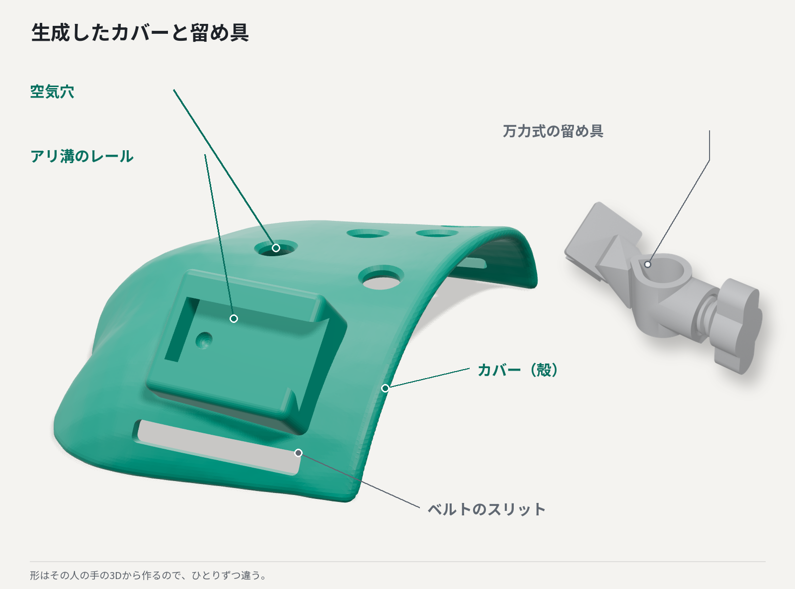

# 部品ライブラリ（OpenSCAD）

> **このドキュメントで決めたこと**
> 1. 部品は、こぶしの外側にかぶせる「カバー」（空気穴・ベルトのスリット・アリ溝のレールを含む1つの部品）と、道具を挟む「万力式の留め具」（受け具とねじ。道具ごと・角度ごとに刷る）にする。留め具は 2026-11-24 に C字クリップから置き換えた（[ADR-0011](adr/0011-dorsal-cover.md)・[ADR-0012](adr/0012-c-clip-dovetail.md)・[ADR-0015](adr/0015-vise-holder.md)）。カバーの殻（`cover_shell.stl`）は生成APIのPythonが手の3Dメッシュから距離場で作り、OpenSCADはそれを `import()` して、スリット・空気穴・レールを付ける。
> 2. 部品の引数の名前・単位・既定値・範囲は、`scad/catalog.json` を唯一の正とする。生成APIの範囲チェック、Geminiへのプロンプト、この表は、すべてそこから作る。寸法はmm、角度は度。
> 3. すき間（カバーとこぶし、アリ溝）、留め具のねじのすき間、最小の厚さ、ふちの丸みなど、着け心地と刷れるかどうかを左右する値は人が固定し、AIには変えさせない。11/9 の試し刷りでは、前の版の3Dモデルで刷ったカバーがメンバーのこぶしに合った。今の版では刷っていないので、値は `catalog.json` で「仮」のまま（2026-11-10）。

関連：[measurement.md](measurement.md)（採寸値と手の3Dメッシュ）、[generation-pipeline.md](generation-pipeline.md)（範囲チェック、殻の作り方）、[ADR-0010](adr/0010-hand-mesh-fusion.md)（手の3Dメッシュ）、[ADR-0011](adr/0011-dorsal-cover.md)（カバー方式）、[ADR-0012](adr/0012-c-clip-dovetail.md)（アリ溝。C字クリップは置き換え済み）、[ADR-0013](adr/0013-clip-angle-variants.md)（角度違い）、[ADR-0015](adr/0015-vise-holder.md)（万力式の留め具）、[notes/2026-11-07-cover-shape.md](notes/2026-11-07-cover-shape.md)（チームのメモ）

---

## 1. 全体の形

- 部品：①カバー（殻＋空気穴＋スリット＋レール。1つのSTL）②万力式の留め具（受け具とねじ。道具の太さと角度ごとに、2つを1枚に並べた1つのSTL）③ベルト（市販の面ファスナー。刷らない）④フェルトかスポンジ（市販。カバーの内側に貼る）
- **座標**：手の座標系（[measurement.md §8.1](measurement.md#81-手の座標系)：原点＝手首の関節、x＝人差し指の付け根→小指の付け根、y＝手首→中指の付け根からx成分を除いた向き、z＝x×y）。殻の計算は正準形（右手は左右反転して左手として扱う。z は手のひら側）で行い、生成APIが最後に右手なら鏡像に戻してから `cover_shell.stl` と位置の値を書く。OpenSCADは**実際の手の座標**のまま描き、`hand` 引数で鏡像は取らない（二重に反転しないため）。そのため、右手と左手のカバーは自然に互いの鏡像になる
- 留め具は、レールの座標（§4.4）で描き、生成APIが `rail_origin`・`rail_frame` で手の座標へ置く。左手は `hand="left"` で描く（鏡に映すと、めねじが左ねじになりねじが入らない。ねじは左右で同じ）
- 印刷の向き：カバーは手のひら側の切り口を下にして刷り、殻の内側にサポートを付ける（殻なので避けられない。跡はフェルトで隠れる）。留め具の受け具は道具の軸を立てた向きで刷り、レールに入る舌の下にサポートが要る。ねじはつまみを下にして刷る（§4.5）。§7

## 2. ファイル構成

| パス | 中身 |
|---|---|
| `scad/main.scad` | 入口（カバー）。全引数の既定値をトップレベル変数で宣言し、`mode` に応じて部品を描く。生成APIは `-D` でこの変数だけを上書きする |
| `scad/vise_main.scad` | 入口（留め具＝万力式）。`mode="clip"` で刷る並び（受け具とねじを1枚）、`mode="assembled"` で手の座標に組んだ形。ねじに使う BOSL2 を、カバーを描くときに読み込まないよう `main.scad` と分けた。`-D` の名前は同じ（`c_clip_tool_d_mm`・`c_clip_angle_deg`・`hand`・`rail_origin`・`rail_frame`・`quality`） |
| `scad/parts/cover.scad` | カバー。`import(cover_shell_file)` で読んだ殻から、スリットと空気穴を引き、レールを足し、最後に `import(cover_keepout_file)`（手を c だけ広げた立体）を引いて、内側の面を守る |
| `scad/parts/strap_slits.scad` | ベルトのスリット（引く形） |
| `scad/parts/air_holes.scad` | 空気穴（引く形。両端の縁を0.8mm面取りする） |
| `scad/parts/rail.scad` | アリ溝のレール（カバー側。溝と、止めの出っ張りを受けるくぼみ）。土台は殻の中へ入り込ませる（`RAIL_FOOT_MM`＝6mm。スリットを避けて台をずらしたときは `rail_foot_mm` で最大12mmまで深くする） |
| `scad/parts/vise_holder.scad` | 万力式の留め具（V字の受け、めねじのボス、T字のつまみのねじ。太さ `tool_d` から挟める範囲と形を決める） |
| `scad/parts/holder_base.scad` | 留め具の土台（レールに入る舌と板、腕。道具の軸の向き。C字クリップの `clip_tongue` をそのまま使う） |
| `scad/parts/c_clip.scad` | もとの C字クリップ。今はレールに入る舌（`clip_tongue`）と、道具の軸の向き（`clip_axis`）を留め具が使う |
| `scad/lib/common.scad` | 固定値（§3）と、角を丸める共通処理 |
| `scad/view.scad` | 確認用画像の描画専用。カバー・留め具のSTLを読み込み、手の3Dメッシュ（`hand_file`、半透明の肌色）と道具の目安（赤い棒）を添える |
| `scad/test_pieces/*.scad` | 試し刷り用の部品（§6） |
| `scad/vendor/BOSL2/` | BOSL2（BSD 2-Clause）。留め具のねじ（台形ねじ M12・ピッチ3mm）を描くのに使う（`vise_main.scad` だけが読み込む） |
| `scad/catalog.json` | 部品と引数の定義（§4の表の元データ）。生成APIとプロンプトが読む |

`-D` で渡す変数の名前は `<部品ID>_<引数名>` とする（例：`cover_edge_radius_mm=2`）。配列は `[12.0,40.5,-8.2]`、真偽値は `true`/`false`、選択肢は `"cover"` のように文字列で渡す。位置と向き（スリット・空気穴・レールの中心と向き）は、生成APIが手のメッシュから計算した値を配列で渡す（§5）。ファイルのパス（`cover_shell_file`、`cover_keepout_file`、`view.scad` の `hand_file`）は、生成APIがジョブの作業フォルダの中に作ったファイルの絶対パスだけを渡す（[generation-pipeline.md §6.3](generation-pipeline.md#63-コマンドの組み立て)）。

**殻はOpenSCADでは作らない**。手の3Dメッシュの面から一定の距離の層を、OpenSCADで作るには `minkowski()` か `offset` が要るが、数千〜1万面のメッシュでは数分〜数十分かかる。距離場で作れば十秒台で、切り口のふちも同時に丸められる（[generation-pipeline.md §6.2](generation-pipeline.md#62-殻cover_shellstlの作り方)）。そのため、**殻（と内側を守る立体）は生成APIのPython、穴・スリット・レール・留め具はOpenSCAD**と分ける。

前の版のファイル `grip_body.scad`・`collet.scad`・`collet_nut.scad`・`thumb_rest.scad`・`strap_slot.scad`・`test_pieces/thread_test.scad`・`carve_test.scad`・`size_gauge.scad` は消す（握りとねじ締め式をやめたため）。

## 3. 固定値（AIは変えられない）

| 名前 | 値 | 単位 | 理由・決め方 |
|---|---|---|---|
| `NOZZLE_MM` | 0.4 | mm | 一般的なノズルの径。大学のプリンタの実際の値は要確認 |
| `MIN_WALL_MM` | 2.0 | mm | ノズル5本分。これより薄い壁は割れやすい。カバーの厚み、スリット・空気穴とふちの間の残りの下限に使う |
| `MIN_EDGE_RADIUS_MM` | 1.5 | mm | 手に当たる所の角の丸みの最小値（安全の決まり「角を丸める」） |
| `MAX_OVERHANG_DEG` | 45 | 度 | サポートなしで刷れる張り出しの上限。カバーの外側に使う（カバーの内側と、留め具の舌の下はサポートを付ける） |
| `HAND_CLEARANCE_MM`（c） | 1.5（仮） | mm | カバーの内側の面と、こぶしの面のすき間。**フェルトの厚みを含む**。採寸のずれと、メッシュが手の形の型に寄る分も吸収する。前の版の「握りのすき間0.5mm」とは役割が違う（握りは手が食い込む前提、カバーはかぶせるだけ）。`clearance_test` で1.0／1.5／2.0を比べる予定だった。11/9 は前の版の3Dモデルのカバーを刷ってこぶしに合ったが、今の版では刷っていないので仮のまま |
| `FELT_THICKNESS_MM` | 1.0（要確認） | mm | 内側に貼るフェルトかスポンジの厚み（市販品）。c に含める。実際の品を決めてから直す |
| `DOVETAIL_CLEARANCE_MM` | 0.25（仮） | mm | アリ溝のすき間（片側）。`dovetail_test` で0.2／0.25／0.3を比べる予定だった。値は仮のまま（2026-11-10） |
| `VISE_SCREW_SLOP_MM` | 0.10 | mm | 留め具のねじのすき間（BOSL2 の `$slop`）。2026-11-24 の試し刷り（PLA）で回った値（`scad/parts/vise_holder.scad`） |
| `VISE_RANGE_MM` | 2.5 | mm | 1つの留め具で挟める太さの幅（聞き取りの太さから上下に） |
| `VISE_DMAX_MIN_MM` | 12 | mm | 受け具の穴の大きさの下限（いちばん太い道具の太さで）。ねじ（直径12mm）が通るため |
| `CLIP_INTERFERENCE_MM`・`CLIP_ENTRY_CHAMFER_DEG`・`CLIP_ROOT_NOTCH_MM`・`CLIP_GROOVE`・`TPU_SLEEVE_WALL_MM` | — | — | C字クリップとTPUの筒の値。留め具を万力式にしてからは使っていない（`catalog.json` には残してある） |
| `WRIST_FREE_MM` | 25 | mm | 手首の関節から、カバーが来てはいけない距離（y の向き）。`wrist_cut_mm` の下限。手首の動きを妨げない（安全の決まり） |
| `THUMB_EXTRA_MM` | 2.0 | mm | 親指のカプセルを、c＋t よりさらに太らせて避ける量（親指を包まない） |
| `CAVITY_VOXEL_MM` | 0.5 | mm | 殻を作るときの距離場の格子の間隔。名前は第1弾のくり抜き（cavity）のまま使う。0.5mmで、くり抜きのスパイクでは約140万点・約12秒 |
| `CAVITY_SMOOTH_SIGMA` | 0.7 | 格子 | 距離場をぼかす量（ガウス、格子の間隔の単位）。表面の点の拾い方によるざらつきを消す |
| `MESH_SUBDIVIDE` | 1 | 回 | 手のメッシュ（約2,300頂点）のループ細分割の回数（`hand-mesh` が行う）。殻の内側に角が出ないようにする |
| `BED_MM` | [180, 180, 180] | mm | 造形できる大きさ。大学のプリンタの実際の値は要確認 |
| `FN_PREVIEW` / `FN_PRINT` | 48 / 128 | 個 | 円の分割数。プレビューは軽く、印刷用は滑らかにする |

やめた固定値：`MIN_WALL_AROUND_BORE_MM`・`COLLET_FINGER_WALL_MM`・`THREAD_PITCH_MM`・`THREAD_SLOP_MM`・`THREAD_LENGTH_MM`・`COLLET_LENGTH_MM`・`COLLET_TAPER_DEG`・`COLLET_TAPER_LENGTH_MM`・`CLAMP_RANGE_MM`・`SLOT_WIDTH_MM`・`MAX_CARVE_RATIO`（握り・ねじ締め式・くり抜きをやめたため）。

## 4. 部品と引数

表の「決め方」：**採寸**＝採寸値と手の3Dメッシュから計算した値（[§5](#5-採寸値との対応)）、**ルール**＝固定の式、**聞き取り**＝聞き取りの結果、**AI**＝Geminiが要望を見て決める、**ユーザー**＝ユーザーが画面で選ぶ、**固定**＝AIもユーザーも変えない。

「AIが変えてよい幅」は、サーバーが計算した基準値（baseline）から、Geminiが動かしてよい量を表す。これを超えると範囲チェックで止まる（[generation-pipeline.md §4](generation-pipeline.md#4-範囲チェック)）。

### 4.1 カバー本体 `cover`（必須）

殻の層は `c ≤ sdf(p) ≤ c + t`（`sdf` は手の3Dメッシュからの符号付き距離、手の中が負。c＝`HAND_CLEARANCE_MM`、t＝`cover_thickness_mm`）。そこから次の所を捨て、**なめらかな共通部分**（半径 `edge_radius_mm`）で丸める。切る面と位置の元になる目印（`z_pip`・`wrist_cut_mm`・`x_index` など）は [measurement.md §8.3](measurement.md#83-カバーの目印手の座標系の上) で決める。下の表の1行目・4〜6行目はその目印による面、2・3行目は、手のひらと指を確実に開けておくために、この章で足した決まり。

| 捨てる所 | 決め方 | 理由 |
|---|---|---|
| 手のひら側 | PIP関節の中心の高さの平均 `z_pip`（ただし指の付け根の関節の中心の高さ＋8mm を超えない：`min(z_pip, z_mcp + 8)`）＋ `palm_cut_offset_mm` より手のひら側（z が大きい側） | 手のひら側を開ける。握りこぶしでは、PIP関節がこぶしの一番前の角になるので、その中心までを覆えば、指の背と関節の出っ張りに沿う |
| 手のひらを向いた面の上 | 一番近い手の面の向きが、手のひら側（正準形の +z）から65度以内の所（描いたあとの検査 R6c は50度で見る。余裕を取る） | **平面だけでは手のひらが開かない**：握りこぶしでは、PIP関節は手のひらの皮膚より手のひら側（z が大きい側）に来るので、`z_pip` の平面より手の甲側に、手のひらの皮膚とその上の殻の層が入ってしまう。少し曲がっている人では、指の腹の側まで殻が回り込む（指を包む形になる）。そのため、手のひらと指の腹を向いた面の上は、平面と別に必ず捨てる |
| 指の上（基節から先） | 手の甲の骨（手首→付け根）より、指の骨（基節・中節・末節）に近い所。こぶしの山（付け根の関節）は二等分の面から3mmだけ覆う | 指先側を覆わない。指を固定する形（装具）にしない |
| 手首側 | 手首から y の向きに `wrist_cut_mm` より手首側 | 手首を覆わない |
| 親指のまわり | 親指のカプセルを c＋t＋`THUMB_EXTRA_MM` だけ太らせた所 | 親指を包まない |
| 人差し指側の外 | 人差し指の付け根から、人差し指の太さ＋c＋t より外（x の小さい側） | 親指の付け根のふくらみを覆わない |

| 引数 | 単位 | 既定値 | 範囲 | 決め方 | AIが変えてよい幅 |
|---|---|---|---|---|---|
| `cover_thickness_mm`（t） | mm | 2.5 | 2.0〜3.5 | AI | 範囲内なら自由 |
| `palm_cut_offset_mm`（手のひら側を切る面の位置。負にすると手の甲の側へ寄り、カバーが小さくなる） | mm | 0 | −8〜+8 | AI | 範囲内なら自由（正にしても、手のひらを向いた面と中節より先は2・3行目の決まりで捨てるので、手のひらと指先は覆わない） |
| `wrist_cut_mm`（手首から、カバーが始まるまでの距離） | mm | 手首→中指の付け根の長さ（`|0-9|`）の40% | `WRIST_FREE_MM`（25）以上、かつ `|0-9| − 15` 以下 | 採寸 | ±10（範囲の中で） |
| `edge_radius_mm`（ふちと切り口の丸み） | mm | 2.0 | 1.5〜4 | AI | 範囲内なら自由（1.5未満は不可） |
| `shell_file`（殻。手の座標、mm、閉じた面のSTL） | パス | — | 生成APIが作業フォルダに作った `cover_shell.stl` だけ | 採寸（生成APIが作る。[generation-pipeline.md §6.2](generation-pipeline.md#62-殻cover_shellstlの作り方)） | 変えられない（Geminiの出力にも含めない） |
| `keepout_file`（手を c だけ広げた立体。内側の面を守る） | パス | — | 生成APIが作った `cover_keepout.stl` だけ | 採寸 | 変えられない |

- 殻の形（`cover_shell.stl`）は、手のメッシュと c・t・`palm_cut_offset_mm`・`wrist_cut_mm`・`edge_radius_mm` で決まる。この5つのどれかを変えたら作り直す（10〜40秒の見込み）。空気穴・スリット・レール・留め具だけの変更では作り直さない
- `keepout_file` は手のメッシュと c だけで決まり、採寸の版ごとに1回作る

### 4.2 空気穴 `air_holes`（必須）

| 引数 | 単位 | 既定値 | 範囲 | 決め方 | AIが変えてよい幅 |
|---|---|---|---|---|---|
| `count` | 個 | 6 | 0〜10 | AI | 範囲内なら自由 |
| `diameter_mm` | mm | 6 | 4〜8 | AI | 範囲内なら自由 |
| `centers`・`normals`（穴の中心と向き） | mm[n][3] | — | — | ルール（生成APIが手のメッシュから計算。§5） | 変えられない |

穴はカバーの面に垂直に開け、両端の縁を0.8mm面取りする（尖った縁を残さない）。

### 4.3 ベルトのスリット `strap_slits`（必須）

| 引数 | 単位 | 既定値 | 範囲 | 決め方 | AIが変えてよい幅 |
|---|---|---|---|---|---|
| `strap_width_mm`（ベルトの幅） | mm | 25 | 20／25／38 から選ぶ（市販の面ファスナーの幅） | AI・ユーザー | 選択肢の中で自由 |
| `strap_count`（ベルトの本数） | 本 | 1 | 1（2026-11-08 に固定。2本にするとスリットがカバーのふちやレールにかかって切れるため） | 固定 | 変えられない |
| `strap_thickness_mm`（ベルトの厚み） | mm | 2.0 | 1.5〜3.0 | AI（買う品が決まったら固定にする） | 範囲内なら自由 |
| `centers`・`axes`（スリットの中心と向き） | mm[2×本数][3] | — | — | ルール（§5） | 変えられない |

スリットの穴の大きさは、`strap_width_mm + 1.0` × `strap_thickness_mm + 1.5`。親指側と小指側の**側面の壁**の手のひら寄りに1つずつ（2本なら2つずつ）、横向きに開け、ベルトが手の幅の向きに手のひら側を通るようにする。手の甲側の角には開けない（レールの台がある所。2026-11-08）。穴の縁とレールの台の間は `MIN_WALL_MM` 以上あけ、台がスリットにかかるときは、台のほうを手の甲側へずらす。穴が実際に開いているかは描いたあとに `R6e_slit_open` で確かめ、`R6e_slit_rail`（描く前の箱どうしの距離）は目安として知らせる（§5。2026-11-10）。

### 4.4 アリ溝のレール `rail`（必須）

| 引数 | 単位 | 値 | 決め方 |
|---|---|---|---|
| `width_mm`（溝の口の幅） | mm | 10 | 固定 |
| `depth_mm`（溝の深さ） | mm | 4 | 固定 |
| `length_mm` | mm | 24 | 固定 |
| `dovetail_deg`（アリ溝の角度。溝の壁と底のなす角） | 度 | 60 | 固定 |
| `detent_mm`（止めの出っ張りの高さ。留め具側に凸、レール側にくぼみ） | mm | 0.6 | 固定 |
| `origin`・`frame`（レールの位置と向き） | mm[3]・[3][3] | — | ルール（§5：人差し指の中手骨の、親指側かつ手の甲側の外面。長さの向きは手の y（手首→指先）、外向きは正準形の −x と −z の間の45度に固定） |

- レールは、留め具を差し替える受け口なので、寸法は全部固定にし、AIには変えさせない（すべての留め具と合わなくなるため）。すき間 `DOVETAIL_CLEARANCE_MM` は留め具の凸（舌）の側で取る
- 土台は殻の中へ `RAIL_FOOT_MM`（6mm）入り込ませて一体にし（スリットを避けて台をずらしたときは `rail_foot_mm` で最大12mm）、内側へ出た分は `keepout_file` で削る（手に当たらない）。手のひら側の面より先に出た角も `cover_palm_plane` で切る
- レールの両端と角は `MIN_EDGE_RADIUS_MM` 以上で丸める。溝は手首側（−Y）の端が開き、指先側の端は閉じている。留め具は手首側の端から溝に沿って差し込む。止めのくぼみは、閉じた端の壁から3mmの位置

### 4.5 万力式の留め具 `c_clip`（必須）

2026-11-24 に C字クリップから置き換えた（[ADR-0015](adr/0015-vise-holder.md)）。部品の ID と引数の名前は今まで通り `c_clip`。V字の受けに道具の柄を寄せ、T字のつまみの付いたねじで押し付けて挟む。ねじで締めるので、刷りの誤差が締まり具合に効かない。

| 引数 | 単位 | 既定値 | 範囲 | 決め方 | AIが変えてよい幅 |
|---|---|---|---|---|---|
| `tool_d_mm`（道具の柄の太さ） | mm | 聞き取りの値 | 3〜20 | 聞き取り | 変えられない |
| `angle_deg`（道具の立て具合＝机に対する傾き） | 度 | やりたいことから（§5） | 60／70／80 | AI（理由を書く）・ユーザーがプレビューで変えられる | 選択肢の中で自由 |
| `count`（留め具の数） | 個 | 1 | 1〜2 | AI（先が細くなる筆の柄なら2を勧める） | 範囲内なら自由（レールは1本なので、2個目は同じ形の予備。形の計算では使っていない） |
| `inner_d_mm`・`wall_mm`・`opening_ratio`・`height_mm`・`grip_ribs`・`tpu_sleeve` | — | — | — | 固定（C字クリップの引数。万力式では使わない） | 変えられない |

- **挟める太さ**：`tool_d_mm ± 2.5mm`。ただし受け具の穴は、ねじ（直径12mm）が通る大きさ（いちばん太い道具12mm用、穴の径13mm）より小さくしない。そのため、聞き取りの太さが9.5mm以下なら上限は12mm。細い道具（挟める下限が約5.4mm未満）では、ねじの先を直径6mmに細くして、V字の奥まで届かせる
- **形**：受け具は、手の側（レールの側）を90度のV字にした穴と、外側（親指側）に伸ばしためねじのボス（台形ねじ M12・ピッチ3mm、すき間 `$slop` 0.10）。高さ（道具を挟む長さ）は20mm、穴のまわりの肉は2.5mm。ねじは長さを「いちばん細い道具に届き、つまみが受け具から3mm離れる」に合わせ、T字のつまみ（長さ32mm・太さ9mm）を付ける
- **置き場所**：受け具の中心はレールの上面の中心から**親指側へ26mm・手のひら側へ6mm・指先側へ5mm**（穴が12mm用のとき）。手の側の端（腕を付ける所）は太さによらず同じ所に置き、太い道具では外へ広げる（手との距離が変わらない）。レールの座標では 手の甲向き＝`[s·side, 0, s]`、親指側＝`[−s·side, 0, s]`、指先向き＝`[0, 1, 0]`（s＝1/√2、side は右手 +1・左手 −1）
- **角度**：机に手の甲を上にして置いた姿勢での、机に対する道具の傾き（90度が垂直）。道具の軸＝`指先向き·cos(角度) − 手の甲向き·sin(角度)`。道具はこぶしの親指側の横を通り、人差し指の付け根の横あたりで机に届く（[ADR-0013](adr/0013-clip-angle-variants.md)）。描いたあとに R6h で手・カバーとのすき間と、机までの長さ（留め具から120mm以内。道具を差し込む深さを変えられるため）を測る
- **刷る向き**：受け具は道具の軸を立てて刷る（めねじの山を崩さないため）。ねじのボスの下は45度の斜面で机まで伸ばしてあるので、サポートはレールに入る舌の下だけ。ねじはつまみを下にして立てて刷る。印刷用のSTLは、受け具とねじを1枚に並べた1つのファイル
- **生成**：生成のたびに `scad/vise_main.scad` で描く（1つ0.5秒ほど）。C字クリップのときの、先に作っておいた固定STLのライブラリ（`cliplib`）はやめた。描いたあと、閉じた立体で受け具とねじの2つになっているかを R6f で確かめる
- 角度ごと・道具ごとに別のSTLにする。差し替えて使い分けられる

### 4.6 TPUの筒 `tpu_sleeve`（使わない）

C字クリップの輪の内側に入れる部品だった。留め具を万力式にしたので作らない（AIが選んでも生成APIが外す。2026-11-24）。

### 4.7 全体の引数（`main.scad`）

| 引数 | 選択肢 | 既定値 | 意味 |
|---|---|---|---|
| `hand` | `right` / `left` | `right` | 選択式Q2の答え。記録と確認用。形の鏡像は、生成APIが殻と位置の値で済ませている（§1） |
| `mode` | `cover` / `clip` / `assembled` | `assembled` | `cover`・`clip`＝その部品だけを、刷る向きで描く（ダウンロード用）。`assembled`＝手の座標に置いた状態（プレビューと確認用画像）。カバーは `main.scad`、留め具は `vise_main.scad` で描く。生成APIは部品ごとに別々に描く |
| `part` | `cover` / `c_clip` | `cover` | `assembled` のときに描く部品 |
| `quality` | `preview` / `print` | `preview` | 円の分割数（§3） |

### 4.8 組み合わせのルール（範囲チェックのR4・R5）

- `wrist_cut_mm ≥ WRIST_FREE_MM`（手首を覆わない。安全のルールなのでR5）。`wrist_cut_mm ≤ |0-9| − 15`（指の付け根の関節の山を覆える長さを残す）
- `edge_radius_mm ≥ MIN_EDGE_RADIUS_MM`、かつ `edge_radius_mm ≤ cover_thickness_mm × 1.5`（厚みに比べて丸みが大きすぎると、ふちが細くなる）
- 留め具：`tool_d_mm` は 3〜20mm。形の引数は固定なので、組み合わせのルールはない（描いたあと R6f で、閉じた立体で受け具とねじの2つになっているかを確かめる）
- スリット：2本のとき、2つのスリットの間を `strap_width_mm + 8` 以上あける。スリットとカバーのふちの間は `MIN_WALL_MM` 以上（位置はルールで決めるので、描いたあとのR6で確かめる）
- 空気穴：穴どうしは4mm以上、穴と関節の山・スリット・レールの間は6mm以上（[measurement.md §8.3](measurement.md#83-カバーの目印手の座標系の上)）、穴とふちの間は `MIN_WALL_MM` 以上（ルールで位置を決めるとき守る）
- 造形サイズ：カバーの外形と、留め具を刷る並びの外形が `BED_MM` に収まる（描く前は手のメッシュの外接箱から見積もり、描いたあとR6で確かめる）

## 5. 採寸値との対応

生成APIは、Geminiに聞く前に、採寸値と手の3Dメッシュから基準値（baseline）と位置を計算する。Geminiはこの基準値を、§4の「AIが変えてよい幅」の中で調整し、理由を付けて返す。位置（スリット・空気穴・レール・切る所）はGeminiに渡さず、変えさせない。

採寸値は [measurement.md §12](measurement.md#12-出力するjsonmeasurement22)。手の3Dメッシュは、`hand-mesh` が作ったものを、1円玉で測った手の甲の長さで実寸にしたもの（[measurement.md §8](measurement.md#8-手の3dメッシュ)）。

| 部品の引数 | 計算式 | 使う値 | 理由 |
|---|---|---|---|
| `cover.wrist_cut_mm` | `clamp(0.40 × |0-9|, WRIST_FREE_MM, |0-9| − 15)` | 手首→中指の付け根の長さ（メッシュの関節） | 手の甲の手首側の約4割は覆わず、手首を自由にする。40%は仮の値（今の版のカバーではまだ着けて確かめていない。2026-11-10） |
| `cover` の目印（`z_pip`・`x_index`・親指のカプセル） | [measurement.md §8.3](measurement.md#83-カバーの目印手の座標系の上) のとおり | 手の3Dメッシュの関節 | §4.1 |
| `cover.cover_thickness_mm` | 2.5（既定） | — | 2.0mm（ノズル5本分）に余裕を足した。軽さを求める要望があればAIが薄くする |
| `strap_slits.centers`・`normals` | 親指側と小指側の側面で、y ＝ **手ごとの「手のひらだけを通る通り道」の真ん中**（親指の下にベルトをくぐらせられ、曲げた指先がまだ来ない範囲。[measurement.md §8.3](measurement.md#83-カバーの目印手の座標系の上)。2026-11-08。見つからなければ 70%、2本なら45%と72%。上限・下限はふちの肉を残す所）、高さ ＝ 手のひら側のふちから `MIN_WALL_MM`＋スリットの半分＋`edge_radius_mm`＋0.5mm 手の甲側。その高さでいちばん外側の点を、壁の中ほどまで寄せる。抜く向きは外面の法線（下向き成分は0.7までに抑え、横〜斜め下へ抜く）。描いたあとに、穴の中の点がカバーの中にないか（穴が開いているか）を測り、10%を超えてふさがれていれば `R6e_slit_open`（警告）にして `needs_attention`（開いた穴でも縁の近くが3〜5%ほど「中」と出るため。2026-11-10 に2%から変えた）。描く前の箱どうしの距離 `R6e_slit_rail` は目安（情報）。**スリットにレールの台がかかるとき**は、スリットは動かさず、台の向きは変えずに台を手の甲側へ1mmずつずらし、1mm以上離れる所に置く（2026-11-10）。ずらすと道具も握った指へ近づくので、主な取り付け具の角度で太さ11.5mmの道具が手から2mm以上離れ（ずらす前に足りなければそれより近づかず）、机に届く（留め具から120mm以内）所まで（最大20mm）。台が面から傾くので、溝の下に殻が来ない高さまで持ち上げ、浮いた側は土台（`rail_foot_mm`、ふつう6mm、最大12mm）を深くして殻に届かせる。離しきれなければずらさない（途中までずらしても穴は開かず、道具だけが近づいた） | 手の3Dメッシュ、殻、レールの位置 | 中手骨の中ほどで、ベルトが関節にかからず、手のひらの真ん中を通る。手の甲側の角にあるレールの台と重ならない（2026-11-08。前は角に置いて塞がれた） |
| `strap_slits.axes` | y の向き（スリットの長い辺が手首→指先の向き） | — | ベルトが手の幅の向きに回る |
| `air_holes.centers` | [measurement.md §8.3](measurement.md#83-カバーの目印手の座標系の上) の範囲（手の甲で、y ＝ `wrist_cut_mm + 8` 〜 付け根の y の最小値 − 10）に格子状に候補を置き、§4.8 の間隔を守るものから `count` 個を選ぶ。向きはカバーの外面の法線 | 手の3Dメッシュ、殻 | 汗がこもりやすい手の甲に開け、関節の山・スリット・レールは避ける |
| `rail.origin`・`rail.frame` | 人差し指の中手骨（手首→付け根）の72%の点から、親指側かつ手の甲側（正準形で −x と −z の間の45度の向き）へ光線を出し、その近く（3mm以内）にあるカバーの外面の点のうち一番遠いものを台の置き場にする（見つからなければ基節の半径＋c＋t だけ進んだ点）。原点はそこからレールの高さだけ外の、溝の口の中心。レールの長さの向きは手の y（手首→指先）、外向きは上の45度の向きに固定する（2026-11-08。前は基節・中手骨の向きにしていたが、手ごとに留め具の向きがずれたため。`api/app/geometry/handframe.py` の `rail_direction`）。スリットにかかるときは台を手の甲側へずらす（上の `strap_slits` の行） | 手の3Dメッシュの関節、殻 | 筆先が人差し指の指先の近くに来る位置に道具を付ける（メモ §3.4）。握りこぶしで基節の外面が平らに近い所 |
| `c_clip.tool_d_mm` | 聞き取りの値そのまま | 選択式Q3（道具の太さ、mm） | 道具の太さに合わせた留め具を刷る（手だけでなく道具にも合わせる）。1つで太さ±2.5mmを挟める |
| `c_clip.angle_deg` | `brush`（絵・字）＝70、`pen`＝60、`spoon`＝60（AIがやりたいことと理由から、60／70／80の中で選び直してよい。2026-11-08） | 選択式Q1・道具の種類 | 筆は立て気味、ペンは少し寝かせる。スプーンは未検証。値は仮のまま（2026-11-10。`api/app/attachments.py` の `ANGLE_BY_TOOL`）。取り付け具が複数のときは、取り付け具ごとに決める（[ADR-0014](adr/0014-multiple-attachments.md)） |
| `c_clip.count` | 1（先が細くなる筆の柄なら、AIが2を勧めてよい） | 道具の種類、チャットのメモ | 筆の柄は先へ向かって細くなるので、太さがほぼ一定の所を2か所で挟む |
| `strap_slits.strap_count` | 1（固定。2026-11-08 のチームの決定） | — | 2本にするとスリットが切れるため |
| `hand` | そのまま | 選択式Q2の `hand_side` | — |

## 6. 試し刷り用の部品

> 2026-11-24 追記：留め具を万力式にした。チームで万力式の試作（右手・70度・太さ6〜12mm用）を刷り、元の自助具に付けてペンをしっかり挟めることを確かめた（PLA、ねじのすき間 `$slop` 0.10）。下の `clip_test.scad` は C字クリップ用の記録。

プリンタは11/9・11/10だけ使える。11/7 の計画では、11/9の朝いちばんにクリップとアリ溝の小さな試作を刷り、結果で固定値（§3）を決めてから、アプリで作ったカバーの1回目を刷る予定だった（[tasks.md §3](tasks.md#3-日程)）。

> 2026-11-10 追記：11/9 の試し刷りでは、前の版の3Dモデルで刷ったカバーが、メンバーのこぶしに合った。今の版では刷っていない。そのため、§3 のすき間・しめしろ・アリ溝のすき間は、`catalog.json` で「仮」のまま。下の試し刷りの部品は、値を決めるときに使う。

| ファイル | 目的 | 内容 | 刷る順 |
|---|---|---|---|
| `test_pieces/holder_test.scad` | 留め具（万力式）を刷って試す（2026-11-24 に、右手・70度・太さ6〜12mm用を刷って確かめた） | `part="vise"`（受け具。刷る向き）・`part="vise_screw"`（ねじ）を、`tool_d_mm`・`angle_deg`・`hand` を変えて出す。`part="rail_stub"` でレールの短い台も出せる | 済 |
| `test_pieces/clip_test.scad` | クリップの押し込みやすさ・保持・割れにくさと、しめしろを決める | デモで使う筆の柄の太さで、壁の厚さ1.6／2.0／2.4mm × しめしろ0.2／0.3／0.4mm の9個（本番と同じく舌の底を下にする向き）。数字を刻む。それぞれ数十回着け外しして、押し込む力・ひびの入り方・筆が回らないかを比べる。家族や介護する人が片手で楽に扱えるかも見る | 1 |
| `test_pieces/dovetail_test.scad` | アリ溝のすき間と、止めの「カチッ」を決める | レールの短い台（長さ24mm）を、すき間0.2／0.25／0.3mmの3個と、それぞれに合うクリップの凸だけの部品。滑らせやすさ、がたつき、勝手に抜けないかを比べる | 2 |
| `test_pieces/clearance_test.scad` | カバーとこぶしのすき間 c を決める | Bさんの手をアプリで撮って作った実寸の手のメッシュから、人差し指と中指の付け根の関節の山のまわりだけを、c ＝ 1.0／1.5／2.0mmで切り出した小さな殻を3個。フェルトを貼ってかぶせ、当たり・ゆるさを比べる | 3 |
| `main.scad`（アプリで作った値） | カバー全体の1回目と、筆のクリップ | 11/8の通しのテストでアプリが作ったSTL。試し刷りで決めた固定値を入れてから描き直す | 4（試し刷りのあと） |

## 7. 推奨の印刷設定

| 項目 | カバー | 万力式の留め具（受け具とねじ） |
|---|---|---|
| 材料 | PLA | PETGが望ましい（ねじが粘り強くなる）。PLAでも刷れて使えた（2026-11-24 の試し刷り） |
| 刷る向き | 手のひら側の切り口を下にする | ファイルの向きのまま（受け具は道具の軸が縦、ねじはつまみが下） |
| サポート | 殻の内側に付ける（木の形のサポート）。外側は付けない | 受け具のレールに入る舌の下に付ける。ねじは要らない |
| 積層の厚さ | 0.2 mm | 0.2 mm |
| 外壁の数 | 3 | 4以上（ねじ山が中まで詰まる） |
| 充填 | 15%、ジャイロイド | 40%以上 |
| ブリム | 5 mm（切り口の接地面が細いため） | なし |

- 大学のプリンタでPETGが使えるかは要確認（未決事項）
- 刷ったあと、カバーの内側のサポートの跡をやすりで落とし、フェルトかスポンジを貼る（印刷ガイドに書く）

## 8. 安全のための作り込み

[ADR-0011](adr/0011-dorsal-cover.md) の安全の決まりを、形でこう守る。

- **握った指を無理に開かせない**：カバーは手の面から c 離れた外側にかぶせるだけにする。内側の面が手に食い込まないことを、描いたあとに確かめる（R6e）
- **手のひら側は必ず開ける（装具にしない）**：手のひら側の切る面（`z_pip` の平面）に加えて、手のひらと指の腹を向いた面の上を必ず捨てる（§4.1。平面だけでは握りこぶしの手のひらが開かないため）。描いたあと、切る面より手のひら側に材料がないこと、手のひらを向いた面の上に材料がないことを自動で確かめる（R6c）。中節・末節は覆わず、指を固定する形にしない
- **手首を覆わない**：`wrist_cut_mm ≥ 25`。描いたあと、手首から25mm以内に材料がないことを確かめる（R6d）
- **角はすべて丸める**：殻のふちと切り口は、距離場のなめらかな共通部分で半径 `edge_radius_mm`（1.5mm以上）に丸める。空気穴の縁は0.8mm面取りし、スリットの穴は角を1.0mm丸めた長方形にする（縁の面取りはない）。レールの角は1.5mm以上で丸める。留め具のねじの先は面取りする
- **内側にフェルトかスポンジを貼る**：すき間 c にフェルトの厚みを含めてある。印刷ガイドとダウンロードの画面で、貼り方を案内する
- **痛みや赤みが出たら使うのをやめる**：ダウンロードの画面と印刷ガイドで案内する
- **口に入れる部品は作らない**：スプーンを挟む場合、刷った部品が口に入らないよう、留め具から柄が60mm以上出るように画面で案内する（要検証）
- **使う前にOTが確かめる**：これまでどおり（デモのケースは除く）。可能なら試し刷りの段階で一度見てもらう
- 刷ったあと、留め具に道具を差してねじを締め、強く引いても抜けないこと、カバーに留め具を差して「カチッ」と止まり勝手に抜けないことを確かめるよう、印刷ガイドに書く。ねじが緩んだら締め直す
