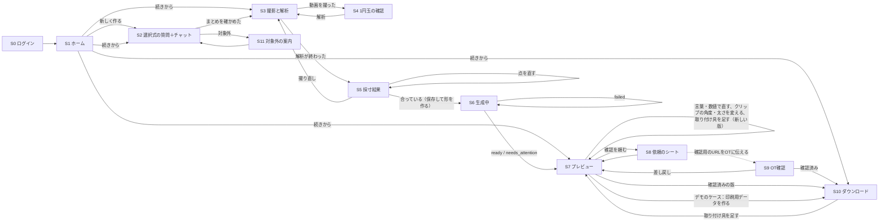

# 画面の仕様

> **このドキュメントで決めたこと**
> 1. 画面は12枚（S0〜S11）。**スマホ1台で最後まで使える**ようにする（3D表示も2本指で回せる）。PCは、大きく見たいときや印刷するときに使えばよい。
> 2. PCで続きを見るときは、同じGoogleアカウントでログインする。動画は保存しないので、PCには採寸の数値と手の3Dメッシュ（写真ではない）だけが見える（切り抜いたフレームは手の3Dを作るためだけに `hand-mesh` に送り、保存しない）。撮影はPCのWebカメラでもできる。
> 3. 指が不自由な人や片手で操作する人のために、細かいタップは求めない。操作は大きなボタンとドラッグだけにし、文字入力にはいつも選択肢を添える。家族や支援者が代わりに操作してよいことを、撮影・点の修正・クリップの付け外しの画面で示す。

関連：[architecture.md](architecture.md)、[api.md](api.md)、[measurement.md](measurement.md)、[parts-library.md](parts-library.md)、[ADR-0011](adr/0011-dorsal-cover.md)（こぶしにかぶせるカバー）、[ADR-0012](adr/0012-c-clip-dovetail.md)（C字クリップ＋アリ溝）、[ADR-0013](adr/0013-clip-angle-variants.md)（角度違いのクリップ）

---

## 1. 画面の一覧と遷移

| ID | 画面 | パス | 主に使う端末 | 使う人 |
|---|---|---|---|---|
| S0 | ログイン | `/login` | 両方 | 全員 |
| S1 | ホーム（ケース一覧） | `/` | 両方 | 本人・家族 |
| S2 | やりたいこと（選択式の質問＋任意のチャット） | `/cases/:caseId/interview` | 両方 | 本人・家族 |
| S3 | 撮影と解析 | `/cases/:caseId/capture` | スマホ（PCのWebカメラでもよい） | 本人・家族・OT |
| S4 | 1円玉の確認 | なし（S3の上に重ねる画面。URLは `/cases/:caseId/capture` のまま） | 両方 | 同上 |
| S5 | 採寸結果の確認と点の修正 | なし（S3の上に重ねる画面。URLは `/cases/:caseId/capture` のまま） | スマホ | 同上 |
| S6 | 生成中 | `/cases/:caseId/designs/:designId`（生成が終わるまで） | 両方 | 本人・家族 |
| S7 | プレビューと微調整 | `/cases/:caseId/designs/:designId`（生成が終わったあと） | 両方 | 本人・家族 |
| S8 | OTに確認を頼む | S7の上に下から出すシート | 両方 | 本人・家族 |
| S9 | OT確認 | `/review/:caseId` | PC | OT |
| S10 | ダウンロードと印刷ガイド | `/cases/:caseId/designs/:designId/print` | 両方（印刷するのはPC） | 本人・家族・OT |
| S11 | 対象外の案内 | S2の上に重ねるダイアログ | 両方 | 本人・家族 |

- ログインしていない状態で `/login` 以外を開いたら、S0に移り、ログイン後に元のパスへ戻す
- S1の「続きから」は、ケースの `status` を見て行き先を決める（`interviewing`→S2、`measuring`→S3、`designing` 以降→S7、`approved`→S10）。`designing` で版がまだない場合（生成の前に画面を閉じた、生成に失敗したなど）は、S7の空の状態から「形を作る」を押せるようにする
- S3〜S5の途中でページを再読み込みすると、動画と写真は消える（保存しないため）。その場合はS3からやり直す。角度の計算（`hand-mesh`）に失敗したときも同じで、採寸は保存されず、ケースは `measuring` のまま。採寸を保存したあとなら、数値は残る
- 生成中・承認中のケースを開き直したら `POST /recover` を呼び、期限切れの処理を回収してから画面を決める。有効な処理があれば待機表示へ戻り、新しい生成を自動で開始しない

## 2. 共通のルール

| 項目 | 決めたこと | 理由 |
|---|---|---|
| ボタンの大きさ | 押せる範囲は48×48px以上。主なボタンは画面の下に置き、幅いっぱいに広げる | 指の曲がった手や、利き手でない手でも押せるように |
| 文字 | 本文は16px以上。色だけで意味を伝えない（アイコンと文字を添える） | 見えにくい人と色覚の多様性への配慮 |
| 文字入力 | 入力欄には必ず選択肢を添える。音声入力はOSのキーボードの機能を案内する | 文字を打つのが難しい人のため |
| 読み上げ | 読み上げ用の情報（semantics）は、読み上げを使う人が「Enable accessibility」を押したときに有効になる（Flutter Web の既定）。起動時に常に有効にするのは 2026-11-09 にやめた | 常に有効にすると、画面が変わるたびの計算が約25%増え、スマホが重かったため（[adr/0002](adr/0002-frontend-flutter-web.md)） |
| 読み込み中 | 1秒を超えそうな処理では、何をしているかを文で出す（例：「手の形を調べています」）。くるくる回るだけの表示は使わない | 待つ理由が分かると安心できる |
| エラー | [api.md §5](api.md#5-エラー) の `message` をそのまま出す。`retryable` なら「もう一度試す」ボタンを出す | — |
| 再送 | 生成・微調整・依頼・承認のボタンは、送信してから結果が出るまで押せなくする。通信が切れたら、勝手に送り直さず、まずFirestoreの版の状態を読む。処理が続いていれば待ち、失敗が確定していれば「もう一度試す」を出す | 二重に処理して、費用が増えないように |
| 端末の案内 | スマホだけで最後まで使える。PCでもS3の「カメラで撮る」でWebカメラを使える（PC用の別の画面や、スマホに切り替える選択の画面はない）。撮り方の手順の最後に「PCで撮るときは、ノートPCを持って同じように動かします。動かしにくいときは、スマホで撮るのがおすすめです」と出す（2026-11-10 に実装に合わせた） | スマホしか持たない人も、PCしか手元にない人もいるため。手を動かすと、手の形が変わってしまうため |
| デモの表示 | デモのケース（`demo: true`）では、S7・S10の上に「デモ用：OTの確認を省略しています。実際に使う前には、必ず作業療法士の確認が必要です。」と常に出す | 審査とデモで最後まで見せつつ、安全の約束を誤解させないため |
| 言葉 | 医療の専門用語は使わない（例：「MP関節」ではなく「指の付け根」）。OT向けのS9だけは専門用語を併記する | — |

## 3. 各画面

### S0 ログイン

| 項目 | 内容 |
|---|---|
| 役割 | Googleアカウントでログインする |
| 入力 | 「Googleでログイン」ボタン |
| 表示 | アプリ名のロゴ画像（`assets/images/logo.png`。2026-11-10 に、手のアイコンと文字のアプリ名から変えた）と、その下のGoogleの4色の線（飾り）。ひとことの説明（「スマホで撮ったこぶしの形から、筆やペンを持つためのカバーを作ります」）。「1. 聞く」「2. 撮る」「3. 刷る」の3つの手順。「手の動画は保存しません。手の3Dの形を作るために、手の部分を切り抜いた画像を最大8枚だけ送ります（画像は保存しません。作った手の3Dの形は保存します）」という約束。ボタンの下に「作業療法士（OT）の確認を通してから印刷できます」 |
| 読み込み中 | ポップアップの完了を待つ間、ボタンを押せない状態にする |
| エラー | ポップアップがブロックされたら、許可の方法を案内する |
| 遷移 | 成功したら元のパス、なければS1へ |

### S1 ホーム（ケース一覧）

| 項目 | 内容 |
|---|---|
| 役割 | 自分のケース（自分が持ち主のケース）を一覧し、新しく作るか続きから始める |
| 入力 | 「新しく作る」ボタン、ケースのカード、カードの右のメニュー（「消す」）、右上のアカウントのボタン（名前と「ログアウト」） |
| 表示 | 上の大きなタイトルは、アプリ名のロゴ画像（`assets/images/logo.png`。2026-11-10）。見出し「作りかけ・作った道具」の下に、ケースごとに、タイトル、状態（「聞き取り中」「撮影を待っています」「形を作る前」「形を確かめています」「確認待ち」「確認済み」。最新の版が差し戻されていれば「差し戻し」）、最新の版の小さな画像（`views/iso.png`。なければ状態のアイコン）、更新日時。一覧の下に「PCで大きく見たいときは、同じGoogleアカウントでログインしてください。」 |
| 読み込み中 | カードの形の灰色の枠を3つ出す |
| 空の状態 | 「まだ道具がありません」「やりたいことを教えてください。質問に答えて手を撮ると、形ができます。」と、大きな「新しく作る」ボタン（ケースがあるときは、右下の浮いたボタン） |
| エラー | 読み込めなかったら「読み込めませんでした（…）」と「もう一度試す」ボタン |
| 遷移 | 「新しく作る」→ `POST /v1/cases` → S2。カード → §1のルールで行き先を決める |
| 消す | カードのメニューの「消す」→ 確かめるダイアログ（「『タイトル』を消します。手の3Dの形、作った形、印刷用のデータもすべて消えます。消したあとは元に戻せません」。OTに確認を頼んでいる途中なら「消すと、OTも見られなくなります」も添える）→「消す」で `DELETE /v1/cases/{case_id}` → 一覧から外し、「消しました」と出す。形を作っている途中は消せない（409のエラーの文を出す） |

### S2 やりたいこと（選択式の質問＋任意のチャット）

寸法に効く基本の情報は、選択式の質問で聞く。それ以外の伝えたいことだけを、Geminiとのチャットで受ける。

理由：
- 指が曲がったままの人や片手で操作する人には、文字を打つよりボタンを1回押すほうがずっと楽
- 答えが決まった値になるので、AIの読み間違いがなく、そのまま部品の寸法に使える
- Geminiを呼ぶ回数が減り、待ち時間と費用が減る
- iPhone Safariの日本語入力の不具合に当たる場面が減る

**S2a 選択式の質問**（1画面に1問、大きなボタン、上に「質問 3 / 7」の進み具合、「戻る」で前の質問に戻れる。道具を2つ以上選ぶと、Q3・Q4が道具ごとに出るので、全体の数が増える（例：道具2つなら「3/9」）。2026-11-09、[ADR-0014](adr/0014-multiple-attachments.md) §2）

| # | 質問 | 選択肢 | 入る値（`requirements`） | 何に使うか |
|---|---|---|---|---|
| Q1 | 何をしたいですか | 絵を描く（筆）／字を書く（ペン）／食べる（スプーン）／その他。**いくつでも選べる**（見出しの下に「使う道具をすべて選んでください（いくつでも）。」。押すたびに選ぶ／外す。四角の印）。自動では次へ進まず、1つ以上選ぶと「次へ」が押せる | `tools[]` の `activity`（`draw`／`write`／`eat`／`other`）と `tool_type`（`brush`／`pen`／`spoon`。その他は筆）。選んだ順に並べる。今までの `activity`・`tool_type` は主な道具（最初の丸い柄の道具）の値 | 道具の種類（道具ごとに取り付け具を1つ作る）。「その他」はチャットで内容（`activity_ja`）と、代わりに使う道具の種類を決める（主な道具が「その他」のとき必須） |
| Q2 | どちらの手に着けますか | 右手／左手 | `hand_side` | 撮影の案内、親指側の向き |
| Q3 | 道具の柄の太さ（挟む所）。**道具ごとに聞く**。道具が2つ以上なら見出しの前に道具の名前（例「ペン：道具の柄の太さ（挟む所）」。同じ道具が2つなら「筆（その他）：」のように、やりたいことを添える）。道具が1つなら今までと同じ | 区分：細い（約6mm）／ふつう（約8.5mm）／太い（約11.5mm）／わからない。**「mmで入れる」**を選ぶと、3.5〜20.0mmを0.5mm刻みの大きな＋−ボタンで入れる | `tools[]` の `tool_d_mm`（区分は代表の値：6／8.5／11.5）、`tool_shaft_size`（区分を選んだとき）、`tool_d_source`（`user`＝mmで入れた／`category`＝区分から推定）。[api.md §3.2](api.md#32-put-v1casescase_idrequirements) | **C字クリップの内径**（太さ − しめしろ。[ADR-0012](adr/0012-c-clip-dovetail.md)）。C字クリップは挟める太さの幅が狭いので、できるだけmmで入れてもらう。筆の柄は先に向かって細くなるので「指で持つあたり（挟む所）の太さ」を測ってもらう。1円玉（直径20mm）と柄を並べた図を見せる。「わからない」は道具ごとの既定（筆・ペンは「ふつう」、スプーンは「太い」）にし、`assumptions` に残して、S7とS10で「刷る前に太さを確かめてください」と出す |
| Q4 | 柄の形は（**道具ごと**。見出しはQ3と同じく「ペン：柄の形は」） | 丸い／平たい | `tools[]` の `tool_shaft_shape` | C字クリップの内側の形。MVPは丸い柄だけ。道具が1つで「平たい」なら、まとめの画面で「平たい柄のクリップは準備中です。丸い柄の道具を使うか、家族やOTと相談してください」と出す（長円のクリップは拡張機能）。道具が2つ以上なら、平たい柄の道具だけ取り付け具を作らず、まとめの画面で「◯◯：平たい柄はクリップで挟めません。太柄スポンジなどで丸くしてください」と出す |
| Q5 | カバーとクリップを着け外しするのは | 自分でできる／家族や支援者がする | `donning_by`（`self`／`helper`） | クリップの硬さ（`self` なら壁を薄めにして押し込む力を減らす）と、S10の案内 |
| Q6 | 指の形は | 握った形で固まっている／少し曲がっている／ほぼ伸ばせる | `finger_state`（`fist`／`bent`／`straight`） | 撮影の案内（握った形のまま撮る）と、AIの判断の材料。カバーは握った形の手が主な対象（[ADR-0011](adr/0011-dorsal-cover.md)）。「ほぼ伸ばせる」でも作れるが、「軽く握った形で撮ってください」と出す |
| Q7 | 撮影するのは | 自分（片手）／家族や支援者 | `capture_by`（`self`／`helper`） | 撮影の案内を片手向けにするか |

**S2b ほかに伝えたいこと（チャット）**

| 項目 | 内容 |
|---|---|
| 役割 | 選択式で聞けないことを受ける。Q1で「その他」を選んだときは、ここで内容を聞く（必須）。それ以外は「とばす」で進める |
| 入力 | 文字の入力欄（500字まで）、送信ボタン、例のボタン（「痛い所がある」「長い時間使いたい」「目立たない見た目がいい」。AIが選択肢を返したときはそれに替わる）、「とばす」（1回でも送ったあとは「まとめを見る」）。会話は3往復まで（それを超えると入力欄に「会話は3往復までです」と出し、打てなくする） |
| 表示 | 会話の吹き出し。Geminiは、書かれた内容を要件のメモ（`notes`）に直し、足りない点を1つだけ聞き返す。選択式の答えと食い違う内容（例：「左手で持ちたい」）があれば、勝手に変えず「Q2を左手に変えますか？」と確かめるボタンを出す。道具を2つ以上選んだときは、柄の太さ・形の提案は主な道具（最初の丸い柄の道具）に当てる |
| 読み込み中 | AIの吹き出しの位置に「考えています…」 |
| 空の状態 | 「ほかに伝えたいことはありますか？（なければ『とばす』）」と例のボタン |
| エラー | 送れなかったら、エラーの文を出す（「もう一度送る」のボタンはない。もう一度打って送る）。Geminiが使えないときは「とばす」で先に進める（Q1が「その他」の場合を除く） |
| 遷移 | 対象外の依頼 → S11。終わったら S2c |
| 注意 | 病名などの詳しい情報は入れなくてよいと書く。iOS Safariでは、日本語の変換中の文字が重複する不具合が報告されている（flutter/flutter#195443。入力欄の `enableInteractiveSelection:false` で起きる）。この設定は使わない |

**S2c まとめ**

| 項目 | 内容 |
|---|---|
| 役割 | 選んだ答えとメモを1枚で確かめる |
| 表示 | 「筆で絵を描く・右手・柄の太さ8.5mm（mmで入力）・丸い・クリップは家族が付け外し・握った形で固まっている・家族が撮影」と、チャットのメモ。項目ごとに「直す」。道具が2つ以上なら、「やりたいこと」は選んだ順に並べ（例「ペンで字を書く、スプーンで食べる」）、「柄の太さ」「柄の形」の2行の代わりに、道具ごとに「道具・太さ・形」の1行（例「ペン｜柄の太さ 8.5mm（mmで入力）・丸い」）。その行の「直す」はその道具のQ3に戻る。推定の太さの注意は「ペン・スプーンの太さを推定で作ります。…」と道具の名前を付ける（平たい柄の道具はクリップを作らないので数えない） |
| 遷移 | 「この内容で撮影に進む」→ `PUT requirements`（`tools` と、主な道具の値を入れた今までの項目）→ S3 |
| 開き直したとき | 保存済みの `tools` から、道具の順・太さ・形を戻す（全部答えてあれば、まとめから） |

### S3 撮影と解析

| 項目 | 内容 |
|---|---|
| 役割 | アプリの中でカメラを開き、手の動画（15〜20秒。手は動かさず、カメラのほうをこぶしのまわりで半周させる。2026-11-09 に「カメラを固定して手を回す」から変えた）をその場で撮り、ブラウザの中で解析する。予備は撮った動画を選ぶこと（写真2枚のモードは 2026-11-09 にやめた） |
| 入力 | 「カメラで撮る」（アプリの中のカメラの画面を開く。スマホは背面、PCはWebカメラ）。カメラの画面では、丸いボタン「撮り始める（20秒）」で撮り始める。カメラが2台以上あれば、撮る前だけ「カメラを切り替える」。撮影中は同じボタンが「撮り終える」になる（15秒たつまでは押せず、ボタンの下に「15秒以上撮ってください」。20秒で自動で終わる。2026-11-08 に5秒・10秒から）。左上の「×」で閉じる。1円玉は手の甲のまん中に置き、手は動かさず、カメラのほうをこぶしのまわりで半周させる（2026-11-09）。予備として「撮った動画を選ぶ」（ライブラリから選ぶ。カメラは開かない。選ばずに閉じたら元の画面に戻る。戻らないブラウザのために、待っている間は「やめる」を出す） |
| 表示 | 撮る前：撮り方の手順の文（図やアニメーションは出さない。2026-11-08）（**いつもの握った形のまま、手の甲を上にしてこぶしを置く**、**1円玉は手の甲のまん中**（手首と指の付け根の間）に置く、**手は動かさず、スマホを親指側から手の甲の上、小指側へと半周させる**、途中でこぶしの前（指の背と関節の出っ張り）が写る所も通る、こぶし全体がいつも画面に入る近さで構える、PCはノートPCを持って動かす（スマホを勧める）。2026-11-09 に、11/8 の「カメラを固定して手を回す・1円玉は机の上」から変えた）。「指を無理に開かないでください。いつもの握った形のまま撮ります。」（「ほぼ伸ばせる」なら「軽く握った形で撮ってください。…」）「家族や支援者に撮ってもらうのがおすすめです。」。カメラの画面（2026-11-10 に変えた）：黒い背景で、上に閉じるボタンと題（撮影中は「録画中」の札と「あと◯秒」）、その下の残りの場所いっぱいにカメラの映像を広げる（映像は枠いっぱいに切り取って見せる＝`object-fit: cover`。はみ出た端は見えないが撮れている。スクロールしない）。長い撮り方の説明はこの画面には出さず（前の画面にある）、カメラの下に1〜2行の短い状態の札だけを出す：撮る前「1円玉を手の甲に置き、こぶし全体を画面に入れてください」、撮影中「手が見えています。スマホをゆっくり半周させてください」／「手が見えません。こぶし全体を画面に入れてください」。撮影中は札の下に進み具合の棒。映像に手の骨組み（MediaPipeの21点）を重ねる。前面カメラ（PCのWebカメラを含む）は鏡のように見せる（取っておくフレームは反転しない）。解析中（「手を調べています」の画面）は、いまの段階の文、「12 / 30枚」と進み具合の棒、段階の一覧（済み／いま／これから）、「画面を閉じると、撮影からやり直しになります。」（取り出したフレームの小さな画像は出さない） |
| 読み込み中 | 初回は手のモデル（約8MB）とMediaPipeの本体（圧縮して約3MB）を読み込み、「カメラを準備しています（初回は少し時間がかかります）」と出す。1円玉を見つけるOpenCV.js（約11MB、圧縮して約3.5MB）は、カメラを開いたあと裏で読み込む（撮影を待たせない）。解析中は「フレームを選んでいます」→「手の形を調べています」→「まとめています」→「手の3Dの形を作っています」→「手の3Dを実寸にしています」（最後に採寸を保存してからS5へ移る） |
| 空の状態 | 撮り方の手順の文と、「カメラで撮る」「撮った動画を選ぶ」のボタン（図やアニメーションは 2026-11-08 にやめた） |
| エラー | カメラの使用を許可しなかった：「カメラの使用が許可されませんでした。ブラウザの設定でカメラを許可してください」。カメラがない：「カメラが見つかりませんでした」（「撮った動画を選ぶ」を勧める文は出さない）。HTTPSでないページではカメラが使えない（「このブラウザではカメラを使えません（HTTPSで開いているか確かめてください）」。開発中の `localhost` は使える）。撮り直しを勧める条件（[measurement.md §3.3](measurement.md#33-撮り直しを勧める条件)）に当てはまったら、S5で理由のお知らせを出す（S5の「撮り直す」で撮り直す。「このまま進む」のボタンはなく、そのまま「合っている」で進める）。選んだ動画が読めない：「カメラの設定を『互換性優先』にして撮り直すか、『カメラで撮る』で撮ってください」 |
| 遷移 | 撮ったら S4（1円玉の確認）→ 解析 → 手の3D → 終わったら S5 |
| 写真2枚のモード | **2026-11-09 にやめた**（ボタンを消し、採寸エンジンとアプリの中の処理も消した）。以前の仕様：写真①（上から）と②（親指側の横から）を撮る → S4で写真ごとに1円玉を確かめる（向きが違うので、1枚目の位置からは追いかけられない）→ 手の3Dは動画と同じく `hand-mesh` で作る → S5（手首と付け根の点を直せる）。手が見つからなければ「手で点を置く」（拡張機能） |
| 同意 | 初めて撮る前に、1画面で示す：「手の3Dの形を作るため、手の部分を切り抜いた画像を最大8枚、計算のためだけにシンガポールのサーバーに送ります。画像は保存しません。作った手の3Dの形（写真ではありません）は、作った形を確かめるために保存します。ケースを消すと消えます」。ボタンは「同意して進む」「やめる」。押すと `POST /consent` で同意を記録する（文の版は `mesh-consent-2`）。同意しないと撮影に進めない |
| 手の3Dの計算 | 解析のあと「手の3Dの形を作っています」と出す。起動を待つときは「手の3Dを作る準備をしています（1〜3分。1/3回目）」。3回やり直してもだめなら「いまは手の3Dを作れません。動画は保存していないので、少し時間をおいて、もう一度撮影してください（約1分）」と、「撮り直す」ボタン。採寸は保存されず、ケースは `measuring` のまま |
| 手の3Dの計算の上限 | 自動再試行も利用回数に含む。`RATE_LIMITED` は「本日の利用上限に達しました」、`GENERATION_DISABLED` は「いまは計算を停止しています」と表示し、自動再試行しない。起動待ち・再試行を含めて5分で止める |
| デモ | メンバーや審査員が手を握るだけで、対象の人と同じ状態になる。その場で撮って、刷ったカバーを着けてもらえる |
| 注意 | 動画・写真はメモリの中にだけ置き、保存しない。送るのは切り抜いたフレームだけ。iPhoneのSafariでアプリの中のカメラが使えるかは要確認（11/8に実機で確かめる。だめなら「撮った動画を選ぶ」を主にする） |

### S4 1円玉の確認

| 項目 | 内容 |
|---|---|
| 役割 | 自動で見つけた1円玉が合っているかを確かめる。タップは、違う物を選んだときだけ |
| 入力 | 合っていれば「この1円玉で解析する」（輪が見つかっているときだけ押せる）。違う所に輪があるときは、写真の中の1円玉をタップする（PCはクリック。何度でもタップし直せる）。長いほうの両端に2つのハンドルを合わせるフォールバックは**未実装**（タップでも見つからなければ撮り直す） |
| 表示 | 最初のフレームに、OpenCV.jsで自動で見つけた1円玉の輪郭（黄色い楕円）を重ねる（[measurement.md §4.3](measurement.md#43-1円玉の見つけ方)）。「1円玉を自動で見つけました。黄色い輪が1円玉に重なっていれば進みます。違う所に輪があるときは、1円玉をタップしてください」。タップしたら、押した所に赤い十字を出し、近くの丸い所へ吸い寄せて探し直す（少しずれていてもよい）。写真の上では、PCのマウスの形を指にする。「家族や支援者が操作してもかまいません」と添える。戻る操作をすると「撮り直しますか？」と確かめる（「続ける」「撮り直す」。S3の解析中も同じ） |
| 読み込み中 | 「1円玉を探しています」（ふつうは1秒以内。OpenCV.jsの読み込みが終わっていなければ、終わるまで待つ） |
| 空の状態 | 自動で見つからなかった：「1円玉を自動では見つけられませんでした。写真の中の1円玉をタップ（PCはクリック）してください」 |
| エラー | タップしても見つからない：「うまく見つかりませんでした（赤い十字がタップした所です）。1円玉の上をもう一度タップしてください」。1円玉が小さく写りすぎ（長径14px未満）：「カメラを手と1円玉に近づけて（またはズームして）撮り直してください」 |
| 遷移 | 決まったら解析を続ける（S3の解析の表示） |
| 注意 | 読み上げ（semantics）を有効にすると、Flutter Webはタップできる部品を読み上げ用の部品に置き換え、タップした位置ではなく部品の中心を返す。写真の部品は読み上げの対象から外し（`excludeFromSemantics`）、外側に「写真。黄色い輪が1円玉でなければ、1円玉をタップしてください」という読み上げの説明を付ける（プロトタイプで確かめた） |

### S5 採寸結果の確認と点の修正

| 項目 | 内容 |
|---|---|
| 役割 | 代表フレームと、手の3Dメッシュ（1円玉で実寸にしたもの）を見て、合っているかを確かめる（採寸はS3の解析の最後に保存済み）。点がずれていれば、手首と指の付け根の点だけを直す（[measurement.md §13](measurement.md#13-確認と点の修正s5)）。数値は「詳しく見る」にしまう |
| 入力 | 3Dの手の回転・拡大。画面の下の主なボタン「合っている（保存して形を作る）」。3Dと代表フレームの下に「点を直す」「撮り直す」の2つのボタン。「詳しく見る」（開け閉めできる枠）で値と警告を見る（「写真2枚で測る」は 2026-11-09 にやめた） |
| 表示 | 代表フレーム3枚（親指側・上・小指側）に点と骨組みと1円玉の楕円を重ねたものと、手の3Dメッシュ（生成APIが実寸にして保存したもの。three.jsで表示）。メッシュには、カバーの目印（手のひら側を切る高さ、手首側の端）を薄く重ね、「測った手を、1円玉で実寸にした3Dの形で表しました。薄い板より手の甲側をカバーで覆います。手のひら側と手首は開けておきます。」と添える。警告はお知らせで出す（`MESH_SCALE_INCONSISTENT` は「手の甲の点がずれているかもしれません。『点を直す』で確かめてください。」、`POINTS_MANUAL` は「点を手で直しました。」、`ANGLE_DISAGREE`、`COIN_OFF_HAND`（「1円玉を手の甲のまん中に置いて、撮り直してください。」）、`FEW_FRAMES`・`VIEW_BIASED`）。「詳しく見る」を開くと、値の一覧（手の甲の4区間、手の甲の点が自動か直したか、大きさを合わせた倍率とばらつき、縮尺 px/mm、警告の数、フレームの数（候補 → 残した → 使えた）、指ごとの曲がり角（手の3D）と長さ）を、やさしい名前とmm・度で出す。指の太さ・こぶしの幅の表示と、値をタップして3Dの手の該当する所を光らせる機能は**未実装**。値は見るだけで、スライダーで直さない（手のメッシュの姿勢を作り直すにはGPUが要るため） |
| 点を直す | 代表のフレーム2〜3枚（上・親指側・小指側）を1枚ずつ大きく出し（上の札で切り替える）、**手首と指の付け根の5点だけ**を大きな丸で示して、ドラッグで動かせるようにする。ドラッグ中は、指で隠れないよう、点の上に3倍の拡大鏡を出す。点を選んで「上へ」「下へ」「左へ」「右へ」のボタンでも動かせる。「家族や支援者が操作してもかまいません。」。直さなかったフレームは「この写真はとばす」でとばせる。「この点で計算し直す」（点を動かしたときだけ押せる）で採寸を計算し直して保存し直し（`manual_points`）、3Dの手の大きさが変わる。「元に戻す（自動の点）」で自動の点に戻せる。指の点（PIP・指先など）は直さない（カバーの形には指の点を使わず、倍率に効くのはこの5点だけのため） |
| 読み込み中 | 「手の3Dを実寸にしています」はS3の解析の画面で出す。点を直したあとは「直した点で大きさを計算し直しています」（数秒。GPUは使わない） |
| 空の状態 | ない（S3を通らないと来られない） |
| エラー | 点を直したあとの計算・保存に失敗したら、エラーの文を出す（直した点は残る。「この点で計算し直す」をもう一度押せる）。手の3Dがなければ「手の3Dを読み込めませんでした。」 |
| 遷移 | 「合っている（保存して形を作る）」→ 動画とフレームを捨てて、生成の画面（`/cases/:caseId/designs/new`）へ移り、そこで `POST designs` → S6。「撮り直す」→ S3 |
| 注意 | 読み上げ（semantics）を有効にすると、Flutter Webはドラッグの位置ではなく部品の中心を返す。写真の部品は読み上げの対象から外し（`excludeFromSemantics`）、外側に「写真。手首と指の付け根の点を動かせます。下のボタンでも動かせます」という説明を付ける（S4と同じ。プロトタイプで確かめた）。読み上げを使う人は、点を選んで矢印のボタンで動かせる（実装済み） |
| 補足 | 「PCで大きく見たいときは、同じGoogleアカウントでログインしてください。」は、S5ではなくS1の一覧の下に出す |

### S6 生成中

| 項目 | 内容 |
|---|---|
| 役割 | 形ができるまでの進み具合を見せる |
| 入力 | 「中止して戻る」（生成そのものは止まらない。MVPでは画面を離れるだけ） |
| 表示 | 4つの段階（部品を選んでいます → 寸法を決めています → カバーの形を作っています（こぶしに沿った殻とクリップ） → 画像で確認しています（2/3回目））。Firestoreの `progress` を読んで、今の段階に印を付ける。確認の回では、できた画像（`views/iso.png`）を小さく出す |
| 読み込み中 | この画面がそのまま読み込み中の表示 |
| 空の状態 | ない |
| エラー | `failed`：エラーの文と「もう一度作る」。`AI_UNAVAILABLE`：「AIが混み合っています。少し待ってもう一度試してください」 |
| 復旧 | 表示中は約16秒ごと（2秒ごとの進み具合の読み取りの8回に1回）に `POST /recover` を呼ぶ。`GENERATION_INTERRUPTED`／`GENERATION_TIMEOUT` が確定したら待機表示を終えて「もう一度作る」を出す。接続切断だけで失敗と決めず、まず既存の処理状態を確かめる |
| 遷移 | `ready` ／ `needs_attention` → S7（同じパスのまま表示を切り替える） |

### S7 プレビューと微調整

| 項目 | 内容 |
|---|---|
| 役割 | 3Dで、カバー・C字クリップ・道具を手に着けた形を確かめ、言葉・数値・色・クリップの角度で直す。OTに確認を頼む |
| 入力 | 3D表示の回転・拡大（ドラッグとホイール、スマホは2本指）。言葉で直す欄と、よく使う指示のボタン（「もう少しゆるく」「もう少しきつく」「カバーを薄く」「空気穴を増やす」「クリップを外しやすく」）。**クリップの角度**（下の「角度を選ぶ」）。「カバーの厚み・空気穴などを直す」で下から出る、数値のスライダー（範囲は版の引数の `range`。カバーの厚み、手のひら側をどこまで覆うか、手首からカバーまでの長さ、ふちの丸み、空気穴の数・大きさ、ベルトの厚み。それぞれ「元に戻す」があり、「この値で作り直す」で送る。クリップの内径は道具の太さで決まるので出さない）。**見た目**（下の表）。前の版に切り替えるボタンは**未実装**（直すと新しい版が開く）。取り付け具が2つ以上なら**取り付け具の切り替え**。**太さを直す**・**取り付け具を足す**（下の表）。「OTに確認を頼む」 |
| 表示 | three.jsで、部品ごとのプレビュー用STL（カバー、C字クリップ、TPUの筒があればそれも）を組み付けた形で表示する（色は選んだ色）。道具（筆など）は、聞き取りの太さの棒で示し、筆先が人差し指の指先の近くに来るかを見られるようにする。手の3Dメッシュを半透明で重ねる（下の「手を重ねる」）。3D表示の下に、主な寸法（カバーの厚み、道具の太さ、クリップの内径、クリップの角度）と、「AIが決めた理由」（`summary_ja`。角度を選んだ理由を含む）。道具の太さが推定なら「道具の太さは推定です。刷る前に、定規で確かめてください。」。`needs_attention` なら、上に「確かめてほしい点があります：」と、指摘の一覧を出す。差し戻された版なら「差し戻されました：（OTのコメント）」。言葉で直したときにAIが聞き返したら（`clarify_ja`）、その文を出す。`clamped` の引数の印はS7には出さない（S9だけ） |
| 読み込み中 | 3Dを読み込む間は、3D表示の枠の中で待つ（`views/iso.png` を代わりに出す機能は**未実装**）。直している間は「『もう少しゆるく』に合わせて直しています」「値に合わせて作り直しています」のように文で出す |
| 空の状態 | 採寸は保存したが版がまだない：「まだ形がありません。『形を作る』を押すと、カバーとクリップの形を作ります（1〜3分）。」と、「形を作る」ボタン（`POST designs` → S6） |
| エラー | 3Dが読めない：3D表示の枠に「3Dを読み込めませんでした（…）」と出す。部品のファイルがない版は「3Dのデータがありません。」（画像4枚を並べる・「再読み込み」は**未実装**）。直すのに失敗：入力を残して、エラーの文を出す |
| 遷移 | 直す → 終わるまでS7の上に「…直しています」の文を出し、できたら新しい版を新しいパスで開き直す（S6の段階の表示は、最初の生成と、通信が切れて待ち直すときだけ）。「OTに確認を頼む」→ S8。頼んだあと（確認待ち）は、ボタンが「確認を待っています」になり押せない（デモのケースを除く）。確認済みの版を開いたら「印刷へ進む」→ S10。デモのケースでは「印刷用データを作る（デモ）」→ `prepare-print` → S10。戻るとS1へ |
| 注意 | 色だけを変えたときは、新しい版を作らず、描き直さず、3D表示の色だけを変える（確認済みも外れない） |
| 手を重ねる | 「手を重ねる」の切り替えで、カバーの下に手の3Dメッシュを半透明で重ねる（既定はオン）。カバーが手の甲・関節に沿っているか、手のひら側と手首が開いているかを見るため。確認用画像（`views/*.png`）にも同じく半透明の手を添える |
| 角度を選ぶ | 「クリップの角度」を60度・70度・80度の大きなボタンで選ぶ（AIが選んだ角度に「おすすめ」の印。[ADR-0013](adr/0013-clip-angle-variants.md)）。押すと**クリップだけを描き直し**、カバーは前の版のものを使い回すので速い。新しい版になるので、OTに頼んだあとに変えたら、もう一度確認を頼む。取り付け具が2つ以上なら、選んでいる取り付け具の角度を変える（`{clip_angle_deg, attachment_id}`）。見出しは「クリップの角度（ペン）」のように道具の名前を添え、その下にAIがその角度を選んだ理由（取り付け具の `reason_ja`）を出す。「おすすめ」の印も取り付け具ごと。角度違いのクリップを2つ以上刷りたいときは、同じ道具を「取り付け具を足す」で足してから、その角度を変える |
| 取り付け具の切り替え | （2026-11-09、[ADR-0014](adr/0014-multiple-attachments.md) §5）取り付け具（道具ごとのクリップ）が2つ以上あるときだけ、3D表示の上に「見るクリップ（道具ごと）」と道具の名前のボタン（「ペン」「スプーン」。同じ道具が2つなら「ペン 8.5mm」のように太さを添える）を並べる。最初は主な取り付け具を選ぶ。押すと、3D表示のクリップと道具（道具の種類で形を変える：筆は木の柄と黒い穂先、ペンは紺の軸と銀のペン先、スプーンは銀の柄と皿）、主な寸法（道具の太さ・角度。クリップの内径は主な取り付け具のときだけ）、推定の太さの注意、角度のボタンが、その取り付け具のものに変わる（版は変わらない）。取り付け具が1つなら、このボタンの並びは出さない。新しい版になっても同じ取り付け具を選んだままにし、足したときは足した取り付け具を選ぶ |
| 太さを直す | 角度のボタンの下の「（道具の名前）の柄の太さを直す」。下から出る画面で、選んでいる取り付け具の柄の太さを、mmの入力（S2のQ3の「mmで入れる」と同じ部品）だけで直す（区分は出さない。区分の目安の値を送ると、推定の太さが人の入れた値として残ってしまうため）。今の太さから変えたときだけ「この太さで直す」を押せる。`{tool_d_mm, attachment_id}` を送る。そのクリップだけを描き直し、新しい版になる |
| 取り付け具を足す | 「取り付け具を足す」。下から出る画面で、道具（筆・ペン・スプーン）、柄の太さ（区分か mm）、柄の形（丸い／平たい）を選び、「足す」で `{add_attachment: {activity, tool_type, tool_d_mm, tool_shaft_size, tool_shaft_shape}}` を送る（やりたいことは道具から：筆＝描く、ペン＝書く、スプーン＝食べる）。「平たい」を選ぶと「◯◯：平たい柄はクリップで挟めません。太柄スポンジなどで丸くしてください」を出し、「足す」を押せない。取り付け具が4つ（要求の道具が4つ）なら、ボタンを押せず「取り付け具は4つまでです」と出す。足すと新しい版になり、OTの確認はもう一度頼む。足せなかったときはエラーの文を出し、版は前のまま |
| カバーは前の版と同じ | 取り付け具を足した版・太さを直した版（版の `origin` が `refine_add_attachment`・`refine_tool_d`）では、上に「カバーは前の版と同じです。刷ってあるカバーをそのまま使えます」と出す |
| 言葉・数値で直す（取り付け具） | 言葉で直す・数値で直すの本文にも、選んでいる取り付け具の `attachment_id` を添える（クリップの値はその取り付け具にだけ効く。カバーの値は全部に共通）。取り付け具の一覧を持たない古い版には添えない（生成APIは主な取り付け具を直す） |

**見た目（デザイン）を決める段階**

見た目は前もって聞かず、形ができてからS7で、3Dを見ながら選んでもらう。形を見る前に好みを答えるのは難しく、撮影までの質問は少ないほど離脱が減るため。色は形に効かず、模様もカバーの外側に浅く付けるだけなので、寸法を決める前に聞く必要もない。

| 項目 | 選ぶ画面 | いつまで変えられるか | 理由 |
|---|---|---|---|
| 雰囲気（目立たない／明るい／落ち着いた） | S7 | いつでも | 選ぶと、おすすめの色が入る（目立たない＝白、明るい＝コーラル、落ち着いた＝紺。模様は入らない）。1つずつ選ぶより楽。「いかにも医療用」に見えないことを画面で示せる |
| 色 | S7だけ（S10は刷る色を見せるだけで、変えられない） | 最後まで（OTの確認のあとでも） | STLに入らないので、OTの確認とは関係がない。新しい版を作らず、3D表示の色を変えるだけで描き直さない。いま選べるのは、アプリに書いた6色（ティール・コーラル・紺・黄色・白・灰色）。大学にあるフィラメントの色（`settings/filaments`）から選ぶのは**未実装** |
| 模様（なし／リング／ドット。拡張機能。カバーの外側の面に浅く付ける） | **未実装**（選ぶ画面はない。いつも「なし」） | 作るなら、OTに確認を頼む前まで | 形が少し変わるので、OTが確認した形と刷る形を同じにするため（`geometry_hash` に入る）。作るなら、依頼したあとは選べなくし、「模様を変えるには、新しい版を作ってもう一度確認を頼みます」と出す |

見た目のために形の機能を変えたい場合（例：「カバーを薄く目立たなく」）は、言葉での微調整で受ける。安全のための決まり（手のひら側を開ける、手首を覆わない、角を丸める、厚みの下限）は、見た目のためでも変えられないことを添える。

### S8 OTに確認を頼む（下から出すシート）

| 項目 | 内容 |
|---|---|
| 役割 | 確認してほしいOTを選んで頼む。S7の上に、下から出すシートで開く（見出しは「OTに確認を頼む（3版）」のように版の番号を添える） |
| 入力 | 登録されたOTの一覧（`GET /v1/therapists`）から選ぶ。一覧にないときだけ、メールアドレスを入れる。ひとこと（任意）、「頼む」 |
| 表示 | 頼む版の画像と番号、カバーの厚みとクリップの角度（取り付け具が2つ以上なら「筆 70度・ペン 60度」のように道具ごと）。「頼むと、形（模様を含む）はこの版で固定されます。色はあとでも変えられます」。頼んだあとは、「頼みました。確認用のURLをOTに伝えてください。」と、確認用のURL（`review_url`）と「コピー」ボタン。OTはこのURLから S9 を開く |
| 読み込み中 | 「印刷用のデータを準備しています」（20〜60秒。この間に印刷用STLを作り、刷れるかを確かめる） |
| エラー | `REVIEWER_NOT_ALLOWED`：「このアドレスはOTとして登録されていません」。`RENDER_FAILED`：「このままでは刷れない形でした。形を直してから、もう一度頼んでください」 |
| 遷移 | 閉じる → S7（状態は「確認待ち」） |

### S9 OT確認

| 項目 | 内容 |
|---|---|
| 役割 | OTが寸法と理由を見て、「確認済み」にするか差し戻す |
| 入力 | 3D表示、確認項目のチェック6つ（寸法を見た／角が安全（丸めてある）／**手のひら側が開いていて、手首を覆っていない**／握った指を無理に開かせない形である（装具ではない）／口に入れない／本人と家族に使い方と「痛みや赤みが出たらやめる」を伝える。API の `checklist` と同じ6つ。「クリップの太さが道具に合っている」は項目にせず、取り付け具の一覧と R6f・R6h の検査で見る）、コメント（差し戻すときは理由を書く）、「確認済みにする」「差し戻す」。全部にチェックしないと確認済みにできない（`CHECKLIST_INCOMPLETE`：「確認項目をすべて確かめてください。」） |
| 表示 | **取り付け具の一覧**（版に `attachments` があるとき）：取り付け具ごとに、道具・柄の太さ・角度と、クリップの検査 R6f（開き）・R6h（道具の通り道）の結果（合格／注意）と理由。引数の一覧表：部品、名前（専門用語を併記）、値と単位、範囲、基準値、決め方（採寸／ルール／聞き取り／AI／既定）、理由。`clamped`・`override_by_user`・採寸の警告・未解決の指摘を、色とアイコンで目立たせる。採寸の数値と手の3Dメッシュ（写真はない）。カバーの下に手を半透明で重ねて見られる。`MESH_SCALE_INCONSISTENT`・`POINTS_MANUAL` も目立たせる。曲がり角は、採寸に使ったメッシュ復元の角度と、比較用のMediaPipeの角度（`angles_alt_deg`）を並べ、差が15度を超える関節（`ANGLE_DISAGREE`）を目立たせる |
| 読み込み中 | 「読み込んでいます」（表の形の灰色の枠は**未実装**） |
| 空の状態 | ケースに版がない：「確認を頼まれている版はありません。」。OTは、S8で持ち主から伝えられた確認用のURL（`/review/:caseId`）から開く。S1の一覧は持ち主のケースだけなので、OTに頼まれたケースの一覧は**未実装** |
| エラー | `FORBIDDEN`：「このケースを見る権限がありません。」。`STALE_DESIGN`：「確認対象が変わりました。最新の版を確認してください。」（最新の版へのボタンは**未実装**。開き直すと最新の版が出る）。印刷用データは依頼のときに作ってあるので、承認のときに描画が失敗することはない |
| 承認の送信 | 表示した版の `geometry_hash` を承認リクエストに付ける。承認は数秒で終わる（描き直さないため） |
| 遷移 | 確認済み → S10。差し戻し → 「差し戻しました。」と出し、持ち主のS7に「差し戻されました：（コメント）」、S1のカードに「差し戻し」の札が出る。PCの幅では左にナビゲーションレール（「ホーム」「確認依頼」「印刷」。「印刷」は確認済みのときだけ押せる） |

### S10 ダウンロードと印刷ガイド

| 項目 | 内容 |
|---|---|
| 役割 | 確認済みの印刷用STLを部品ごとにダウンロードし、刷り方・用意するもの・組み立て方・使い方を知る（デモのケースは、OTの確認なしで作った印刷用STL） |
| 入力 | 部品ごとの「ダウンロード」（カバー、取り付け具ごとのC字クリップ、TPUの筒（あれば））。取り付け具が1つなら「C字クリップ（70度）」の1行、2つ以上なら「ペン クリップ（9mm・60度）」のように道具・太さ・角度を付けた行を取り付け具の数だけ出す（同じ道具が複数なら「ペン 8mm」のように太さで見分ける）。ファイルは `files.print` の取り付け具の `print_key`（主は `c_clip`、ほかは `c_clip_a2` など）と「まとめてダウンロード」。刷る色は見せるだけ（色を変えるのはS7）。ダウンロードできるとき（取り付け具が4つ未満）は「取り付け具を足す（形の画面へ）」：S7を開き、そこで足す（[ADR-0014](adr/0014-multiple-attachments.md) §4。カバーを刷ったあとで別の道具のクリップを足せる） |
| 表示 | 取り付け具を足した・太さを直した版（`origin` が `refine_add_attachment`・`refine_tool_d`）なら「カバーは前の版と同じです。刷ってあるカバーをそのまま使えます」（S7と同じ）。「OTの確認が済みました」と、確認したOT（メールアドレス）と日時、コメント。刷る色（色の丸と `#2A9D8F` のような色の番号）。**部品ごとの刷り方**（[parts-library.md](parts-library.md)）：カバーは手のひら側の切り口を下にして刷る（内側にサポートが要る。跡はフェルトで隠れる）。C字クリップはファイルの向きのまま（レールに差し込む所の底を下にして）刷る。輪の下にサポートが要る。材料はクリップにPETGが使えればPETG、TPUの筒はTPU（使えるかは要確認）。**用意するもの**：内側に貼るフェルトかスポンジ（厚さ約1mm）、面ファスナーのベルト（幅25mm、本数は版の `strap_count`）。確認の前（ダウンロードできないとき）も、刷り方以下は読める。**組み立て方**（取り付け具が2つ以上のときは先頭に「クリップは差し替えて使います。使う道具のクリップをレールに差し込みます」）：内側にフェルトを貼る → スリットにベルトを通す → クリップをレールに横から滑り込ませ、「カチッ」と止まるまで押す → 道具をクリップに押し込む → 軽く引いて抜けないか確かめる。**着け方**：握った指を無理に開かせず、手の甲側からかぶせ、手のひら側でベルトを留める（家族や支援者が片手でできる）。**注意**：「痛みや赤みが出たら、すぐに使うのをやめて作業療法士に相談してください。」「最初は短い時間から使ってください。」「カバーとクリップは口に入れないでください。」（2026-11-10）「PLAは熱に弱いので、熱いお湯につけないでください。」「道具の太さが聞き取りと違うと挟めません。刷る前に確かめてください。」 |
| 読み込み中 | 通常のケースはない（印刷用STLはOTに頼んだときに作ってある）。デモのケースで「印刷用データを作る」を押したときだけ「印刷用のデータを作っています」（20〜60秒） |
| 空の状態 | 確認済みでない版で開いた：「OTの確認が済むとダウンロードできます。」と、「形の画面に戻る」（S7へ）。デモのケースでは、上の帯（デモの表示）と「印刷用データを作る（デモ）」 |
| エラー | ダウンロードに失敗：「ダウンロードできませんでした。もう一度試してください。」と出す（ボタンはない。もう一度「ダウンロード」を押す）。読み込みに失敗：エラーの文と「もう一度試す」 |
| 遷移 | 「ホームへ戻る」でS1。「取り付け具を足す（形の画面へ）」でS7 |

### S11 対象外の案内（ダイアログ）

| 項目 | 内容 |
|---|---|
| 役割 | 作れない依頼の理由と、代わりの案を伝える |
| 表示 | 見出し「このアプリでは作れません」。AIが返した理由と、「指を伸ばしたり固定したりする装具は、体に合わせた調整が必要なため、このアプリでは作れません。作業療法士に相談してください。」。「代わりにできること」（「握った形のまま、こぶしにかぶせて道具を持つカバーなら作れます」「作業療法士に相談して、装具を作ってもらう」） |
| 遷移 | 「言い直す」→ S2の入力欄へ戻る。「閉じる」→ S2。会話が3往復に達したあとは「閉じる」だけ |
