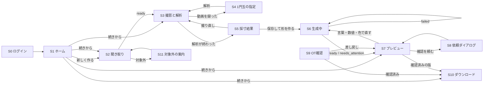

# 画面の仕様

> **このドキュメントで決めたこと**
> 1. 画面は12枚（S0〜S11）。撮影と採寸（S3〜S5）はスマホ、プレビューから印刷（S7〜S10）はPCを想定する。ただし、どの画面もスマホとPCの両方で動くようにする。
> 2. スマホとPCは、同じGoogleアカウントでログインすることで引き継ぐ。手の写真はスマホから出ないので、PCには採寸の数値だけが見える。
> 3. 指が不自由な人や片手で操作する人のために、細かいタップは求めない。操作は大きなボタンとドラッグだけにし、文字入力にはいつも選択肢を添える。

関連：[architecture.md](architecture.md)、[api.md](api.md)、[measurement.md](measurement.md)

---

## 1. 画面の一覧と遷移

| ID | 画面 | パス | 主に使う端末 | 使う人 |
|---|---|---|---|---|
| S0 | ログイン | `/login` | 両方 | 全員 |
| S1 | ホーム（ケース一覧） | `/` | 両方 | 本人・家族 |
| S2 | やりたいこと（聞き取り） | `/cases/:caseId/interview` | 両方 | 本人・家族 |
| S3 | 撮影と解析 | `/cases/:caseId/capture` | スマホ | 本人・家族・OT |
| S4 | 1円玉の指定 | `/cases/:caseId/capture/coin` | スマホ | 同上 |
| S5 | 採寸結果の確認・修正 | `/cases/:caseId/measure` | スマホ | 同上 |
| S6 | 生成中 | `/cases/:caseId/designs/:designId`（生成が終わるまで） | 両方 | 本人・家族 |
| S7 | プレビューと微調整 | `/cases/:caseId/designs/:designId`（生成が終わったあと） | PC | 本人・家族 |
| S8 | OTに確認を頼む | S7の上に重ねるダイアログ | PC | 本人・家族 |
| S9 | OT確認 | `/review/:caseId` | PC | OT |
| S10 | ダウンロードと印刷ガイド | `/cases/:caseId/designs/:designId/print` | PC | 本人・家族・OT |
| S11 | 対象外の案内 | S2の上に重ねるダイアログ | 両方 | 本人・家族 |

- ログインしていない状態で `/login` 以外を開いたら、S0に移り、ログイン後に元のパスへ戻す
- S1の「続きから」は、ケースの `status` を見て行き先を決める（`interviewing`→S2、`measuring`→S3、`designing` 以降→S7、`approved`→S10）。`designing` で版がまだない場合（生成の前に画面を閉じた、生成に失敗したなど）は、S7の空の状態から「形を作る」を押せるようにする
- S3〜S5の途中でページを再読み込みすると、写真は消える（保存しないため）。その場合はS3からやり直す。採寸を保存したあとなら、数値は残る
- 生成中・承認中のケースを開き直したら `POST /recover` を呼び、期限切れの処理を回収してから画面を決める。有効な処理があれば待機表示へ戻り、新しい生成を自動で開始しない

## 2. 共通のルール

| 項目 | 決めたこと | 理由 |
|---|---|---|
| ボタンの大きさ | 押せる範囲は48×48px以上。主なボタンは画面の下に置き、幅いっぱいに広げる | 指の曲がった手や、利き手でない手でも押せるように |
| 文字 | 本文は16px以上。色だけで意味を伝えない（アイコンと文字を添える） | 見えにくい人と色覚の多様性への配慮 |
| 文字入力 | 入力欄には必ず選択肢を添える。音声入力はOSのキーボードの機能を案内する | 文字を打つのが難しい人のため |
| 読み上げ | 起動したら読み上げ用の情報（semantics）を有効にする | Flutter Webは既定で無効なため（[adr/0002](adr/0002-frontend-flutter-web.md)） |
| 読み込み中 | 1秒を超えそうな処理では、何をしているかを文で出す（例：「手の形を調べています」）。くるくる回るだけの表示は使わない | 待つ理由が分かると安心できる |
| エラー | [api.md §5](api.md#5-エラー) の `message` をそのまま出す。`retryable` なら「もう一度試す」ボタンを出す | — |
| 再送 | 生成・微調整・依頼・承認のボタンは、送信してから結果が出るまで押せなくする。通信が切れたら、勝手に送り直さず、まずFirestoreの版の状態を読む。処理が続いていれば待ち、失敗が確定していれば「もう一度試す」を出す | 二重に処理して、費用が増えないように |
| 端末の案内 | スマホでS7を開いたら「PCで開くと大きく見られます」と一度だけ出す。PCでS3を開いたら「スマホで撮るか、撮った写真を選んでください」と出す | — |
| 言葉 | 医療の専門用語は使わない（例：「MP関節」ではなく「指の付け根」）。OT向けのS9だけは専門用語を併記する | — |

## 3. 各画面

### S0 ログイン

| 項目 | 内容 |
|---|---|
| 役割 | Googleアカウントでログインする |
| 入力 | 「Googleでログイン」ボタン |
| 表示 | アプリ名、ひとことの説明、「手の動画は保存しません。角度を測るために、手の部分を数枚だけ送ります（保存しません）」という約束 |
| 読み込み中 | ポップアップの完了を待つ間、ボタンを押せない状態にする |
| エラー | ポップアップがブロックされたら、許可の方法を案内する |
| 遷移 | 成功したら元のパス、なければS1へ |

### S1 ホーム（ケース一覧）

| 項目 | 内容 |
|---|---|
| 役割 | 自分のケースを一覧し、新しく作るか続きから始める |
| 入力 | 「新しく作る」ボタン、ケースのカード |
| 表示 | ケースごとに、タイトル、状態（「聞き取り中」「確認待ち」「確認済み」など）、最新の版の小さな画像（`views/iso.png`）、更新日時 |
| 読み込み中 | カードの形の灰色の枠を3つ出す |
| 空の状態 | 「まだ道具がありません。やりたいことを教えてください」と、大きな「新しく作る」ボタン |
| エラー | 読み込めなかったら「再読み込み」ボタン |
| 遷移 | 「新しく作る」→ `POST /v1/cases` → S2。カード → §1のルールで行き先を決める |

### S2 やりたいこと（聞き取り）

| 項目 | 内容 |
|---|---|
| 役割 | Geminiと会話して、道具の要件（`requirements`）を集める |
| 入力 | 選択肢のボタン（最大4つ）、文字の入力欄、送信ボタン |
| 表示 | 会話の吹き出し。画面の上に、集まった要件のまとめ（「筆で絵を描く・右手・柄8mm」）を出し、項目が埋まると印が付く |
| 読み込み中 | AIの吹き出しの位置に「考えています…」 |
| 空の状態 | 最初の質問（固定の文）と選択肢を出す |
| エラー | 送れなかったメッセージの横に「もう一度送る」 |
| 遷移 | `ready` になったら「この内容で撮影に進む」ボタンを出す → S3。`out_of_scope` → S11 |
| 注意 | iOS Safariでは、日本語の変換中の文字が重複する不具合が報告されている（flutter/flutter#195443。入力欄の `enableInteractiveSelection:false` で起きる）。この設定は使わない。11/7に実機で確かめる |

### S3 撮影と解析

| 項目 | 内容 |
|---|---|
| 役割 | 手の動画（5〜10秒、半周）を録り、ブラウザの中で解析する。うまくいかなければ写真2枚のモードに切り替える |
| 入力 | 「動画を撮る」ボタン（スマホのカメラが開く）、「撮った動画を選ぶ」、「写真2枚で測る」。聞き取りで持つ手が `unknown` のままなら、最初に「右手」「左手」の大きなボタンで聞く |
| 表示 | 撮り方の短いアニメーション（暗い布、1円玉の置き場所、親指側から小指側への半周、40〜50cm離れる）。「家族や支援者に撮ってもらうのがおすすめです」。解析中は「12/30枚」と、取り出したフレームの小さな画像 |
| 読み込み中 | 初回は手のモデル（約8MB）、MediaPipeの本体（圧縮して約3MB）、1円玉を切り出すモデルを読み込む。「手を調べる準備をしています（初回だけ）」と進み具合を出す。解析中は「フレームを選んでいます」→「手の形を調べています」→「まとめています」 |
| 空の状態 | 撮り方のアニメーションと、「動画を撮る」ボタンだけを出す |
| エラー | 撮り直しを勧める条件（[measurement.md §3.3](measurement.md#33-撮り直しを勧める条件)）に当てはまったら、理由と「撮り直す」「このまま進む」「写真2枚で測る」の3つのボタン。動画が読めない：「カメラの設定を『互換性優先』にして撮り直してください」と「写真2枚で測る」 |
| 遷移 | 録ったら S4（1円玉をタップ）→ 戻って解析 → 終わったら S5 |
| 写真2枚のモード | 写真①（上から）と②（親指側の横から）を撮る → S4で各写真の1円玉を指定 → S5（点をドラッグで直せる）。手が見つからなければ「手で点を置く」 |
| 同意 | 初めて撮る前に、1画面で示す：「角度を正確に測るため、手の部分を切り抜いた画像を最大8枚、計算のためだけにシンガポールのサーバーに送ります。保存しません」。ボタンは「同意して進む」「やめる」。同意しないと撮影に進めない |
| 角度の計算 | 解析のあと「角度を計算しています」と出す。起動を待つときは「角度を計算する準備をしています（1〜3分）」。3回やり直してもだめなら「いまは角度を計算できません。時間をおいてやり直してください」と、「やり直す」ボタン（ケースは保存され、あとで続きから始められる） |
| 角度の計算の上限 | 自動再試行も利用回数に含む。`RATE_LIMITED` は「本日の利用上限に達しました」、`GENERATION_DISABLED` は「いまは計算を停止しています」と表示し、自動再試行しない。起動待ち・再試行を含めて5分で止める |
| 注意 | 動画・写真はメモリの中にだけ置き、保存しない。送るのは切り抜いたフレームだけ |

### S4 1円玉の指定

| 項目 | 内容 |
|---|---|
| 役割 | 1円玉の位置を教える。動画では最初のフレームで1回タップするだけ。自動で見つからないときは、長いほうの両端に2つのハンドルを合わせる |
| 入力 | 1円玉のタップ。フォールバックでは、2つのハンドルのドラッグ（代表フレーム3枚、写真モードなら各写真） |
| 表示 | 最初のフレーム。タップすると、見つかった1円玉の輪郭（楕円）を重ねる。フォールバックでは、ドラッグ中に指の上に3倍の拡大鏡 |
| 読み込み中 | タップのあと「1円玉を探しています」（1秒以内の見込み） |
| 空の状態 | 「写真の中の1円玉をタップしてください」 |
| エラー | 楕円が取れない：「うまく見つかりませんでした。もう一度タップするか、両端に印を合わせてください」 |
| 遷移 | 決まったら S3 に戻って解析を続ける |

### S5 採寸結果の確認・修正（動画のモード）

| 項目 | 内容 |
|---|---|
| 役割 | 測った値と、カプセルで表した3Dの手を確かめ、ずれていたら値を直して保存する |
| 入力 | 3Dの手の回転・拡大。値ごとのスライダー（直したら理由を入れる）、「撮り直す」、「写真2枚で測る」、「保存して形を作る」 |
| 表示 | 代表フレーム3枚（親指側・上・小指側）に点と骨組みと1円玉の楕円を重ねたもの。3Dの手（生成APIが組み立てたカプセルの手と、握りを置くすき間の円）。値の一覧（指ごとの長さ・曲がり角・太さ、手の幅、すき間の直径）を、やさしい名前とmm・度で出す。警告とばらつきの印。値をタップすると、3Dの手の該当する所が光る |
| 読み込み中 | 3Dの手を組み立てている間は「手の形を組み立てています」。保存中は「保存しています」 |
| 空の状態 | ない（S3を通らないと来られない） |
| エラー | 保存に失敗したら、入力をそのまま残して「もう一度保存」 |
| 遷移 | 「保存して形を作る」→ `POST designs` → S6。「撮り直す」→ S3 |
| 補足 | 写真2枚のモードでは、1.0版と同じく、写真の上の点をドラッグで直せる。保存したら「PCで続きを見るには、同じGoogleアカウントでログインしてください」と出す |

### S6 生成中

| 項目 | 内容 |
|---|---|
| 役割 | 形ができるまでの進み具合を見せる |
| 入力 | 「中止して戻る」（生成そのものは止まらない。MVPでは画面を離れるだけ） |
| 表示 | 4つの段階（部品を選んでいます → 寸法を決めています → 形を作っています → 画像で確認しています（2/3回目））。Firestoreの `progress` を読んで、今の段階に印を付ける。確認の回では、できた画像（`views/iso.png`）を小さく出す |
| 読み込み中 | この画面がそのまま読み込み中の表示 |
| 空の状態 | ない |
| エラー | `failed`：エラーの文と「もう一度作る」。`AI_UNAVAILABLE`：「AIが混み合っています。少し待ってもう一度試してください」 |
| 復旧 | 表示中は15秒ごとに `POST /recover` を呼ぶ。`GENERATION_INTERRUPTED`／`GENERATION_TIMEOUT` が確定したら待機表示を終えて「もう一度作る」を出す。接続切断だけで失敗と決めず、まず既存の処理状態を確かめる |
| 遷移 | `ready` ／ `needs_attention` → S7（同じパスのまま表示を切り替える） |

### S7 プレビューと微調整

| 項目 | 内容 |
|---|---|
| 役割 | 3Dで形を確かめ、言葉・数値・色で直す。OTに確認を頼む |
| 入力 | 3D表示の回転・拡大（ドラッグとホイール、スマホは2本指）。言葉で直す欄と、よく使う指示のボタン（「もう少し太く」「もう少し細く」「くぼみを浅く」「ナットを回しやすく」）。数値のスライダー（範囲は `GET /v1/parts`）。色の見本（6色）と模様（なし／リング／ドット。模様は拡張機能）。版の切り替え。「OTに確認を頼む」 |
| 表示 | three.jsで `preview.stl` を表示する（色は選んだ色）。横に、AIが決めた理由のまとめ（`summary_ja`）と主な寸法。`needs_attention` なら、上に「AIの確認で解決しなかった点があります」と、指摘の一覧を出す。`clamped` の引数には印を付ける |
| 読み込み中 | STLを読み込む間は、`views/iso.png` を代わりに出しておく |
| 空の状態 | 採寸は保存したが版がまだない：「まだ形がありません」と、「形を作る」ボタン（`POST designs` → S6） |
| エラー | STLが読めない：画像4枚を並べて出し、「再読み込み」を出す。直すのに失敗：入力を残して、エラーの文を出す |
| 遷移 | 直す → S6（新しい版）。「OTに確認を頼む」→ S8。確認済みの版を開いたら「印刷へ進む」→ S10 |
| 注意 | 色だけを変えたときは描き直さず、3D表示の色だけを変える |

### S8 OTに確認を頼む（ダイアログ）

| 項目 | 内容 |
|---|---|
| 役割 | 確認してほしいOTのメールアドレスを入れて頼む |
| 入力 | メールアドレス、ひとこと（任意）、「頼む」 |
| 表示 | 頼む版の画像と番号。頼んだあとは、確認用のURL（`review_url`）と「コピー」ボタン |
| 読み込み中 | 「印刷用のデータを準備しています」（20〜60秒。この間に印刷用STLを作り、刷れるかを確かめる） |
| エラー | `REVIEWER_NOT_ALLOWED`：「このアドレスはOTとして登録されていません」。`RENDER_FAILED`：「このままでは刷れない形でした。形を直してから、もう一度頼んでください」 |
| 遷移 | 閉じる → S7（状態は「確認待ち」） |

### S9 OT確認

| 項目 | 内容 |
|---|---|
| 役割 | OTが寸法と理由を見て、「確認済み」にするか差し戻す |
| 入力 | 3D表示、確認項目のチェック（寸法を見た／角が安全／装具ではない／口に入れない／本人に使い方を伝える）、コメント、「確認済みにする」「差し戻す」 |
| 表示 | 引数の一覧表：部品、名前（専門用語を併記）、値と単位、範囲、基準値、決め方（採寸／ルール／聞き取り／AI／既定）、理由。`clamped`・`override_by_user`・採寸の警告・未解決の指摘を、色とアイコンで目立たせる。採寸の数値（写真はない）。曲がり角などの参考値（world landmarks由来の値には「参考」と付ける） |
| 読み込み中 | 表の形の灰色の枠 |
| 空の状態 | 頼まれたケースがない：「確認を頼まれているケースはありません」 |
| エラー | `FORBIDDEN`：「このケースを見る権限がありません」。`STALE_DESIGN`：「確認対象が変わりました。最新の版を確認してください」と、最新の版へのボタン。印刷用データは依頼のときに作ってあるので、承認のときに描画が失敗することはない |
| 承認の送信 | 表示した版の `geometry_hash` を承認リクエストに付ける。承認は数秒で終わる（描き直さないため） |
| 遷移 | 確認済み → S10。差し戻し → 持ち主のS7に「差し戻されました」とコメントが出る |

### S10 ダウンロードと印刷ガイド

| 項目 | 内容 |
|---|---|
| 役割 | 確認済みの印刷用STLをダウンロードし、刷り方と使い方を知る |
| 入力 | 「STLをダウンロード」 |
| 表示 | 確認したOTの名前と日時、コメント。推奨の印刷設定（[parts-library.md §7](parts-library.md#7-推奨の印刷設定pla)）。組み立て方（ナットをねじ込む → 道具を差す → ナットを締める → 強く引いて抜けないか確かめる）。注意（口に入れない、痛みが出たら使うのをやめてOTに相談する、PLAは熱に弱いので熱いお湯につけない） |
| 読み込み中 | 印刷用STLを作っている間（確認直後）は「印刷用のデータを作っています」 |
| 空の状態 | 確認済みでない版で開いた：「OTの確認が済むとダウンロードできます」と、S7への戻り |
| エラー | ダウンロードに失敗：「もう一度試す」 |
| 遷移 | S1へ戻る |

### S11 対象外の案内（ダイアログ）

| 項目 | 内容 |
|---|---|
| 役割 | 作れない依頼の理由と、代わりの案を伝える |
| 表示 | 理由（例：「指を伸ばしたり固定したりする装具は、体に合わせた調整が必要なため、このアプリでは作れません。作業療法士に相談してください」）。代わりにできること |
| 遷移 | 閉じる → S2（言い直せる） |
